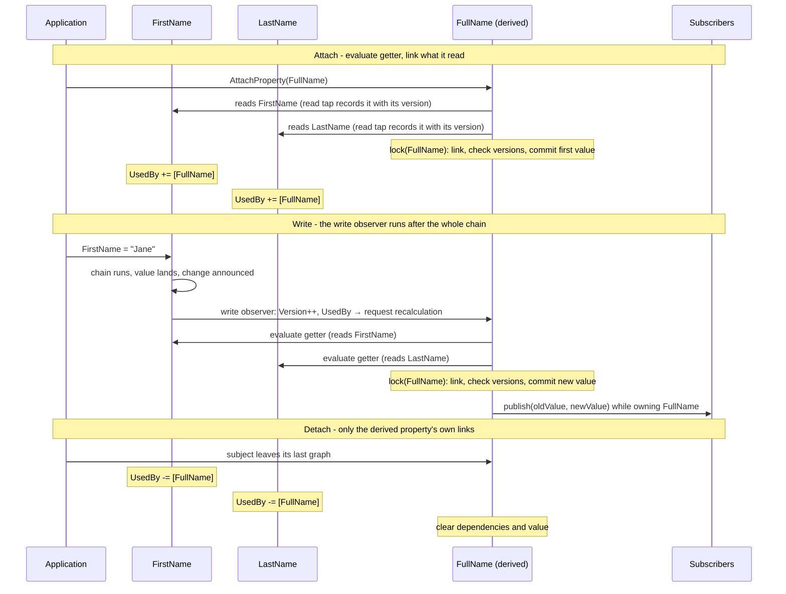
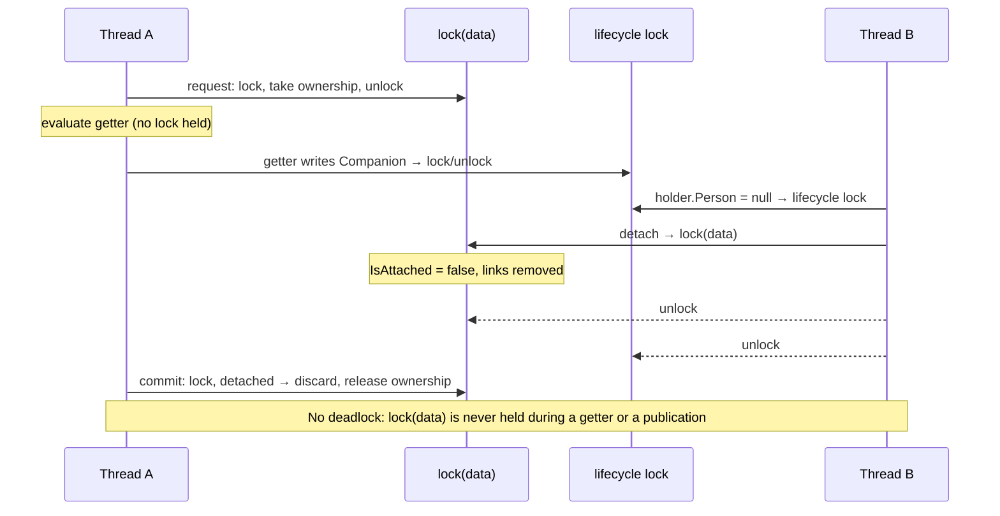

# Derived Property Change Detection: Internal Design

This document describes the internal architecture of the derived property tracking system in `Namotion.Interceptor.Tracking`. For user-facing documentation, see the [Tracking](../tracking.md) documentation.

## Overview

Derived properties are computed properties marked with `[Derived]`. They are not intercepted (no partial backing field), but the intercepted properties their getters read are tracked automatically. When any of them changes, the derived property is recalculated and a change notification is fired. Because such a property stores nothing, it also owns nothing: `LifecycleInterceptor.WriteProperty` ignores it, so a subject it returns is attached only through the intercepted properties that hold it. Properties added through `RegisteredSubject.AddDerivedProperty` are intercepted and keep attaching their values.

```csharp
[InterceptorSubject]
public partial class Person
{
    public partial string FirstName { get; set; }   // Intercepted (partial)
    public partial string LastName { get; set; }    // Intercepted (partial)

    [Derived]
    public string FullName => $"{FirstName} {LastName}";  // Not partial, just a regular property
}
```

The source generator detects `[Derived]` and sets `IsDerived = true` on `SubjectPropertyMetadata`, but does not generate a backing field. The getter body is the user's original C# expression.

Derived properties can also be added at runtime via `RegisteredSubject.AddDerivedProperty<T>(name, getValue, setValue)`. These work identically with the dependency tracking system: the getter and setter lambdas are wrapped in interception calls and dependencies are recorded on every evaluation.

The design rests on three rules:

- **Every intercepted read and write is observed**, in the core, whatever the subject's context: a read through a thread-static read tap, a write through a process-wide write tap that runs once after the whole interceptor chain. Tracking is not part of the read or write interceptor chain at all.
- **Only a derived property changes its own dependency links**, under its own lock, when it commits an evaluation or when it is detached. A write of a source, or a detach of a source, never touches a link.
- **One owner at a time evaluates, commits and publishes a derived property.** A request that finds the property owned is left to the owner, which evaluates again before it commits or after it published.

## Components

| Type | Assembly | Role |
|------|----------|------|
| `PropertyAccessObservation`, `IPropertyReadObserver`, `IPropertyWriteObserver`, `PropertyWriteObservation` | `Namotion.Interceptor` | The access taps: the read observer slot of the current thread, the process-wide write observer and the write depth of the current thread. No derived concepts. Public, `[EditorBrowsable(Never)]` infrastructure. |
| `InterceptorExecutor` | `Namotion.Interceptor` | Calls the taps on every intercepted read and write, and provides `GetPropertyValueWithoutContext` and `SetPropertyValueWithoutContext`, which generated code calls for a subject without a context. |
| `DerivedPropertyChangeHandler` | Tracking | `IPropertyLifecycleHandler` only: attaches and detaches derived properties, and registers the write observer. |
| `DerivedPropertyOwnership` | Tracking | The ownership protocol: requests, the owner loop that evaluates, commits and publishes, the attach evaluation, detach, and the takeover after a failure. |
| `DerivedPropertyRecorder` | Tracking | Thread-static recorder, installed as the thread's read observer while a getter is evaluated. Records each read property with its version, in nested frames. Uses `ArrayPool` to avoid allocations in steady state. |
| `TrackingWriteObserver` | Tracking | The write observer: once per landed write, moves the written property's version and requests the recalculation of every derived property that read it. |
| `DerivedPropertyData` | Tracking | Per-property state, created once and never removed or replaced. Stored in `Subject.Data` under key `"ni.dpd"`. |
| `DerivedPropertyTypeGate` | Tracking | Per subject type, whether any `DerivedPropertyData` exists for a subject of the type. Raised before the first data of the type is stored, never lowered. Lets a write, and the detach of a subject, skip the data lookup for types nothing derived touches. |
| `PropertyReferenceCollection` | Tracking | Collection for used-by properties with lock-free snapshot reads and writes under its own leaf lock. See [Used-by properties collection](#used-by-properties-collection). |
| `SubjectLifecycleAttachments` | Tracking | Per subject, the lifecycle interceptors the subject is attached to, so a derived property stays attached while its subject is in any graph. See [Detach and Attachments](#detach-and-attachments). |
| `DerivedPropertyChangeHandlerExtensions` | Tracking | `GetRequiredProperties`, `GetUsedByProperties`, `RecalculateDerivedProperty`, and access to `DerivedPropertyData` via `PropertyReference`. |

## Access Taps

**Read tap.** `InterceptorExecutor.GetPropertyValue` and `InterceptorExecutor.GetPropertyValueWithoutContext` report the property to the thread's read observer, when one is set, before the value is read. Tracking sets the observer only while a getter is evaluated, so outside of an evaluation a read costs one thread-static load and a null check. The slot holds one observer: whoever sets it replaces the previous observer, and clearing it does not restore one.

**Write tap.** `InterceptorExecutor.SetPropertyValue`, `PublishDerivedPropertyValue` and `SetPropertyValueWithoutContext` increment the thread's write depth before the chain, and in a `finally` after it decrement it and call the process-wide write observer with a `PropertyWriteObservation`: the property, whether the value landed (`IsWritten`, always true without a context), the raw write timestamp (0 when the write did not land or the subject has no context), `IsDerivedRecalculation`, the write's nesting depth on the thread, and whether the chain threw (`HasFailed`). An observer exception replaces the chain's own, so an observer must not throw when `HasFailed` is set.

**Registration.** `TrackingWriteObserver` is installed by the first `DerivedPropertyChangeHandler` or `LifecycleInterceptor` created in the process, and is never removed. `SetWriteObserver` keeps the first observer, so code that installs another observer before Tracking does pre-empts derived property tracking.

**Subjects without a context.** Generated code reads and writes a subject that has no context through `GetPropertyValueWithoutContext` and `SetPropertyValueWithoutContext`, which call the taps. A hand-written subject base class has to call them as well instead of reading and writing its fields directly, or derived properties do not follow its subjects before they are attached (`SubjectBaseContract` documents the requirement).

**Ordering.** The write observer runs after the whole chain, so after `PropertyChangeInterceptor` announced the write and after the lifecycle reconciled it, and it acts only on a write that landed. See [Interaction with Other Interceptors](#interaction-with-other-interceptors).

## Dependency Graph

The system maintains a bidirectional dependency graph:

```
Dependencies (RequiredProperties):      Used-by properties (UsedByProperties):
  FullName → [FirstName, LastName]        FirstName → [FullName]
                                          LastName  → [FullName]
```

- **Dependencies** (`data.RequiredPropertiesSpan`): Which properties a derived property read in its last committed evaluation. Stored as a private `PropertyReference[]` with a separate count, written under `lock(data)` of the derived property. The buffer is reused when capacity is sufficient. `GetRequiredProperties` reads it without the lock and clamps the count to the array length.
- **Used-by properties** (`data.GetUsedByProperties()`): Which derived properties depend on this property. Stored as a private `PropertyReferenceCollection`, which synchronizes its own writes (see [Used-by properties collection](#used-by-properties-collection)).

Both directions of a link between a derived property D and a source change only under `lock(D)`: D's commit sets them to exactly what the evaluation read (removes the stale ones, then adds the missing ones), and D's detach removes them all. A source's own lock is never taken, and a write or detach of a source never changes a link. The used-by collection of a source is still written by several derived properties, each under its own lock, so it synchronizes its writes with a leaf lock of its own and never relies on a caller's lock. The write observer reads it without any lock.

Both directions are needed:

- Dependencies let a derived property remove itself from the used-by collection of every source when it is detached or stops reading one.
- Used-by properties let a write of a source find every derived property that read it.

Dependencies can span subjects. For example, `Car.AveragePressure` depends on each `Tire.Pressure`:

```
Dependencies:                             Used-by properties:
  Car.AveragePressure → [Tire0.Pressure,    Tire0.Pressure → [Car.AveragePressure]
                         Tire1.Pressure,    Tire1.Pressure → [Car.AveragePressure]
                         ...]               ...
```

When a tire is replaced, the write of the structural property recalculates `AveragePressure`, whose commit drops the old tire's `Pressure` from both directions and adds the new tire's.

`DerivedPropertyData` has two roles. As a **source**, it holds `Version`, incremented by every landed write of the property, and the used-by collection. As a **derived property**, it holds the dependencies, the committed value and the ownership state. A property can have both roles, for example a derived property added at runtime that another derived property reads. The data is created the first time an evaluation reads the property or the property attaches as a derived property, lives in `Subject.Data` for as long as the subject does, and is never removed or replaced, which the version protocol below relies on.

## Data Flow

The following trace shows the lifecycle of a derived property (`FullName`) depending on source properties (`FirstName`, `LastName`).



## The Version Protocol

The version protocol guarantees that a write of a property an evaluation read is never missed: either the evaluation reads the written value, or it evaluates again, or a recalculation is requested that evaluates again. It has a reader side, an evaluation E of a derived property D, and a writer side, a write of a property that E reads. Code comments refer to the steps by their labels.

### Reading (R1 to R5)

For every property E reads, before the value is read (the read tap runs first):

- **R1**: get or create the property's `DerivedPropertyData`, followed by a full fence (`Interlocked.MemoryBarrier`) whether or not this call created it. Recording is not a hot path, and the unconditional fence keeps the proof independent of multi-copy atomicity (another evaluation may have created the data after a writer's W3). A recalculation gets the data from D's last committed links when the read at the same position is of the same property, instead of looking it up: data is never replaced, so that is the stored data, as a lookup would have found it.
- **R2**: read its `Version` with acquire semantics (`Volatile.Read`), so R3 cannot move before it.
- **R3**: read the value (the getter continues).

A property read twice in one evaluation keeps the version recorded at its first read: a later version would let a value mixed from before and after a write pass the version check. A derived property's reads of itself are not recorded, because a getter added at runtime reads its own property again through the interceptor chain.

When the getter has returned (or thrown), E commits under `lock(D)`:

- If E no longer counts (it lost ownership of D, D was detached, or a newer attach superseded it), E discards its recording. A recalculation also discards it, and evaluates again, when a request arrived during E (see [Ownership Protocol](#ownership-protocol)).
- **R4**: otherwise set D's links to exactly the recorded set.
- **R5**: one full fence, then read every recorded version again (`Volatile.Read`). If any differs, a write moved a source after E read it: E evaluates again. Otherwise E commits its value.

### Writing (W1 to W5)

For every landed write, in `TrackingWriteObserver`, after the whole chain:

- **W1**: the value lands (the terminal write of the chain, or the plain field write without a context).
- **W2**: a full fence (`Interlocked.MemoryBarrier`).
- **W3**: read the gate of the subject's type (`DerivedPropertyTypeGate`, a volatile read) and stop if it is not raised; otherwise look up the property's `DerivedPropertyData` without creating it, and stop if there is none. The publication of a recalculation does not look it up: the owner marks the data it publishes on its thread for the observer.
- **W4**: `Interlocked.Increment` its `Version`.
- **W5**: read its used-by collection and request a recalculation of each derived property in it, and of the property itself when it is a derived property with a setter and the write is not a recalculation's publication. Every one is requested, also after a request threw (an observer of its publication); the first exception propagates afterwards.

A write that did not land (vetoed, captured by a transaction, stopped by the equality check) is skipped entirely.

### Proof that no write is missed

Take a read R3 of E and a write W1 of the same property:

- **W3 finds no data.** The data did not exist when W3 ran, and data is never removed, so R1 created it later. The fences at W2 and R1 order W1 before R3, so E reads W1's value or a later one. A gate that is not raised is the same case: whoever creates the first data of a type raises the gate, with a full fence after the store, before it stores the data, and the gate is never lowered. A gate that W3 finds not raised, after the fence of W2, therefore means that no data of the type was stored yet, this property's included.
- **W4 precedes R2 in the version's order.** W1 precedes W4 (W2), and R3 follows R2, so E reads W1's value or a later one.
- **W4 follows R2.** The recorded version is older than W4's. By the full fences on both sides (W4's interlocked increment before W5, R5's fence after R4), either R5 reads W4's version, and E evaluates again, or W5 reads D's link from R4, and requests a recalculation. That request takes `lock(D)`: if E has not committed yet, it finds E owning D and sets `RecalculationNeeded`, so E evaluates again before it commits; if E committed and still owns D, E evaluates again after it published; if E released D, the request takes ownership itself and evaluates. Every evaluation that follows starts after W1.
- **W1 is E's own write**, made on E's thread after R3 (by the getter, or by a write it triggers on this thread). See [Own writes](#own-writes): the version check does not fire for it, and E is evaluated exactly once more, which reads W1's value.

A version change that R5 detects without a request is therefore always another thread's write, which the owner loop treats as a foreign request (see [Failures and takeover](#failures-and-takeover)).

The proof relies on R5's own fence. `PropertyReferenceCollection.Add` additionally executes a full barrier after a successful add.

### Own writes

A write on the evaluating thread moves the version of the written property. If a running recording on this thread read that property at exactly the version before this write, the recording takes the new version, so R5 does not fire for the thread's own write, and the recording is marked: its value may stem from before the write. A write of another thread in between moved the version further, so such a recording keeps its version and still fails R5. Every non-suspended frame of the thread is updated, so an outer evaluation is covered as well when a nested one writes.

A marked evaluation is evaluated exactly once more before it commits, so a value computed before the getter's own write is not committed. The extra evaluation is not marked again in the same commit: it commits what it read, also when it wrote after reading once more. This bound is what lets a getter that writes a subject it creates on every evaluation still commit, at the cost of two evaluations per commit. A write of a property the derived property is already linked to also requests a recalculation through W5, which the owner answers by evaluating again, see [What a Getter's Side Effects Cost](#what-a-getters-side-effects-cost).

### Throwing getters

A getter that throws is not a failure of the protocol. The reads before the throw are the ones that decided the outcome, so they are linked (R4) and checked (R5) as usual, the previous value is kept, and the property is marked faulted, so the first successful evaluation afterwards is published even when no value was committed before (its old value is then the default of the property type). A success clears the mark.

## Ownership Protocol

`DerivedPropertyOwnership` implements the protocol. Its invariant: one owner at a time evaluates, commits and publishes a derived property, and a getter or a publication never runs under `lock(data)`.

### State

All of it is read and written under `lock(data)` of the derived property:

| Field | Meaning |
|-------|---------|
| `OwnerToken`, `OwnerThreadId` | The token of the owning evaluation (a recalculation or an attach), 0 when nobody owns the property, and the thread it runs on. |
| `AttachToken` | The token of the attach in progress, 0 when none is. A newer attach or a detach replaces it, which tells the attach its result no longer counts. |
| `RecalculationNeeded`, `HasForeignRequest` | A request arrived while the property was owned or an attach was in progress, and whether one of them came from another thread than the owner's (or while nobody owned it). |
| `PendingRawTimestamp` | The raw changed timestamp of the newest pending request, 0 when it has none. |
| `IsAttached` | Set by the attach, cleared by the detach. A request for a detached property is dropped. |
| `LastKnownValue`, `HasValue`, `IsFaulted` | The committed value, whether the current attachment committed one, and whether the last evaluation threw. |
| `RecalculationSequence` | Incremented for every committed value and every detach; read without the lock by the stale-publication guard. |

`IsDerived` marks data that belongs to a derived property, as opposed to data created because an evaluation read the property. It is written once by the attach and read with `Volatile.Read`, so a request for a property that is only a source returns without taking the lock.

### Request

A request comes from the write observer (W5), from `RecalculateDerivedProperty`, or from the protocol itself after an attach. A request without a timestamp (a write without a context) takes the current time first. Under `lock(D)`:

1. D is detached: drop the request.
2. D is owned, or an attach is in progress: set `RecalculationNeeded`, store the request's timestamp in `PendingRawTimestamp` (the last request to arrive wins, which carries the trigger's timestamp to the coalesced change), mark it foreign when it comes from another thread than the owner's, and return. The caller does not wait.
3. Otherwise take ownership with a new token and run the owner loop on this thread.

### Owner loop

1. Evaluate the getter outside every lock, recording its reads.
2. Under `lock(D)`:
   - Not the owner anymore: return without touching any state.
   - Detached, or an attach in progress: release ownership and return. An attach takes over a set `RecalculationNeeded` (the hand-off).
   - `RecalculationNeeded` is set: clear it, adopt the pending timestamp, and go to 1.
   - R4 and R5 (see [Reading](#reading-r1-to-r5)). A source moved without a request: go to 1. An own write after a read not evaluated again yet: go to 1 once.
   - The getter threw: mark D faulted, keep the previous value, release ownership and return.
   - Otherwise commit: store the new value, increment `RecalculationSequence`, and stamp the write timestamp when the request carried one. The old value is the last committed value, or the default of the property type when there is none.
3. If D had a value or was faulted, publish old to new outside the lock, still owning D. Only the attach's first value is not published.
4. Under `lock(D)`: not the owner anymore, return. A request is pending on an attached D without an attach in progress: clear it, adopt its timestamp and go to 1. Otherwise release ownership (an attach in progress takes a pending request over).

Publishing while owning D is what keeps the publications of one property in commit order: a concurrent write during the publication sets `RecalculationNeeded` and leaves its evaluation to the owner, which publishes it afterwards. The publication also keeps two guards: it is skipped when `RecalculationSequence` moved since the commit (a newer commit or a detach), or when `LastKnownValue` is no longer the committed reference. They make a publication that already passed its commit harmless after a detach, also for a `null` value. Comparing references is safe for boxed value types, because every evaluation produces a distinct box.

The publication runs the value through the write chain with a no-op write delegate (`PublishDerivedPropertyValue`), with `IsDerivedRecalculation` set and the committed value as the final value, so the getter is not invoked again: the change notification (observable, queue, per-property subscriptions), the lifecycle reconciliation of subject values, and the write observer, which requests the recalculation of derived properties that read this one through the interceptor chain (a derived property added at runtime). If the subject implements `IRaisePropertyChanged`, `RaisePropertyChanged` is called after the chain.

The loop is bounded by `MaxStabilizationIterations` (100) evaluations per loop. In correct code it runs one or two.

### Failures and takeover

A loop fails only after it evaluated: an observer threw while it published (the time source included, which the publication calls for a request without a timestamp), or the iteration limit was reached, which traces a warning. After a failure the owner releases ownership and decides, under `lock(D)`, whether to take a request over with a new token. It takes over only while D is attached and no attach is in progress, and only when a request is pending or the failed loop took one it had not answered with a commit yet:

- A **foreign request**, raised on another thread, or a source that moved without a request (R5), is always taken over.
- A request raised on the owner's own thread, by its getter or its observers, is taken over once, after the first exception. It is dropped after a later exception and at the iteration limit. This is what makes a getter or an observer that keeps writing what the property reads terminate.

The takeover runs as another loop in the same stack frame, never recursively. A request carried over from the failed loop keeps the timestamp it adopted, and a newer pending request wins. After the last loop, the first exception propagates to the caller whose request started the loops; later ones are dropped. A committed value whose publication failed is not published again: the next loop only publishes newer values, from that committed value as their old value.

### Attach

`DerivedPropertyChangeHandler.AttachProperty` attaches a derived property when its subject attaches (under the lifecycle lock), or when a property is attached directly, such as one added at runtime. Under `lock(D)`:

- D is already attached (through another graph, or by a second handler instance): it has its value and its links, and nothing happens.
- Otherwise mark D attached and derived, clear its value and fault, and set a new attach token. If nobody owns D, the attach takes ownership, clears any stale request flag (requests on a detached property are dropped) and its timestamp. If an evaluation from before a detach owns D, set `RecalculationNeeded` and leave its ownership alone.

Then the attach evaluates outside `lock(D)`. Before each evaluation it resolves the changed timestamp, outside the lock, since a time source is user code. Under `lock(D)` after the evaluation:

- The attach token was superseded (a newer attach, or a detach, also by a getter that detaches its own subject): discard the recording, release ownership if the attach holds it, and take over a request that is pending on an attached D nobody owns.
- Otherwise set the links (R4, R5). If the attach owns D and a request arrived during the evaluation, or the evaluation is not stable (a source moved, or an own write after a read not evaluated again yet), evaluate again. Otherwise commit the first value with the attach's timestamp, without publishing it: consumers read it while the subject attaches. If the getter threw, D is marked faulted instead.
- When the attach commits while another evaluation owns D, it stores its timestamp as the pending timestamp unless a newer request stored one, so the owner, which answers the attach's request, publishes the change with the attach's time.
- Clear the attach token and release ownership if held. If a request is pending and nobody owns D (the previous owner handed off), request a recalculation on this thread after the attach. It publishes from the attach's value.

The attach evaluation is bounded like the owner loop: at the limit, the last evaluation is committed, a recalculation is requested after the attach, and a warning is traced outside the lock after that request, so a failing trace listener cannot lose it.

An attach that fails outside the getter (a throwing time source or trace listener) clears its attach token and its ownership, marks D faulted when it has no value (so the first success afterwards is published), marks a request when it was still the current attach (its links may be missing), requests the recalculation when nobody owns D, and rethrows its own exception.

An attach that finds D owned by another attach treats it like a recalculation in flight: it does not take ownership, and the attach token decides which commit counts. The attach never waits for another thread, and a change from before a detach is never published after one of the new attachment: the previous owner either finished publishing before it could commit again, or handed off to the attach.

### Timestamps

A request carries the raw changed timestamp of its trigger. A write with a context passes its own; a write without a context, or `RecalculateDerivedProperty`, resolves the current changed timestamp once, at the first request, so every dependent of one write shares it. A request left to an owner stores its timestamp as pending, and the owner adopts it when it takes the request. A pending timestamp is zeroed when it is taken, and when an attach marks a request itself; a request without a timestamp is stamped by its publication, on the owner's thread. The commit stamps the derived property's write timestamp with a positive timestamp, and the publication shares the same captured time with the cascade, also under an explicit null scope (`WithChangedTimestamp(null)`), where the stored timestamp stays the never-written sentinel.

## Detach and Attachments

**Detach of a derived property D.** Under `lock(D)`: mark it detached, clear its attach token, remove all its links, clear its value, its has-value flag and its fault, and increment `RecalculationSequence`, so a publication already past its commit fails the stale-publication guard. An evaluation in flight discards its result at its next lock, and a request for the detached property is dropped. The data stays, so a later attach reuses it.

**Detach of a source.** Nothing happens. A derived property keeps following a detached subject for as long as its getter reads it. If the getter reached the subject through a tracked property, the write of that property recalculates the derived property, and its commit drops the link. Links never outlive the attachment of the derived property that owns them.

**Attachments.** A subject can be in several graphs, one per lifecycle interceptor. `LifecycleInterceptor` records, per subject, the interceptors the subject is attached to (`SubjectLifecycleAttachments`, internal subject data that every change replaces by compare-and-swap): it adds itself before it attaches the subject's properties and removes itself before it detaches them. A property detach issued by a lifecycle interceptor is ignored by `DerivedPropertyChangeHandler`, since the subject may still be in another graph. Once the subject left its last lifecycle interceptor, that interceptor detaches all of the subject's derived properties directly, whether or not its context has derived change detection, also when a lifecycle handler threw. Each of those detaches checks again under `lock(D)` that the subject is still detached, because another interceptor may have attached it in between.

A direct call of the public `DetachSubjectProperty` on a derived property detaches it, except one made on a thread on which a lifecycle interceptor is detaching a subject's properties (for example by a lifecycle handler): such a call is ignored, whichever subject it is for, and the property detaches with its subject if that leaves its last graph. A direct call on a source property does nothing, like a lifecycle detach of a source.

## What a Getter's Side Effects Cost

A getter is expected to read, not write. Writes in a getter are supported, at a cost:

- **A write of a property the evaluation read before, not linked yet**, such as a property of a subject the getter creates: no request is raised, and the evaluation is evaluated exactly once more (see [Own writes](#own-writes)). A getter that does this on every evaluation costs two evaluations per commit.
- **A write of a property the derived property is linked to, on every evaluation**, such as incrementing a counter it reads: the write requests a recalculation of the derived property on its own thread, which the owner answers by evaluating again, which writes again. The loop reaches `MaxStabilizationIterations`, traces a warning, and drops the request, since it was raised on the owner's thread; the value of the last commit stays. At attach, the last evaluation is committed and the recalculation requested after the attach ends the same way. Later writes of other threads, or of the sources outside the getter, recalculate the property as usual.
- **A write that a lifecycle interceptor reconciles**, such as assigning a subject: the reconciliation runs on the evaluating thread under the lifecycle lock, with recording suspended (see [Lifecycle Interceptor Design](tracking-lifecycle.md)).
- **A write of a property the getter does not read**: no effect on the evaluation; the write recalculates its own dependents as any write does.

## What Is Followed and What Is Not

A derived property follows every intercepted property its getter reads, on any subject: attached, not attached yet, detached, in another context, or without a context, however the getter reached the subject, through a tracked property, a field, a captured variable or a service. Every read goes through the read tap, so the subject's context and its interceptors do not matter.

Not followed:

- State outside the model, and plain fields or properties that are not intercepted.
- Graph state: parents, the registry (`TryGetRegisteredSubject`, registered properties, children), whether a subject is attached, and its reference count. A getter that reads graph state follows only the intercepted properties it reads along the way.
- Context services read directly, such as `subject.Context.TryGetService<T>()`.
- `IInterceptorSubject.Properties` and `subject.Data` read directly.
- Reads of a hand-written subject base class that bypasses `GetPropertyValueWithoutContext` while the subject has no context.

`RecalculateDerivedProperty` covers these: it requests a recalculation like a write does.

## Concurrency Model

### Per-property lock

`lock(data)` on `DerivedPropertyData` serializes, for one derived property: requests against the owner, commits, attach and detach, and the links. It is held only for short state transitions. A getter and a publication never run under it, and no other property's data lock is taken inside it; only the used-by collection's leaf lock is, and getting or creating a source's data (a `ConcurrentDictionary` operation that runs no user code). Different derived properties evaluate and publish concurrently.

### Used-by properties collection

`PropertyReferenceCollection` is written by multiple derived properties on different threads, each under its own lock (see [Dependency Graph](#dependency-graph)), and read on every write of the source property without any lock. It stores its entries in one of two modes:

- **Small** (up to 32 entries): a copy-on-write `PropertyReference[]`. Every add or remove publishes a new array, and the published array is the snapshot that readers get.
- **Large** (above 32 entries): a dictionary from entry to buffer index plus a private buffer, so an add or remove is O(1) (a remove moves the last entry into the freed slot). Readers get a snapshot array that a change clears and a later read rebuilds. The collection returns to small mode when a remove leaves 16 entries or fewer, so a count oscillating around the threshold does not switch modes on every change.

Every add, remove, and mode switch runs under one lock. Collections share a static pool of 64 locks, chosen by the collection's identity hash, instead of allocating one each. The lock is a leaf: nothing that runs under it takes another lock, so it cannot take part in a lock cycle with `lock(data)` or any other lock. The trade-off of sharing is that rebuilding the snapshot of one large collection, an O(n) copy under its lock, can briefly block writers, `Contains` and rebuilds of unrelated collections that use the same lock (and the lock objects may share cache lines); the wait is bounded and runs no user code.

`Count` never locks. `Items` and `ItemsArray` never lock in small mode; in large mode, a read that finds the snapshot cleared by a change takes the lock, and the first such read rebuilds the snapshot while the others wait for that copy. `Contains` locks while the collection is large. A snapshot never changes after it is handed out, so callers can iterate it outside any lock. The order of entries is unspecified.

Because each add and remove is O(1) once the collection is large, attaching or detaching N derived properties that read one property costs O(N) in total instead of the O(N²) of copying the whole array on every change.

### Thread-static recorder

`DerivedPropertyRecorder` is `[ThreadStatic]`, so each thread records without synchronization. It keeps a stack of frames: an evaluation started inside another one on the same thread (a recalculation requested by a getter's write, or a derived attach during a reconciliation) pushes its own frame and records its own reads. A suspended frame records nothing; the lifecycle pushes one while it reconciles on an evaluating thread, so the reads of the reconciliation and its handlers are not dependencies of the getter. A frame's recording stays on the recorder after the getter returns, until the commit checks it or discards it, and is then cleared, so the thread-static recorder holds no references to subjects that may be detached.

`DerivedPropertyChangeHandler.IsRecordingDerivedProperty` is true while any frame runs on the thread, suspended frames included. `SubjectTransactionInterceptor` relies on it (see [Transactions](#transactions)).

### Lock ordering and deadlock freedom

- **Lifecycle lock before `lock(data)`**: the attach and the detach of a derived property take `lock(data)` briefly under the lifecycle lock. Nothing under `lock(data)` takes the lifecycle lock, because getters and publications, which may write subject-typed properties and so enter the lifecycle, never run under `lock(data)`.
- **`lock(data)` before the used-by leaf lock**: the commit and the detach change used-by collections under `lock(data)`, and the leaf lock takes nothing further. The detach also reads the subject's attachments under `lock(data)`, without their lock.
- **No two data locks nest**: a commit links its sources without taking their locks, so dependency cycles between derived properties cannot form a lock cycle.

The design avoids two lock-order inversions with the lifecycle lock that holding `lock(data)` during a getter or a publication would cause:

**Inversion 1: Getter side effects.** A getter may write a subject-typed property as a side effect (lazy initialization, derived-with-setter patterns). That write enters `LifecycleInterceptor.WriteProperty` and takes the lifecycle lock. Under `lock(data)`, the order would be `lock(data)` then lifecycle lock, while a concurrent lifecycle operation holds the lifecycle lock and attaches or detaches the derived property, taking `lock(data)`.

**Inversion 2: Publications.** A publication runs the write chain, which can take the lifecycle lock in the same way.



The first evaluation at attach runs under the lifecycle lock, because consumers read the value while the subject attaches. A getter that blocks, or takes a lock that another thread holds while it waits for the lifecycle lock, can deadlock there; getters must not block or take locks.

## Correctness Guarantees

### Thread safety: no data corruption

| State | Protection | Accessed by |
|-------|-----------|-------------|
| Dependencies (`RequiredProperties`) | `lock(data)` of the derived property (write) / lock-free clamped read | commit (R4), detach, `GetRequiredProperties` |
| Used-by collection contents | The collection's own leaf lock (writes) / lock-free snapshot (reads) | commit and detach of the derived properties (writes), write observer (W5) |
| Used-by collection field | `Interlocked.CompareExchange` on first add, never cleared | first link of a source |
| `Version` | `Interlocked.Increment` (writers) / `Volatile.Read` after a full fence | write observer (W4), recorder (R2), commit (R5) |
| Ownership state, request flags, pending timestamp, `IsAttached`, `HasValue`, `IsFaulted` | `lock(data)` | requests, owner loop, attach, detach |
| `LastKnownValue`, `RecalculationSequence` | `lock(data)` (write) / `Volatile.Read` (stale-publication guard) | commit, detach, publication |
| `IsDerived` | `Volatile.Write` once at attach / `Volatile.Read` | attach, request, write observer |
| Type gate | `Volatile.Write` and a full fence before the first data of the type is stored / `Volatile.Read` | data creation, write observer (W3), lifecycle detach |
| Recorder frames | `[ThreadStatic]` (no sharing) | read tap, own writes, commit |
| Subject attachments | compare-and-swap of an immutable value in the subject's data (writes) / lock-free read of the value | lifecycle attach and detach, derived detach |

### Value correctness

After concurrent writes, attaches and detaches settle, every attached derived property's last committed and last published value equals what its getter returns on the current state, for every property it follows. A write of a followed property is never missed ([the proof above](#proof-that-no-write-is-missed)), every commit links exactly what its evaluation read, and only the owner publishes, in commit order. The exceptions are the documented bounds: a request dropped after a failure on the owner's own thread (a self-writing getter or observer), a publication that threw, and what is not followed.

### No stale links

Every link belongs to an attached derived property: D's detach removes all of D's links under `lock(D)`, and an evaluation that finds D detached at its commit discards its recording without linking. A link to a detached source stays only while D's getter still reads that source, so it keeps alive nothing the getter does not reach anyway. When the getter stops reading it, the next commit of D removes the link.

### No memory leaks from cross-subject dependencies

- **Source replacement** (replacing a tire): the write of the structural property recalculates `AveragePressure`, whose commit removes the old tire from its dependencies and itself from the old tire's used-by collection.
- **Derived property detach** (the car leaves the graph): the detach removes `AveragePressure` from every tire's used-by collection and clears its dependencies and value, so the tires hold no reference to the car.
- **Source detach** (a tire leaves the graph without a write the car reads): the link stays while `AveragePressure` still reads the tire, and goes with the car's next recalculation that no longer reads it, or with the car's detach.

## Performance Characteristics

| Scenario | Allocations | Cost |
|----------|-------------|------|
| Read outside an evaluation | Zero | One thread-static load and a null check (read tap) |
| Read during an evaluation | Zero in steady state (pooled buffers) | Data lookup or creation (none when the read repeats the last committed links at its position), a full fence, a volatile read, and a scan of the frame for duplicates |
| Write to a subject of a type without derived property data | Zero | Write depth increment and decrement, the observer call, a full fence (W2), the type gate (W3): a thread-static load, a type comparison and a volatile read |
| Write of a property nobody read, on a type with derived property data | Zero | Above, plus one data lookup (W3) |
| Write of a property with dependents | Zero | Above, plus `Interlocked.Increment` (W4), a used-by snapshot read, and a request per dependent |
| Request for an owned property | Zero | One brief `lock(data)` |
| Recalculation, dependencies unchanged | Zero (beyond the getter) | Brief `lock(data)` for the request, the commit and after the publication, the getter, a full fence and a version read per dependency (R5) |
| Recalculation, dependencies changed | One `PropertyReference[]` when the buffer grows | Above, plus used-by adds and removes |
| Attach | Zero (beyond the getter) | Two brief `lock(data)`, the getter, R5 |
| Used-by read (`UsedByProperties.Items`) | Zero (one snapshot copy after a change to a collection in large mode, made by the first read that finds the snapshot cleared) | Returns stable `ReadOnlySpan` snapshot |

## Interaction with Other Interceptors

Derived property tracking is not part of the write chain: the write observer runs once per write, after the whole chain, and acts only on a write that landed. The ordering of the interceptors in the chain therefore does not affect it, and interceptors that stop a write keep their guarantees for derived properties without ordering attributes.

### Equality check (`WithEqualityCheck`)

When `PropertyValueEqualityCheckHandler` is registered (included in `WithFullPropertyTracking`), it compares old and new values before the write proceeds. If they are equal, the rest of the chain is skipped and the write does not land, so the write observer requests nothing. This prevents redundant recalculations when a source property is set to its current value.

The equality check also applies to the publication of a recalculation: if the derived property's new value equals the old value, the change notification is suppressed, and the publication does not request the recalculation of derived properties that read this one.

### Transactions

Direct property reads inside a transaction return pending values. Shared derived tracking has a different view: `LastKnownValue`, dependencies, timestamps, and notifications always represent values that landed in the model. Attach evaluations, recalculations, manual recalculations, and every repeated evaluation therefore evaluate getters while transaction-local pending reads are bypassed: `SubjectTransactionInterceptor` reads landed values while `IsRecordingDerivedProperty` is true. The ambient transaction remains unchanged, so getter side-effect writes retain normal transaction behavior.

The recorder depth defines this model-read extent. Nested and derived-of-derived evaluations remain in the model view until the outermost frame finishes, also while a frame is suspended.

A captured write stops at the transaction interceptor and does not land, so it produces no recalculation or notification until the commit replays it. Derived property writes are never captured. When a write of a derived property with a setter lands while a transaction is open, it recalculates every dependent immediately from landed model inputs, which keeps unrelated dependents current and prevents a rollback from leaving a transaction-local value in shared tracking state.

A top-level recalculation publishes after its frame ended, so synchronous subscribers perform ordinary pending-aware reads. A publication inside an outer getter, including one caused by a landed getter side-effect write, remains inside the outer model-read extent, so those subscribers read landed model values until the outer getter finishes.

`SubjectTransactionInterceptor` runs before `LifecycleInterceptor`, so a captured structural write is never reconciled and never attaches an uncommitted child, and before `PropertyChangeInterceptor`, so a captured write is never announced.

### Validation

A write that `ValidationInterceptor` rejects does not land, so it requests no recalculation. A recalculation's publication is not validated again.

### Writes that never reached the model, and failed writes

When `IsWritten` is false, the write observer returns before the version moves and before any request. When the chain threw after the value landed (for example a lifecycle handler threw), the write still requests the recalculations of its dependents, and an exception from those requests is traced instead of propagated, since the write's own exception wins.

## Design Notes

### Derived-to-derived dependencies are flattened

Derived properties that depend on other derived properties work correctly, but an intermediate `[Derived]` property does not appear in the dependency graph. Instead, the dependencies are "flattened" to the underlying source properties.

```csharp
[Derived]
public string FullName => $"{FirstName} {LastName}";

[Derived]
public string FullNameWithPrefix => $"Mr. {FullName}";
```

When `FullNameWithPrefix` is evaluated, it calls `FullName`'s getter, which reads `FirstName` and `LastName` through the read tap. The recorder captures `FirstName` and `LastName` as direct dependencies of `FullNameWithPrefix`. So when `FirstName` changes, both `FullName` and `FullNameWithPrefix` are recalculated (both appear in `FirstName.UsedByProperties`).

`FullName` itself does not appear in `FullNameWithPrefix.RequiredProperties`, because a `[Derived]` getter is a plain C# property access that does not go through the read tap. A derived property added at runtime is intercepted, so a getter that reads it records it as well as the sources its getter reads, and its publication requests the recalculation of that reader.

### Following a subject the getter reached through a field

A getter can reach a subject through a field, a captured variable or a service, and the derived property follows that subject's intercepted properties like any other, also while the subject is detached or has no context. What it does not follow is the field itself: if the field, the variable or the service returns another subject later, the derived property keeps the links of its last evaluation until one of them, or another dependency, changes, or `RecalculateDerivedProperty` is called. [Reaching Other Subjects](../tracking.md#reaching-other-subjects) documents this for users.
