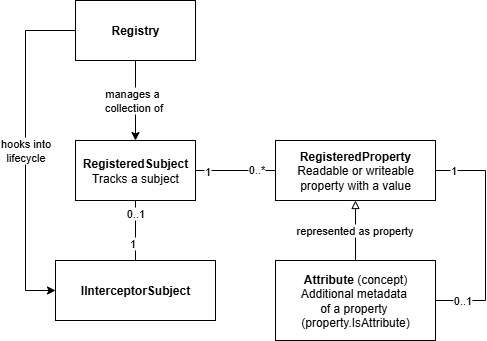

# Registry

The `Namotion.Interceptor.Registry` package provides a powerful tracking system that automatically discovers and manages interceptor subjects and their properties. It enables advanced features like property attributes (metadata attached to properties), dynamic property discovery, and hierarchical subject relationships. Unlike reflection-based approaches, the registry maintains full type safety while providing dynamic capabilities.



## Setup

Enable registry tracking in your interceptor context:

```csharp
var context = InterceptorSubjectContext
    .Create()
    .WithRegistry(); // Enables automatic subject and property tracking

var car = new Car(context);
```

The registry integrates with other interceptor features and automatically includes context inheritance to ensure child subjects participate in the registry.

## Accessing registry subjects and properties

Every subject provides access to its registry information:

```csharp
var tire = new Tire(context);
var registeredTire = tire.TryGetRegisteredSubject();

foreach (var prop in registeredTire.Properties)
{
    Console.WriteLine($"{prop.Name} ({prop.Type.Name})");
}
```

You can also resolve a specific registered property from a strongly-typed expression, including nested paths across subjects:

```csharp
// Direct property
var pressureProperty = tire.TryGetRegisteredProperty(t => t.Pressure);

// Nested path, including collection or dictionary segments
var frontPressureProperty = car.TryGetRegisteredProperty(c => c.Tires[0].Pressure);
```

Member-access hops resolve through the registry; index and dictionary segments evaluate against the object graph. The lookup is null-safe either way: if a subject along the path is null or not tracked by the registry, the method returns `null` instead of throwing.

### Parents and children

A registered property lists the subjects it holds in `Children`, and a registered subject lists the properties that hold it in `Parents`. Every entry carries an `Index`: `null` for a subject reference, the position for a collection and the key for a dictionary.

```csharp
garage.Cars = new Dictionary<string, Car> { ["Motor"] = car };

var parent = car.TryGetRegisteredSubject()!.Parents[0];        // Property: Cars, Index: "Motor"
var child = garage.TryGetRegisteredProperty(g => g.Cars)!.Children[0]; // Subject: car, Index: "Motor"
```

- Both entries follow the assigned value, and paths built afterwards use the new index. The rules, including a subject held more than once and a value mutated in place, are in [Child Index Changes](tracking.md#child-index-changes).
- `Children` of a collection is in position order. A property declared as a dictionary is not reordered by key, so its children stay in the order they were attached, also when its value enumerates as positions. A property declared more broadly, such as `object`, that holds a dictionary with `int` keys has its children ordered by key.

## Enumerate property attributes

The registry makes it easy to find metadata associated with properties:

```csharp
// Get all attributes for a specific property
var property = registered.TryGetProperty("Pressure");
foreach (var attribute in property!.Attributes)
{
    Console.WriteLine($"{attribute.AttributeMetadata.AttributeName}: {attribute.GetValue()}");
}
```

## Define attributes using properties

Property attributes solve the common problem of where to store metadata about your properties. Instead of external configuration or attributes that disappear at runtime, you can define metadata as actual properties:

```csharp
[InterceptorSubject]
public partial class Tire
{
    public partial decimal Pressure { get; set; }

    [PropertyAttribute(nameof(Pressure), "Minimum")]
    public partial decimal Pressure_Minimum { get; set; }

    [PropertyAttribute(nameof(Pressure), "Maximum")] 
    public partial decimal Pressure_Maximum { get; set; }
}
```

This pattern provides several benefits:

- **Type Safety**: Metadata is strongly typed
- **Trackable**: Changes to metadata are tracked like any other property
- **Bindable**: Metadata can be bound to external sources (MQTT, OPC UA, etc.)
- **Discoverable**: Metadata is accessible at runtime through the registry

## Dynamic property and attribute creation

The registry allows you to dynamically add properties and attributes to registered subjects at runtime. This enables building flexible systems that can extend object models programmatically.

### Add properties

Use `AddProperty` to create new trackable properties on a subject:

```csharp
var registered = subject.TryGetRegisteredSubject();

// Add a simple property with getter and setter
registered.AddProperty("DynamicValue", typeof(string),
    getValue: s => _dynamicStorage["DynamicValue"],
    setValue: (s, v) => _dynamicStorage["DynamicValue"] = v);

// Add a read-only property
registered.AddProperty("ReadOnlyInfo", typeof(DateTime),
    getValue: s => DateTime.Now,
    setValue: null);
```

Use `AddDerivedProperty` to create computed properties that automatically track dependencies:

```csharp
// Add a derived property that depends on other properties
registered.AddDerivedProperty("Status", typeof(string),
    getValue: s => s.IsActive ? "Running" : "Stopped",
    setValue: null);
```

Derived properties automatically participate in change tracking and will update when their dependencies change.

### Lifecycle tracking for dynamic properties

Dynamic properties (including derived) fully participate in lifecycle tracking when `WithLifecycle()` or `WithFullPropertyTracking()` is enabled. If a dynamic property holds a reference to another subject, that subject is automatically attached to the lifecycle graph with proper reference counting. For example, a `AddDerivedProperty<Tire>("FirstTire", ...)` that returns the first tire from a collection would give that tire a reference count of 2, one from the collection property and one from the derived property. This holds because dynamic properties are intercepted. A generated non-partial `[Derived]` getter is not intercepted, so it never attaches the subject it returns and never adds a reference.

When the underlying data changes, derived properties are re-evaluated and lifecycle tracking reconciles the old and new subjects automatically (attaching new subjects, detaching removed ones).

When a dynamic property is added, its initial value triggers a change event with `OldValue = null`, representing a transition from "property did not exist" to its initial value. This ensures interceptors (lifecycle, change tracking, etc.) correctly process the initial state.

### Add attributes

Use `AddAttribute` on any property to attach metadata dynamically:

```csharp
var pressureProperty = registered.Properties.First(p => p.Name == "Pressure");

// Add a unit attribute
pressureProperty.AddAttribute("Unit", typeof(string),
    getValue: s => "bar",
    setValue: null);

// Add validation attributes
pressureProperty.AddAttribute("MinValue", typeof(decimal),
    getValue: s => 0.0m,
    setValue: (s, v) => /* store min value */);
```

Use `AddDerivedAttribute` to create computed metadata that updates automatically:

```csharp
// Add a derived attribute that computes the maximum based on current value
pressureProperty.AddDerivedAttribute("DynamicMax", typeof(decimal),
    getValue: s => ((decimal)pressureProperty.GetValue()!) * 1.5m,
    setValue: null);
```

This pattern is useful for creating adaptive metadata that changes based on the current state of your properties.

## Custom property initializers

Implement `ISubjectPropertyInitializer` to automatically add metadata attributes when properties are attached. There are two ways to register an initializer:

**As an attribute.** When you own the attribute class, implement the interface directly on it:

```csharp
public class UnitAttribute : Attribute, ISubjectPropertyInitializer
{
    private readonly string _unit;

    public UnitAttribute(string unit) => _unit = unit;

    public void InitializeProperty(RegisteredSubjectProperty property)
    {
        property.AddAttribute("Unit", typeof(string), _ => _unit, null);
    }
}

// Automatically creates a "Unit" attribute when the property is registered
[Unit("°C")]
public partial decimal Temperature { get; set; }
```

**As a global initializer.** Register an `ISubjectPropertyInitializer` on the context to run for every property that gets attached. This allows initialization based on any source, e.g. reflection attributes or external configuration.

```csharp
public class DefaultValueInitializer : ISubjectPropertyInitializer
{
    public void InitializeProperty(RegisteredSubjectProperty property)
    {
        var attribute = property.ReflectionAttributes
            .OfType<DefaultValueAttribute>()
            .FirstOrDefault();

        if (attribute is not null)
        {
            property.AddAttribute("DefaultValue", property.Type,
                _ => attribute.Value, null);
        }
    }
}

var context = InterceptorSubjectContext
    .Create()
    .WithFullPropertyTracking();

context.AddService<ISubjectPropertyInitializer>(new DefaultValueInitializer());
```

## Subject IDs

The registry provides a subject ID system that assigns stable string identifiers to subjects. This is useful for protocol-level lookups where connectors (e.g., WebSocket) need to identify subjects by string IDs.

### Assign and retrieve IDs

Use `GetOrAddSubjectId` to lazily generate a stable 22-character base62-encoded ID, or `SetSubjectId` to assign a known ID **before** the subject has one:

```csharp
var context = InterceptorSubjectContext
    .Create()
    .WithFullPropertyTracking()
    .WithRegistry();

var car = new Car(context);

// Option A: Generate a stable ID on first call, return the same ID on subsequent calls
var id = car.GetOrAddSubjectId(); // e.g. "5Gk3mR7pLqWx9nYvBtHz01"

// Option B: Assign a known ID (e.g., from an incoming protocol message)
// Must be called before the subject has an ID; reassignment throws.
var car2 = new Car(context);
car2.SetSubjectId("my-car-001");
```

### Look up subjects by ID

Use `ISubjectIdRegistry` to look up subjects by their assigned ID:

```csharp
var idRegistry = context.GetService<ISubjectIdRegistry>();
if (idRegistry.TryGetSubjectById("my-car-001", out var subject))
{
    // subject is the Car instance
}
```

### ID assignment rules

- **Immutable after first assignment**: Once a subject has an ID, calling `SetSubjectId` with a *different* ID throws `InvalidOperationException`. This prevents accidental ID conflicts in concurrent scenarios.
- **Same-ID is a no-op**: Calling `SetSubjectId` with the same ID that is already assigned is safe and does nothing.
- **Unique across subjects**: Calling `SetSubjectId` with an ID that is already in use by a different subject throws `InvalidOperationException`.

### Lifecycle integration

Subject IDs are automatically managed during the subject lifecycle:

- **On attach**: If a subject already has an ID (e.g., set before attachment), it is auto-registered in the reverse index. If the ID conflicts with an existing subject, registration is silently skipped to avoid aborting the lifecycle.
- **On detach**: The reverse index entry is automatically cleaned up.
- **Deferred reverse-index registration**: `SetSubjectId` and `GetOrAddSubjectId` only store the ID in the subject's `Data` dictionary until the subject is attached to the graph via the lifecycle. The reverse index (`TryGetSubjectById`) is populated by the lifecycle attach handler, preventing orphaned index entries for subjects that are never attached.

### Without a registry

Subject IDs also work without a registry configured, because IDs are stored directly in the subject's `Data` dictionary. However, the reverse index lookup (`TryGetSubjectById`) requires a registry.

## Paths

Path providers map between subject property paths and external system paths. They are defined in `Namotion.Interceptor.Registry.Paths` and are used by the connectors and the MCP server to address properties by path.

### IPathProvider Interface

```csharp
public interface IPathProvider
{
    // False when the property is excluded; true with its segment, never null, when it is included.
    bool TryGetPropertySegment(RegisteredSubjectProperty property, [NotNullWhen(true)] out string? segment);

    // The first included property, in the subject's property order and other than the [InlinePaths] property, whose
    // segment equals segment; otherwise the included [InlinePaths] property. Never an excluded property.
    bool TryGetPropertyFromSegment(RegisteredSubject subject, string segment, [NotNullWhen(true)] out RegisteredSubjectProperty? property);
}
```

Both methods may be called concurrently. `IsPropertyIncluded` and `IsPropertyEffectivelyIncluded` are extension methods on `IPathProvider` in `PathProviderExtensions`; the first returns what `TryGetPropertySegment` returns, the second is described below.

A custom provider derives from `PathProviderBase` and overrides `TryGetPropertySegment`. The base class includes every property under its `BrowseName`, matches segments through `TryGetPropertySegment` so that only included properties resolve, reaches the `[InlinePaths]` property only when no other included property has the segment, and has the virtual `PathSeparator`, `IndexOpen` and `IndexClose`:

```csharp
public class StatePathProvider : PathProviderBase
{
    public override char PathSeparator => '/';

    public override bool TryGetPropertySegment(RegisteredSubjectProperty property, [NotNullWhen(true)] out string? segment)
    {
        segment = property.TryGetAttribute("State") is not null || property.CanContainSubjects ? property.Name : null;
        return segment is not null;
    }
}
```

### Included properties

A path provider defines a view of the graph: `TryGetPropertySegment` decides which properties are in it and gives their segments. Paths go only through properties the provider includes, in both directions:

- `TryGetPath` and `GetPaths` build no path for a property when it or any property holding it up to the root is excluded, including an `[InlinePaths]` dictionary whose key is a bare segment. When a subject on the way has several parents and a root is given, the path is the first path, in parent order, that reaches the root through properties the provider includes; there is none when no such path exists, or when that first path needs an `[InlinePaths]` key or property the provider cannot resolve back. Without a root, the path follows the first parent of each subject.
- `TryGetPropertyFromPath`, `TryGetSubjectFromPath` and `GetPropertiesFromPaths` resolve a path only when every segment names a property the provider includes.
- `HasPath` tells whether `TryGetPath` with the same provider and root finds a path, without building the path string. It can be true while `TryGetPath` returns null for a path through an `[InlinePaths]` property whose segment another property has.

So a path built with a provider never passes an excluded property, and resolves back with the same provider to the same property when its `TryGetPropertyFromSegment` is the inverse of its `TryGetPropertySegment`, as in `PathProviderBase` for every property but an `[InlinePaths]` property whose segment another included property has. Within that, the limits in [Path Syntax](#path-syntax) apply: a segment that contains the separator does not resolve back, and a key of a type other than string, integer, `Guid` or enum resolves to the first entry with the same text. With `DefaultPathProvider`, or any provider that gives an attribute its `BrowseName` as segment, an attribute's segment is its bare name, so two attributes with the same name on one subject, or an attribute named like a property, share a segment and resolve back to the first of them in the subject's property order: the `Unit` attributes of `FirstName` and `LastName` both build the path `Unit`. The `[InlinePaths]` property is the exception: it yields its segment to an attribute with that name wherever the attribute is declared, and then has no path itself, see [Resolving keys](#resolving-keys). A nested property has a path only when every level above it is included: with `AttributeBasedPathProvider`, every property holding a subject on the way needs a `[Path]` attribute of its own.

An attribute belongs to its property, so paths pass only properties that are effectively included: the provider includes the property and, for an attribute, the property it belongs to, recursively. The properties holding its subject are not part of this check. The registry applies this rule, not the provider: `IsPropertyEffectivelyIncluded` checks it for one property, for code that lists or filters properties as paths do. Excluding a property therefore excludes its attributes too, so no path is built or resolved to them or through a subject one of them holds. Attributes that belong to each other in a cycle are not included. To give an attribute a path with `AttributeBasedPathProvider`, annotate the attribute and its property.

```csharp
[InterceptorSubject]
public partial class Room
{
    [Path("mqtt", "sensor")]  // without it, Temperature below has no "mqtt" path
    public partial Sensor? Sensor { get; set; }
}

[InterceptorSubject]
public partial class Sensor
{
    [Path("mqtt", "temperature")]
    public partial decimal Temperature { get; set; }
}

// room.Sensor.Temperature has the path "sensor/temperature"
var pathProvider = new AttributeBasedPathProvider("mqtt", '/');
```

### Built-in Providers

- **DefaultPathProvider** - Uses property names exactly as defined
- **CamelCasePathProvider** - Converts property names to camelCase for JSON APIs
- **AttributeBasedPathProvider** - Uses `[Path]` attributes for custom mapping and includes only the properties that have one with its name, and the `[InlinePaths]` property

### [Path] Attribute

Use `[Path]` attributes to map properties to custom external paths:

```csharp
[InterceptorSubject]
public partial class Sensor
{
    [Path("mqtt", "temp")]
    public partial decimal Temperature { get; set; }

    [Path("mqtt", "hum")]
    public partial decimal Humidity { get; set; }
}
```

### [InlinePaths] Attribute

Marks a dictionary property as a transparent container for path resolution:

```csharp
[InterceptorSubject]
public partial class ProductionLine
{
    public partial string Name { get; set; }

    [InlinePaths]
    public partial Dictionary<string, Machine> Machines { get; set; }
}

[InterceptorSubject]
public partial class Machine
{
    public partial string Status { get; set; }
    public partial decimal Temperature { get; set; }
}
```

With `[InlinePaths]`:
- Path `Line.CNC01.Status` resolves to `Line.Machines["CNC01"].Status`
- Only one property per class may be marked with `[InlinePaths]`; multiple properties throws `InvalidOperationException`
- Works with `AttributeBasedPathProvider` without requiring `[Path]` attribute on the dictionary
- Built into `PathProviderBase.TryGetPropertyFromSegment`

### Path Syntax

A path is a sequence of segments joined by the provider's `PathSeparator` (default `.`). A segment names a property and may carry an index between `IndexOpen` and `IndexClose` (default `[` and `]`) that addresses a collection position or a dictionary key:

```text
Machines[CNC01].Status
Devices[192.168.0.1].Status
Sensors['Kitchen [north]'].Temperature
```

#### Grammar

- Inside an index the separator and `[` are literal, so `Devices[192.168.0.1]` is one key.
- An index that starts with `'` is a quoted key and runs to the next lone `'`; a doubled `''` inside stands for one `'`. `['']` is the empty key. Any key may be quoted, and quoting does not change its type: `[5]` and `['5']` address the same entry.
- An unquoted index runs to the first `]` and must not be empty.
- Outside an index `]` and `'` are ordinary name characters, so a segment such as `notes]v2` is parsed as is.
- Empty segments are skipped, so with a `/` separator `/a/b`, `a//b` and `a/b/` all parse as `a/b`.
- A malformed path makes `ParsePath` throw `FormatException`: a segment without a name, an unclosed `[` or quote, an empty `[]`, anything but `]` after a closing quote, or anything but the separator after an index. `TryParsePath` returns the reason and position instead, and the resolvers report a malformed path as not found.
- `PathSeparator`, `IndexOpen` and `IndexClose` must be three different characters, none of them `'`.
- Segments from `[Path]` attributes or `TryGetPropertySegment` are used as is and must not contain `[`. A path with a segment that contains the separator is built but does not resolve back.

#### Building keys

- `TryGetPath` builds a key from its invariant text (`FormatPathIndex`), so a `double` key `1.5` is `[1.5]` on every machine.
- A key is quoted when its text is empty, starts with `'` or contains `]`: `Sensors['Kitchen [north]']`, `Sensors['''quoted']`, `Sensors['']`. Every other key is used as is.
- A path `TryGetPath` builds resolves back to the same entry for collection positions and string, integer, `Guid` and enum keys. For other key types it does when the key's text is unique within its dictionary, otherwise the first entry with that text wins (for example the keys `5` and `"5"` in a `Dictionary<object, T>`, `DateTime` keys that differ below one second, or custom keys without a `ToString` override).

#### Resolving keys

- A collection resolves a position in canonical form only: `[1]`, not `[01]` or `[+1]`. A position outside the collection resolves to no subject; `TryGetPropertyFromPath` still returns it as the key of the last segment (see below).
- A dictionary with string, integer, `Guid` or enum keys parses the text as its key type and accepts only the form `TryGetPath` builds: string keys as is (`[5]` addresses the string key `"5"`), integers like `[-3]`, Guids in lower case `D` form, enum names like `[Blue]` or `[Read, Write]`.
- A dictionary with any other key type, such as `object`, `double` or `DateTime`, matches the text against the text `TryGetPath` builds for its entries, and the first match wins. When no entry matches, the key is returned as its text (a `string`). This reads the registered entries, so the dictionary has to be assigned rather than mutated in place, and the lookup is linear in the number of entries.
- An index on a property that is neither a collection nor a dictionary is not found.
- `TryGetPropertyFromPath` returns the key of the last segment, typed as above, also when no entry exists at it yet.

`[InlinePaths]` keys follow the same rules. A key is built as a bare segment only when it resolves back to that key: it is not empty, contains neither the separator nor `[`, differs from the inline property's own segment, and does not name another property. Otherwise it is built as an index on the inline property, such as `Line.Machines[192.168.0.1].Status` or `Line.Machines[Name].Status`. The inline property's own segment (`Line.Machines`) addresses the property itself, unless another included property of the subject has the same segment: that property takes the segment wherever it is declared, and the inline property itself and a key that needs the index form then have no path. Whether a key is built bare is decided when the path is built, so adding a property later that is named like a key changes what that bare path resolves to.

#### Creating missing subjects

`TryGetPropertyFromPath(rootSubject, path, createMissingSubject)` calls `createMissingSubject` for a subject reference on the way whose value is null. Missing collection and dictionary items are never created, and a malformed path never calls the hook. The connector path extensions are built on it.
