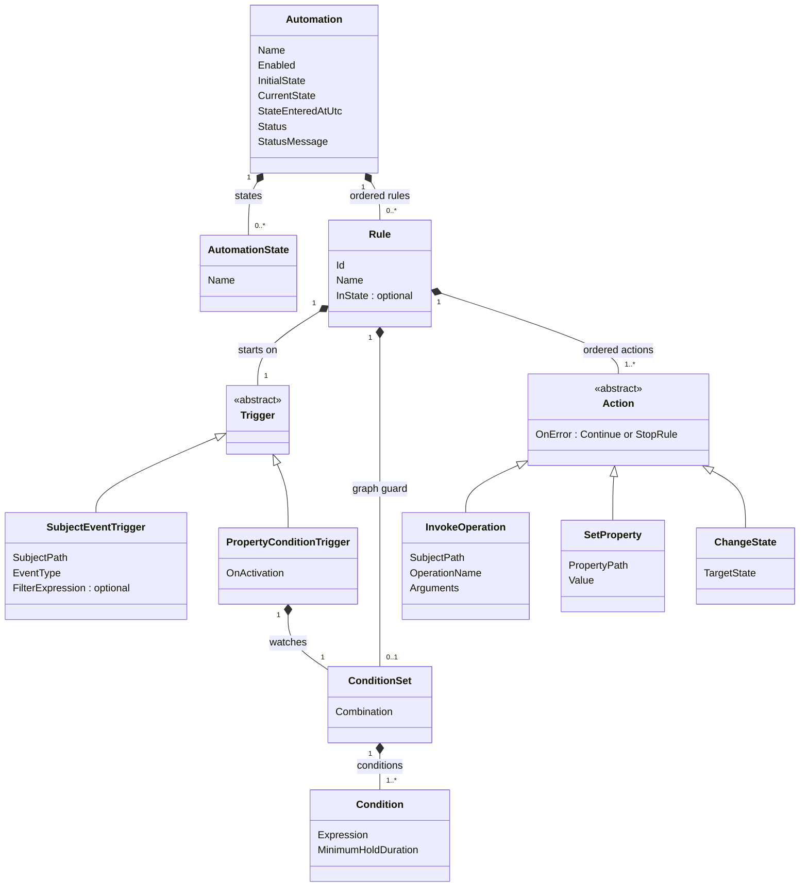

# Automation Design [Draft]

This is a design for configurable, deterministic HomeBlaze automations. It has not been approved for implementation. The examples below describe intended behavior, not an existing configuration schema. Keep design edits in `docs/superpowers/specs` at this stage; creating the permanent subject documentation is a deliverable of the subsequent implementation plan.

## Intent

One automation subject supports both independent rules and named-state workflows. Its triggers observe subject events or property conditions; its ordered actions invoke operations, write properties, or change its own state. A state change can itself trigger another rule. The same model must support a Hue button starting Sonos playback, blinds closing when several conditions become true, day/night lighting, and a door-open reminder that recovers after a restart.

The runtime reuses subject tracking, registry paths, operation metadata, configuration persistence, and `IMonitoredService`. It does not require an AI model or the planned global message bus.

## Approaches

| Approach | Tradeoff | Outcome |
|---|---|---|
| One composable automation subject with optional named states | A common rule model needs explicit trigger, action, and ordering semantics. The same concepts support simple rules and state diagrams. | Selected through the design discussion. |
| Separate trigger and state-machine subjects with a shared engine | Similar to v1, but presents two authoring models for substantially overlapping behavior. | Not selected. |
| Arbitrary scripts as the primary automation model | Offers extensive freedom but makes visual editing, validation, inspection, and Native AOT support harder. | Deferred as a possible extension. |

States are named values, with no separate entry-action collection. State-entry behavior is an ordinary rule listening for a state change. The target state appears only in a `ChangeState` action, not in a second transition destination field.

## Agreed Semantics

- Both ordinary rules and state-machine transitions use subject-event triggers or property-condition triggers.
- Subject events support payload filters and additional conditions on the current subject graph.
- Property-condition triggers observe every property their expressions reference. Conditions support individual minimum hold durations.
- Each rule has ordered actions, mixing operation calls, property writes, and changes to its own automation state.
- A rule can be restricted to a named current state. Without a restriction, it applies in every state, including an automation without named states.
- An automation persists its current state and state-entry timestamp through configuration persistence. Offline time counts toward state timeouts.
- Recovery of an overdue timeout waits for fresh readings of the device properties its trigger and guard require. Unavailable readings remain unknown and keep the recovery evaluation pending. This is default runtime behavior, without a per-rule freshness setting in the initial version.
- Property-condition triggers default to immediate evaluation when activated, with an explicit option to wait for false to true.
- A real state change is observable through `CurrentState` and a subject event containing the previous and new states. Restoring a checkpoint does not emit that event.
- Action errors are logged and recorded. The default action error policy is `Continue`; an action can select `StopRule`.
- Successful actions are not rolled back when a later action fails.
- `IMonitoredService.Status` and `StatusMessage` expose the latest failure. Later successful actions in that run do not clear it. A subsequent fully successful run clears it; a trigger rejected by its conditions does not.
- An error does not disable the automation or prevent it accepting later triggers.

The following detailed mechanics are proposals for review, rather than additional user requirements.

## Domain Model

This is a conceptual model, not the final public API. The implementation should use descriptive concrete type names where `Action`, `Trigger`, or `Rule` would be ambiguous.

`ConditionSet` initially combines its members with AND or OR; an expression can contain boolean negation and grouping. The blinds example uses AND. Minimum hold duration applies independently to each condition before combination. The distinction between a property trigger's condition set and a rule's graph guard is behavioral: the former generates a run request when it becomes true, while the latter only decides whether an existing request may proceed. A graph guard with holds also observes its dependencies while its rule is active, so it can establish a hold before an event arrives. A guard becoming satisfied never generates a run or replays a rejected event.

## Triggers and Activation

### Subject Events

A subject-event trigger identifies a source subject, an exposed event type, and an optional payload filter. Every matching occurrence is eligible, even when two consecutive payloads are identical. A button press must not be implemented solely by comparing its last stored property value.

The event filter sees the captured payload. The graph guard reads the graph when the request is processed. A rejected event is consumed; a guard becoming true later does not replay it. Event subscriptions never replay old button presses after enabling, state entry, configuration reload, or process restart.

Existing subjects already expose typed streams such as `IObservable<ButtonEvent>` on Hue buttons. New event adapters should preserve that convention. A statically registered adapter describes the payload fields, their types, and their readers, and subscribes to the typed stream. Built-in adapters cover button events and automation state changes. Plugin authors can register adapters for additional event types. No runtime code generation or arbitrary reflected event subscription is required, and implementation does not depend on `IMessageBus` being available.

### Property Conditions

Parse expressions once and subscribe to all referenced properties, using the existing expression parser and tracking facilities. Preserve relevant observed condition transitions; do not debounce arbitrary property changes as though they were interchangeable events. Compound conditions are evaluated using the dependency values maintained for the observed change stream. This provides an admitted order per automation, not a global transaction across independent writers.

Unknown or unavailable inputs cannot satisfy a condition. Losing a required input cancels its running hold period. A hold begins when its condition becomes known true and resets when it is no longer true. When the combined set becomes satisfied, it requests one run, then rearms after the combined set becomes unsatisfied. A guard rejection consumes that request; guard changes alone do not generate another request.

| `OnActivation` | Initial behavior |
|---|---|
| `EvaluateImmediately` | If the condition set is currently satisfied, request one run. Positive hold durations begin at activation rather than assuming earlier continuity. This is the default. |
| `WaitForFalseToTrue` | Establish the raw boolean combination as a baseline before applying holds. If already true, wait until that raw combination becomes false and true again, then apply the holds. Starting a hold at activation must not turn an already-true baseline into a new occurrence. |

Activation occurs on startup, enabling, a configuration change that replaces the trigger, source rebinding, or entry into the trigger's applicable state. A rule with no state restriction stays active across state changes; it is not reactivated after every transition. Reentry creates fresh hold periods. Ordinary property hold periods are not persisted across restart, because their continuity during downtime is unknown.

An immediate activation evaluation and the property notification of the same activating change must not produce two runs for one satisfaction cycle. Track activation generations and the trigger's satisfied/rearmed state to distinguish a new occurrence from a second observation of the same condition result.

An unresolved source remains inactive with an actionable diagnostic. When the required source becomes available, establish a baseline and apply `OnActivation`. Rebind subscriptions when graph subjects are replaced or removed, without continuing to read a detached source.

## Named States and Dispatch

`InState` is a structural activation scope, not an alternative syntax for a graph guard. Entering or leaving that scope activates/deactivates the rule's triggers, applies its activation policy, and invalidates its ordinary hold periods. A guard only filters an existing request. Keep this distinction explicit rather than giving a state-equality condition hidden subscription-lifecycle behavior. The proposed UI label is "Active in state"; hide it when no named states exist. State comparisons against another automation remain ordinary graph conditions. The diagram uses explicit state scope and `ChangeState`, so it does not need to infer transition sources by interpreting arbitrary boolean expressions.

`InitialState` is used only when creating an automation without a checkpoint or explicitly resetting it. An unknown persisted or target state is a configuration/action error, never an implicit reset. A state name must be unique. A same-state `ChangeState` is a no-op: it does not reset the state-entry time or emit a new event. A future explicit reentry operation can be added if a concrete use case requires it.

Each automation serializes input processing and its actions on one worker. Subscription callbacks enqueue captured input and return; they do not run operations, await storage, or reenter the automation from a property setter or topology lock. Subject events retain their individual occurrences. Configuration versions and activation generations prevent queued input or expired holds from an earlier activation running against a replacement configuration or state.

The proposed rule-selection behavior is to process applicable rules in configured order for one input. Each rule evaluates its filter and guard immediately before its actions. Multiple rules may run. Once a rule actually changes state, finish that rule's remaining actions, then stop processing that original input. A state change is not rolled back if a subsequent action in that rule fails. New state-change events and activation evaluations are queued until the current rule finishes. New events are separate work, rather than reusing the old event against successive states.

One run comprises the whole dispatch of one input, including all eligible rules it executes. An error in an early rule survives a successful later rule in the same dispatch. Separately queued state-change events and activation requests are later runs; their results are recorded separately. An input that executes no actions is not a successful run for clearing an earlier failure.

Changes caused by an automation may generate later inputs. The runtime must identify and report an unbounded feedback chain instead of allowing it to monopolize the worker; a bounded automatic-chain limit is an implementation default to select during planning. External subject events must not be silently coalesced or dropped as loop suppression. Input storage must be bounded, with an explicit overload fault and resynchronization path, rather than silently losing events or allowing unlimited allocation. Exact limits are left to the builder.

Separate automations have independent workers. Finishing a rule before its own follow-up rules run does not promise that another automation waits for that rule to finish.

## State Persistence and Time

`[Configuration]` selects values for serialization; it does not automatically write each change. Persist the state name and UTC entry timestamp together through the existing `IConfigurationWriter`. `false` from `WriteConfigurationAsync` means nothing was written and must be treated as a failed persistence action, not as success.

The state name and entry timestamp form one checkpoint. Its representation must allow a coherent snapshot during serialization and observation. An immutable persisted checkpoint with read-only state projections is a proposed implementation option; the exact public shape is left to the builder. Operational state changes go through the worker, not arbitrary property setters. Loading checkpoint values during deserialization is restoration, not execution of a transition.

A successful `ChangeState` saves the new checkpoint and publishes one logical state-change event with the old state, new state, and entry time. Follow-up rules are released only after that action succeeds. A persistence failure follows the action's error policy and must not publish a successful state-change event. This requires a snapshot-aware write path: serialize the owning configuration with the prospective checkpoint, save it on the owning storage's worker, and only after acknowledgment publish the new in-memory checkpoint and notifications. Reading `CurrentState` or observing its property must not expose an uncommitted candidate. The existing live-subject writer alone does not supply this contract; the necessary additive snapshot-writing capability is part of the proposed implementation, with the existing public writer behavior preserved.

For an indeterminate write outcome, keep the failure visible and suspend further state changes until the stored checkpoint is reread and reconciled. `Continue` can still attempt the current rule's remaining non-transition actions. Reconciliation is restoration and does not fabricate a successful transition event. This defines the recovery contract without claiming that an external device command and a storage write are atomic.

State deadlines are absolute UTC deadlines calculated from the persisted entry time. Offline time counts. On restart, restore the checkpoint without a synthetic state-change event. Recovery evaluation of an overdue state-time condition waits until required device properties in its trigger and graph guard have fresh readings from after startup. Resolving a property, restoring a cached value, or establishing a device connection alone does not establish freshness. Static configuration and restored automation checkpoint values do not require device readings. Do not replay every missed daily schedule occurrence.

While a required reading is unavailable, treat it as unknown and keep the recovery evaluation pending. Do not consume it as a rejected guard or establish a false baseline from an unknown value. Once the inputs are ready, apply the configured activation policy and evaluate the graph guard. With `EvaluateImmediately`, an overdue door reminder sends immediately if a fresh reading reports open, skips the notification if it reports closed, and keeps waiting if no fresh reading arrives. The original entry timestamp and deadline remain unchanged. A known-false guard rejects that evaluation normally; subsequent guard changes do not replay it. Disabling the rule, changing its configuration, leaving its applicable state, or replacing a dependency invalidates pending work through the same activation-generation rules used elsewhere.

Freshness is runtime input readiness, not another user-authored condition or per-rule option in the initial version. Implementation must provide explicit evidence of a successful device observation, including an observation whose value is unchanged; property-change notification alone is insufficient. The concrete readiness contract and device adapters are implementation design work. A source that cannot establish freshness leaves recovery pending with a diagnostic rather than silently falling back to its cached value.

Time enters the rule model through subject events or properties, not a third trigger type. The initial implementation needs a reusable clock subject for day/night conditions and an observable elapsed-state-time property or equivalent timer-subject adapter for the door example. The following is the proposed minimal time integration:

- A clock subject exposes UTC time and numeric local time-of-day, with a configurable time zone. The time zone defaults to the host's configured local zone.
- The automation exposes numeric elapsed seconds in its current state, calculated from the saved UTC timestamp. Updates only need to run while active rules reference that signal.
- Day/night rules compare local time-of-day with 08:30 and 21:30; the night condition spans midnight. This reconciles to the current period after restart instead of replaying both missed transitions.
- The door's timeout is an ordinary property-condition trigger on elapsed state time, guarded by the door-open input and subject to the recovery readiness behavior above. `EvaluateImmediately` retains the original deadline after restart. It does not start another ten-minute period or add an additional minimum hold duration.

Use `TimeProvider` for clock and timer work. The existing expression grammar supports comparisons and boolean expressions but rejects arithmetic, so examples must not assume subtracting timestamps in user expressions. Numeric time signals keep these examples within that grammar. Wall-clock corrections and daylight-saving changes must be tested; elapsed-state time is UTC-based and local daily windows follow the selected time zone.

Checkpoint persistence and an external operation are not one transaction. Saving state does not provide exactly-once notifications or durable resumption of an action list. A crash between sending a notification and persisting `Informed` may result in another notification after recovery. The first version does not retry whole rules automatically or claim exactly-once effects.

## Actions and Errors

`InvokeOperation` resolves registered operation metadata and its parameters, applies normal enabled/confirmation restrictions, and awaits completion. An unattended automation cannot provide an interactive confirmation; operations requiring one are rejected with an explanatory error. Reuse the public method metadata and conversion facilities where possible, with no dependency on an AI or MCP implementation. Target operations must be of operation kind rather than bypassing metadata through arbitrary reflection.

`SetProperty` uses normal intercepted writes to a writable operational property. It cannot bypass configuration persistence, mutate another automation's checkpoint directly, or write an otherwise read-only value. Constants and expression-bound arguments should have an unambiguous serialized representation. Event argument evaluation sees its captured payload, not a later overwritten event value.

`ChangeState` affects the owning automation only. Other automations can observe it and may expose explicit operations later; a generic property write cannot bypass their transition protocol.

Each action has an error dropdown with `Continue` selected by default and `StopRule` as the alternative. Always log the failure with automation, rule, action, and source context, and record it in the bounded run history. `Continue` attempts the remaining actions; `StopRule` skips them. The proposed meaning of `StopRule` does not stop unrelated rules that remain eligible for the original input, unless the failed rule already changed state. Neither policy rolls back successful actions or implies retry.

Use `IMonitoredService` for lifecycle status and the latest error message. A run with any action/filter/condition evaluation failure is unsuccessful even if later actions complete. Successful actions in that run do not clear its error. A later run that actually executes actions and completes all of them successfully clears the error and restores `Running`. A filter/guard rejection, unresolved input, canceled stale request, or empty evaluation is not a successful run. While stopped or disabled, lifecycle status can be `Stopped` while the last error message remains available for the lifetime of that subject instance; persisting error history across process restarts is not part of the initial checkpoint contract.

The existing host icon helper already gives `IMonitoredService` subjects with `Status == Error` an error color. The editor should show `StatusMessage`; no separate acknowledgment mechanism or new error-status interface is needed. Run records distinguish succeeded, completed with errors, stopped after an error, and canceled. Initial history is bounded and in memory; full errors remain in normal logs. Exact record types and retention limits are builder choices.

Cancellation from stopping, disabling, or replacing configuration is not an action failure and does not erase an earlier error. A run timeout is a recorded failure. An operation that does not cooperate with cancellation must not allow a replacement run to overlap it inside the same automation.

## Authoring and UI

### Repository Creation and Migration Guidance

The repository's [create-homeblaze-library](../../../.claude/commands/create-homeblaze-library.md) and [migrate-homeblaze-library](../../../.claude/commands/migrate-homeblaze-library.md) guides supply the subject and UI conventions. Their older `src/Namotion.Devices.*` examples should be resolved against the current `src/HomeBlaze/` project layout. They supplement the brainstorming workflow; reading them does not approve implementation or require copying the v1 architecture.

Keep the runtime library headless and place Razor components in a separate UI library. As a non-device subject, the creation guide's `Namotion.{Name}` naming convention is the relevant starting point; concrete project names remain to be chosen. Register both assemblies through the existing subject/component discovery mechanisms. A dedicated setup component is unnecessary unless creation needs a distinct workflow; the shared create dialog can use the normal edit component with `IsCreating`.

The editor implements `ISubjectEditComponent`, including validity, dirty tracking, and save. Initialize its local draft once for the edited subject, following current editors, rather than overwriting unsaved fields whenever live state rerenders the component. Apply and persist changes only through the normal Save flow. Runtime `CurrentState`, its checkpoint timestamp, and status/error values remain live observations: saving a draft of names, rules, conditions, actions, or diagram positions must not replace the current checkpoint with the values that existed when the editor opened. Validation and the snapshot-writing design must cover this configuration/runtime concurrency.

The proposed component set is a compact widget, a dedicated editor, and a page for live state and run history. Their exact layout is still under UI discussion. Reuse the existing subject/property pickers, metadata-driven operation parameters, and diagram facilities. Editing a form or dragging a graph node must not execute device commands. View and edit behavior should follow the existing host conventions.

For migration coverage, retain a checklist of the v1 condition/hold editor, event filtering, ordered operations with parameters, named states, transition editing, initial-state selection, and state-entry behavior. Translate state-entry behavior into ordinary state-change rules. Keep diagrams and list editing as views over the same rule configuration rather than recreating the old separate transition store. The reference implementations are v1 `TriggerThingSetup`, `ButtonTriggerThingSetup`, `AutomationSetup`, and the state/transition dialogs; current v2 custom editors and `ISubjectEditComponent` define the save lifecycle.

### Proposed Editing Behavior

The [interactive editor prototype](https://homeblaze-automation-editor-01a197c0.clear-macaw-9363.chatgpt.site/) illustrates rule editing, state diagrams, and activity inspection. It is a design aid; this document records the current decisions. The prototype still uses the earlier "While in state" label and a plain event-filter input, so the state-scope label and shared expression editor described below remain to be reflected in it.

Use one reusable condition/expression editor for event filters and graph conditions. The editor supplies the appropriate field catalog and context: event filters can choose payload fields, such as `value/ButtonState`, while graph conditions choose registered subject/property paths. Both persist expression strings, validate and parse them using `Namotion.Interceptor.Expressions.ParsedExpression`, and evaluate cached parsed expressions with `EvaluateCondition`. Hold durations remain rule-runtime configuration outside expression text. An event filter is evaluated per event and never waits for a hold or subscribes to a past payload.

The agreed canonical representation of each predicate is its expression string. The default simple editor presents field, operator, and value controls that generate that string; it does not persist a second path/operator/value model. An advanced editor exposes the same expression directly. For example, choosing outside temperature, greater than, and 25 produces `/Sensors/Outside/Temperature > 25`, while choosing a button-release payload filter produces `value/ButtonState == Release`. Switch back to simple controls only when they can represent the expression faithfully. Otherwise keep advanced mode and preserve the expression unchanged, without dropping terms or silently simplifying it. Condition grouping, minimum hold durations, state scope, trigger definitions, and typed actions remain structured configuration around these predicate strings.

The current worktree's `ExpressionEditDialog` in `HomeBlaze.Host` wraps `SubjectPathPicker`; it is not yet a complete general-purpose boolean expression builder. Reuse its picker facilities and the existing expression validation/evaluation, and provide the shared builder in a reusable UI layer below the host. The existing `ValueBindingContext` deliberately rejects members of `value`; event payload member access therefore needs an automation-specific `IExpressionContext` backed by the statically registered event descriptors. Binding `value` to the payload and `subject` to its publisher follows the existing variable conventions. The parser already recognizes those member paths, so this does not require a second grammar or runtime reflection.

Provide an editor for source subject/event selection, event payload filters, property conditions with individual hold durations, optional state restrictions, ordered typed actions, and operation parameter binding. Use the existing subject/property pickers and registry operation metadata. Every action exposes its error dropdown. Property-condition triggers expose `OnActivation` with immediate evaluation selected.

Named states can also be presented as a state diagram, using the diagram facilities already referenced by `HomeBlaze.Components`. The underlying rule list is canonical. Diagram edits must not create a second transition store. A rule containing `ChangeState` can produce an edge from its state restriction to that target, with its other actions shown alongside it. Rules without a simple source/target pair remain visible in the rule editor rather than being forced into a misleading edge. State-entry rules remain ordinary rules and may be surfaced as an editing shortcut without adding a separate entry-action collection.

Validate names, references, expression syntax, event adapters, operation parameters, and action policies before applying a new immutable configuration snapshot. A malformed configuration is reported without partly installing new subscriptions or abandoning a still-valid running configuration. A missing runtime device is a resolvable source/target issue, distinct from invalid syntax.

Trigger and action configuration uses explicit, stable type discriminators and statically registered JSON metadata. Reject an unknown discriminator rather than silently substituting another action. Round-trip the configuration and checkpoint without requiring runtime type generation. Stable rule and action identifiers link editor rows and run diagnostics across reordering.

## Acceptance Scenarios

| Scenario | Required outcome |
|---|---|
| Hue button release | Every matching release, including repeated identical events, invokes the configured Sonos operation. Other gestures are filtered out. |
| Blinds | Both covers are fully open AND outside temperature is above 25 degrees. Any referenced property can complete the conjunction. It runs once per false-to-true cycle, respecting each hold. |
| Day/night | Day begins at 08:30 and night at 21:30 in the clock's time zone. Startup reconciles an incorrect saved state to the current period. |
| Door reminder | Closed to open changes state and starts the elapsed-state deadline. Expiry while still open sends the notification and changes state to informed. Closing before expiry invalidates that activation. |
| Door reminder after restart | Restoring an overdue open state waits for a fresh door reading. Open sends immediately without restarting the timeout; closed skips the notification; unavailable remains pending. Restoring informed does not emit another entry event. |
| Recovery input readiness | A successful observation can establish freshness even when its value is unchanged. Cached/default values and connection status alone cannot. Invalidated pending evaluations cannot execute actions later. |
| State-change trigger | A real change publishes old/new state and can start rules in the same or another automation. Follow-up rules in the same automation wait for the current rule's action list. |
| Action errors | `Continue` attempts remaining commands, `StopRule` skips them, and neither undoes an already changed state. The latest failure survives later successes within that run. |
| Recovery | A later fully successful run clears `StatusMessage`; rejected conditions do not. Error status alone does not disable the automation. |
| Persistence failure | A missing writer, false write result, or failed write is visible and does not publish a successful durable state transition. |
| Lifecycle | Source replacement, disable/re-enable, configuration edits, cancellation, and pending hold callbacks cannot execute stale work or leak subscriptions. |

## Scope and Validation

The first version includes the automation subject and runtime, typed event adapters, condition/hold handling, the three action types, checkpoint persistence, minimal time signals, the rule editor and state-diagram projection, and bounded run diagnostics. It does not include arbitrary scripts, distributed exactly-once delivery, persistent action continuations, automatic retries, parallel action execution, a new message bus, or automatic conversion of v1 configuration.

Prefer static descriptors and the existing expression interpreter over new reflection or dynamic compilation. Keep HomeBlaze-specific behavior under `src/HomeBlaze`. New public APIs and configuration shapes require the appropriate snapshots and serialization compatibility tests. The implementer chooses project boundaries, concrete API names, exact queue/history limits, and data structures while preserving the contracts above.

Verification should cover the acceptance scenarios with controllable clocks and event synchronization, including observed property pulses, compound holds, feedback chains, rapid source replacement, save failure, and restart checkpoints. Use integration tests targeted to HomeBlaze UI for the authoring work, including round-tripping rule and diagram edits. Core rule tests should use fake operations and clocks rather than physical devices. No benchmarks or long-running connector tester runs are required by this design; changing a connector implementation later would require revisiting that verification scope.

## Documentation Delivery

The implementation plan must include creating the Automation subject's Markdown documentation under `src/HomeBlaze/HomeBlaze/Data/Files/Docs` and linking it from Subjects, the documentation index, and implementation status as appropriate. Do not create or edit those product documentation files during the design phase.

Document the implemented rule and state model, event filters and property conditions, simple and advanced expression editing, activation policies, hold durations, ordered actions and error handling, persistence and restart recovery, diagnostics, and the home-automation examples in this spec. Include the domain diagram and editor guidance. Separate user-facing behavior from implementation rationale through the existing documentation structure, with one canonical location per concept and cross-references. Verify the examples, local links, and rendered diagrams against the implementation before treating that documentation task as complete.

## Existing Building Blocks

- `HomeBlaze.Abstractions.IMonitoredService` and `ServiceStatus`: lifecycle status and error text.
- `HomeBlaze.Abstractions.Attributes.ConfigurationAttribute`, `HomeBlaze.Services.ConfigurableSubjectSerializer`, and `HomeBlaze.Storage.Abstractions.IConfigurationWriter`: serialization and explicit configuration writes.
- `Namotion.Interceptor.Tracking`: observable, queue, and per-property change subscriptions.
- `Namotion.Interceptor.Expressions.ParsedExpression`: parsed dependency paths and interpreted comparisons/boolean expressions. Event filters need a host context that binds the payload as `value` and its publisher as `subject`, with static field readers. Graph conditions can use absolute registry paths.
- `HomeBlaze.Abstractions.Metadata.MethodMetadata` and `HomeBlaze.Services.RegisteredSubjectMethodExtensions`: operation metadata and invocation.
- `Namotion.Devices.Philips.Hue.HueButton`: a typed `IObservable<ButtonEvent>` source.
- Existing Blazor subject/property pickers and diagram dependencies: authoring UI foundations.

## Review Points

The domain model and agreed semantics above capture the discussion. The detailed worker semantics, minimal time signals, checkpoint representation/protocol, adapter registration, rule-selection behavior, runtime history scope, and UI projection are author proposals for review. They must be assessed before implementation planning. In particular, snapshot-aware configuration writes add storage work beyond the automation runtime; that work is required for the proposed durability-before-publication contract.
