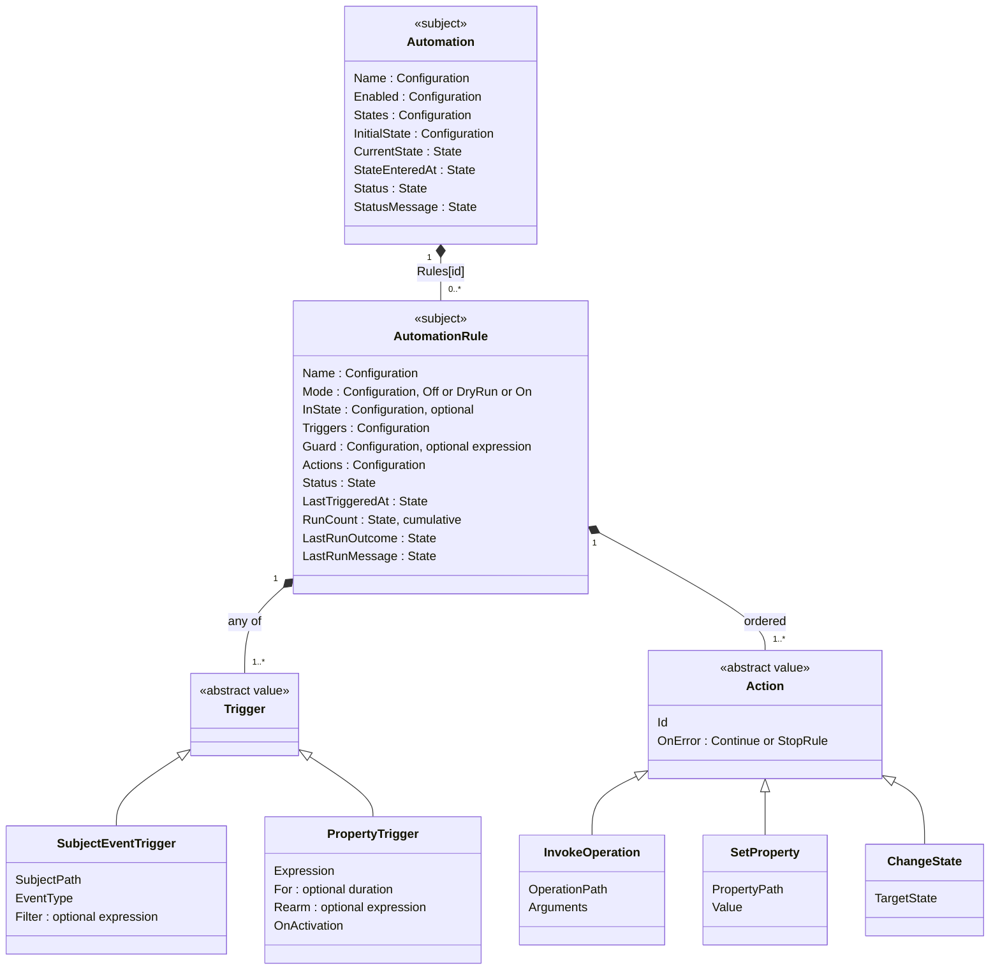

# Automation Design [Draft]

This is a design for configurable, deterministic HomeBlaze automations. It has not been approved for implementation. The examples below describe intended behavior, not an existing configuration schema. Keep design edits in `docs/superpowers/specs` at this stage; creating the permanent subject documentation, including the new `automation.md` page, is a deliverable of the subsequent implementation plan.

## Intent

One automation subject supports both independent rules and named-state workflows. A rule starts on one of its triggers, checks an optional guard, and runs ordered actions that invoke operations, write properties, or change the automation's own state. A state change can itself trigger another rule. The same model must support a Hue button starting Sonos playback, blinds retracting in a storm, a washing machine reporting the end of its cycle, day/night lighting, a sensor outage alert, and a door-open reminder that recovers after a restart.

The model is deliberately small. Time, staleness, and cooldowns are expressions over properties rather than dedicated rule options. Only behavior that needs memory an expression cannot hold, a minimum hold duration and hysteresis, is structured configuration.

The runtime reuses subject tracking, registry paths, operation metadata, `TextTemplate`, and `IMonitoredService`. It does not require an AI model or the planned global message bus.

## Approaches

| Approach | Tradeoff | Outcome |
|---|---|---|
| One composable automation subject with optional named states | A common rule model needs explicit trigger, guard, action, and ordering semantics. The same concepts support simple rules and state diagrams. | Selected. |
| Separate trigger and state-machine subjects with a shared engine | Similar to v1, but presents two authoring models for substantially overlapping behavior. | Not selected. |
| Arbitrary scripts as the primary automation model | Offers extensive freedom but makes visual editing, validation, inspection, and Native AOT support harder. | Deferred as a possible extension. |

States are named values, with no separate entry-action collection. State-entry behavior is an ordinary rule listening for a state change. The target state appears only in a `ChangeState` action, not in a second transition destination field.

## Agreed Semantics

- A rule has one or more triggers, combined with OR. Any trigger firing requests a run.
- A property trigger is one expression with an optional minimum hold duration (`For`), an optional rearm expression (`Rearm`), and an activation policy. Conditions are combined inside the expression with `and`, `or`, `not`, and grouping.
- A subject-event trigger fires on every matching occurrence, filtered by a payload expression.
- A rule has an optional guard: one expression without a hold, evaluated only when a trigger fires. A rejected request is consumed.
- Triggers fire on a false-to-true change, never on every reading. A trigger rearms when its expression is known false, or, with `Rearm`, when the rearm expression becomes known true.
- Expressions support arithmetic on numbers, instants, and durations, duration literals, `now`, and the local time of day `time`. Paths relative to the rule reach the rule and its automation.
- A missing value makes an expression unknown. Unknown never fires a trigger, never rearms it, never passes a guard, and is shown as a visible rule status rather than treated as false.
- A cooldown is a guard over the rule's `LastTriggeredAt`. The editor offers a cooldown shortcut that writes this guard.
- Each rule has a mode: `Off`, `DryRun`, or `On`. A dry run records what the rule would have done without executing anything. `TestNow` shows what the rule would do with the current values, in the UI and for agents.
- Each rule has ordered actions, mixing operation calls, property writes, and changes to its own automation state. String arguments are text templates.
- A rule can be restricted to a named current state. Without a restriction, it applies in every state, including an automation without named states.
- An automation persists its current state, its state-entry timestamp, and each rule's last trigger time in its own checkpoint file, not in its configuration. Offline time counts toward elapsed-time conditions.
- After a restart, device readings are unknown until the device reports. Rules that depend on them wait, without a separate freshness mechanism.
- A real state change is observable through `CurrentState` and a subject event containing the previous and new states. Restoring a checkpoint does not emit that event.
- An automation runs as its own principal. Authorization decides which operations it may call. Operations requiring confirmation are always rejected.
- Action errors are logged and recorded. The default action error policy is `Continue`; an action can select `StopRule`. Successful actions are not rolled back when a later action fails.
- `IMonitoredService.Status` and `StatusMessage` expose the latest failure. A subsequent fully successful run clears it; a trigger rejected by its guard does not. An error does not disable the automation.

The following detailed mechanics are proposals for review, rather than additional user requirements.

## Projects and Subjects

The automation depends on HomeBlaze services (path resolution, operation metadata, authorization, and data paths), so it follows the platform feature naming of `HomeBlaze.History` and `HomeBlaze.AI` rather than the `Namotion.{Name}` plugin convention:

| Project | Content |
|---|---|
| `HomeBlaze.Automation` | Subjects, runtime, event discovery, checkpoint store, service collection extension. No UI. |
| `HomeBlaze.Automation.Blazor` | Widget, edit component, and page component. |
| `HomeBlaze.Automation.Tests` | Rule, time, persistence, and lifecycle tests with fake operations and a controlled `TimeProvider`. |

The expression extension lands in `Namotion.Interceptor.Expressions` and stays free of application references.

### Subject Hierarchy



`Automation` is a `BackgroundService` that hosts the worker, and implements `IConfigurable`, `IMonitoredService`, `ITitleProvider`, and `IIconProvider`. It is offered in the create dialog with `[DisplayName("Automation")]`, a `[Description]`, a `[SubjectIcon]`, and `[Category("Automation")]`, a new group because none of the built-in groups fits.

Rules are child subjects in `Rules: Dictionary<string, AutomationRule>`, so their status is addressable, shown in the property panel, usable on pages, and recorded by history like any other state. The key is a stable identifier generated when the rule is created, never its user-editable name, so paths such as `/Automations/Storm/Rules[k3f9]/LastTriggeredAt` survive renaming and reordering; rule order is a separate configuration value. `AutomationRule` is `[ExcludeFromCreation]`. Triggers and actions are plain value objects inside the rule's configuration, serialized with explicit, stable type discriminators and statically registered JSON metadata; an unknown discriminator is rejected rather than replaced. Actions carry stable identifiers for run diagnostics.

### Runs and History

Runs are recorded through the existing history system instead of a run log of the automation's own. History records scalar `[State]` properties, and tracking suppresses equal values, so each rule exposes three of them:

| Property | Type | Purpose |
|---|---|---|
| `RunCount` | `long`, `[State(IsCumulative = true)]` | Increments on every recorded run, so every run is a history sample, also two identical ones in a row. Its `Delta` aggregation gives runs per hour or day. |
| `LastRunOutcome` | enum: `Succeeded`, `CompletedWithErrors`, `StoppedAfterError`, `RejectedByGuard`, `DryRun`, `Canceled` | The outcome of the last run. |
| `LastRunMessage` | `string` | A short summary: the executed actions with rendered arguments, the error of a failed action, or the missing paths of a rejection. |

The page lists recent runs from history: one entry per `RunCount` sample, with the outcome and message read at or before that sample's time, so repeated identical runs are shown correctly. Without a history store, the page shows only the last run of each rule. The automation's `CurrentState` is a `[State]` string as well, so history also gives a state timeline. Full errors remain in the normal logs; the message stays short and within the history's size limit for strings.

`CurrentState`, `StateEnteredAt`, `LastTriggeredAt`, and the statuses are `[State]` with internal setters, restored from the checkpoint and changed only by the worker. Configuration is edited only through the normal Save flow, so a Save can never overwrite runtime state.

### Operations and Queries

| Member | Kind | Purpose |
|---|---|---|
| `AutomationRule.TestNow()` | `[Query]` | Evaluates the triggers and the guard against current values and returns their results, the unknown paths, and the actions with rendered arguments. Executes nothing and records nothing. Agents reach it through MCP `invoke_query`, for example to explain why a rule did not run. |
| `Automation.ResetState()` | `[Operation]` | Changes to `InitialState` and clears the rules' `LastTriggeredAt`, publishing a state-change event like any real change. |

## Expressions

All predicates and computed values are expression strings parsed once with `Namotion.Interceptor.Expressions.ParsedExpression`. The grammar already supports comparisons, `and`, `or`, `not`, grouping, and three-valued evaluation, in which a comparison with a missing value is unknown and `x == null` tests for a missing value without being unknown. This design extends it.

### Arithmetic

The grammar reserves `+`, `-`, `*`, and `/` so that a later version can add arithmetic without changing what an existing expression means. This design fills that slot in the shared grammar, so pages and value maps gain arithmetic too:

- Numbers support `+`, `-`, `*`, and `/`.
- An instant minus an instant is a duration; an instant plus or minus a duration is an instant; durations add, subtract, and compare.
- Duration literals such as `30s`, `15m`, `2h`, and `8h30m`. Their lexical form must not change the meaning of an existing expression, such as a path segment that starts with a digit.
- An unknown operand makes the result unknown. Division by zero is unknown.

The library provides arithmetic and duration literals only; it has no clock. The host binds time variables through its expression context.

### Paths and Variables

The automation's expression context resolves absolute registry paths, and relative paths from the evaluating rule, the way page expressions resolve from their page: `./LastTriggeredAt` is the rule's last trigger time, and `../StateEnteredAt` or `../CurrentState` belong to its automation. It also binds:

| Variable | Bound to | Available in |
|---|---|---|
| `now` | The current UTC instant | Every automation expression |
| `time` | The local time of day in the host's configured time zone, as a duration | Every automation expression |
| `event` | The captured event payload, for example `event/ButtonState` or `event/NewState` | Event filters and the arguments of a run started by that event |
| `subject` | The publisher of the event, following the existing variable convention | Event filters and the arguments of a run started by that event |

In widgets and value maps, `value` is the value itself and has no members, which `ValueBindingContext` enforces. The payload is a record with fields, so it gets its own variable `event` instead of giving `value` members in one context only. An automation-specific `IExpressionContext` reads the payload fields of the discovered event types.

Automation expressions follow the displayability rules of page expressions: secret configuration values and properties marked `[ExcludeFromExpressions]` evaluate as missing. Otherwise a notification template could send a secret.

### Time

`now` and `time` are driven by `TimeProvider`. Active property triggers that reference them are re-evaluated every second, aligned to the wall-clock second, so a time-based change is noticed at most one second late. Guards, filters, and template arguments read `now` exactly when they are evaluated. Computing the next flip time instead of ticking is a possible later optimization. Wall-clock corrections and daylight-saving changes must be tested; elapsed times are UTC-based and `time` follows the host time zone.

`now - ../StateEnteredAt > 10m` replaces a dedicated elapsed-state-time property, and `time >= 8h30m and time < 21h30m` replaces a clock subject.

### Unknown Values

Unknown is a distinct outcome, never folded into false:

| Trigger expression | Fires | Rearms | Rule status |
|---|---|---|---|
| true | Yes, once the hold has elapsed | No | Triggered |
| false | No | Yes | Armed |
| unknown | No | No | Unknown since a given time, naming the missing paths |

The status is logged once per transition into and out of unknown. It is not an error: `IMonitoredService.Status` stays `Running`, because an offline sensor should not turn every dependent automation red. Outages are detected explicitly with `== null`, `IsConnected`, or `now - <subject>/LastUpdated`, which are not unknown in the cases they are written for.

A guard that evaluates to unknown rejects the request like false, recorded as `RejectedByGuard` with the missing paths in `LastRunMessage`. An input a rule must wait for therefore belongs in its trigger, not its guard, as the door reminder example shows.

## Triggers and Activation

### Subject Events

A subject-event trigger identifies a source subject, an exposed event type, and an optional payload filter. Every matching occurrence is eligible, even when two consecutive payloads are identical. A button press must not be implemented solely by comparing its last stored property value.

The event filter sees the captured payload. The guard reads the graph when the request is processed. A rejected event is consumed; a guard becoming true later does not replay it. Event subscriptions never replay old button presses after enabling, state entry, configuration reload, or process restart.

Events are discovered from the existing convention, without registration. A subject's event types are the `IObservable<T>` interfaces its type implements where `T` implements `IEvent`, such as `IObservable<ButtonEvent>` on Hue buttons and `IObservable<SwitchEvent>` on Shelly switches; both events derive from `DeviceEvent : IEvent` in `HomeBlaze.Abstractions`. Because `IObservable<out T>` is covariant, the runtime subscribes to any of them as `IObservable<IEvent>` without reflection. The payload fields offered to filters and arguments are the public properties of the event record, read once per type and cached, like operation metadata. The automation itself implements `IObservable<AutomationStateChangedEvent>`, whose payload holds the previous state, the new state, and the entry time. Plugin authors only need to follow the convention; HomeBlaze is not built for Native AOT, so the cached reflection is acceptable.

### Property Triggers

Parse the expression once and subscribe to all referenced properties, using the existing expression parser and tracking facilities. The expression is evaluated using the dependency values maintained for the observed change stream. This provides an admitted order per automation, not a global transaction across independent writers.

HomeBlaze's tracking suppresses writes of an equal value, so a trigger sees changes, not individual readings. Debouncing over consecutive readings is expressed as a hold of about one report interval, for example `WindGust > 8` for `20s`, rather than as a reading count.

A hold begins when the expression becomes known true and resets when it becomes false or unknown. When the hold has elapsed, the trigger requests one run and is disarmed. It rearms when the expression becomes known false, or, if `Rearm` is set, when the rearm expression becomes known true. A rearm expression provides hysteresis: with `WindGust > 8` and `Rearm WindGust < 6`, gusts moving around 8 trigger once per storm. A guard rejection consumes the request; guard changes alone do not generate another request.

Each trigger of a rule keeps its own arming state and hold. Two triggers firing in close succession produce two run requests; a cooldown guard limits the second when that is unwanted.

| `OnActivation` | Initial behavior |
|---|---|
| `EvaluateImmediately` | If the expression is currently true, start the hold and request a run when it elapses. The hold begins at activation rather than assuming earlier continuity. This is the default. |
| `WaitForFalseToTrue` | Establish the expression's current value as a baseline. If it is already true, wait until it becomes false and true again, then apply the hold. |

Activation occurs on startup, switching the rule's mode away from `Off`, a configuration change that replaces the trigger, source rebinding, or entry into the rule's applicable state. A rule with no state restriction stays active across state changes. Reentry creates fresh holds. Holds are not persisted across restart, because their continuity during downtime is unknown.

An immediate activation evaluation and the property notification of the same activating change must not produce two runs for one satisfaction cycle. Track activation generations and the trigger's armed state to distinguish a new occurrence from a second observation of the same result.

An unresolved source remains inactive with an actionable diagnostic. When the required source becomes available, establish a baseline and apply `OnActivation`. Rebind subscriptions when graph subjects are replaced or removed, without continuing to read a detached source.

## Guards and Cooldown

A guard is one expression evaluated when a trigger requests a run, immediately before the rule's actions. It has no hold and no subscriptions of its own, and its changes never start a run. It answers "only if", while triggers answer "when": a term such as `not Cover/IsMoving` in a trigger would fire the rule when the cover stops moving, rearm it when its own action starts a movement, and reset its hold on every movement.

`LastTriggeredAt` is set when the first action of a run starts, whether the actions then succeed or fail, so a failing device is not retried before the cooldown ends. Guard rejections, dry runs, and "Test now" do not set it. Before the first run it is null, so a cooldown guard must allow that case:

```
./LastTriggeredAt == null or now - ./LastTriggeredAt > 30m
```

The simple editor presents this as a cooldown duration and generates the guard. The advanced editor shows the expression; it switches back to the cooldown control only when the guard still has that exact form.

## Named States and Dispatch

`InState` is a structural activation scope, not an alternative syntax for a guard. Entering or leaving that scope activates or deactivates the rule's triggers, applies their activation policy, and invalidates their holds. A guard only filters an existing request. The proposed UI label is "Active in state"; hide it when no named states exist. State comparisons against another automation remain ordinary expressions.

`InitialState` is used only when creating an automation without a checkpoint or by `ResetState`. An unknown persisted or target state is a configuration or action error, never an implicit reset. A state name must be unique. A same-state `ChangeState` is a no-op: it does not reset the state-entry time or emit a new event.

Each automation serializes input processing and its actions on one worker. Subscription callbacks enqueue captured input and return; they do not run operations, await storage, or reenter the automation from a property setter or topology lock. Subject events retain their individual occurrences. Configuration versions and activation generations prevent queued input or expired holds from an earlier activation running against a replacement configuration or state.

Applicable rules are processed in configured order for one input. Each rule evaluates its filter and guard immediately before its actions. Multiple rules may run. Once a rule actually changes state, finish that rule's remaining actions, then stop processing that original input. A state change is not rolled back if a subsequent action in that rule fails. New state-change events and activation evaluations are queued until the current rule finishes.

One run comprises the whole dispatch of one input, including all eligible rules it executes. An error in an early rule survives a successful later rule in the same dispatch. Separately queued state-change events and activation requests are later runs. An input that executes no actions is not a successful run for clearing an earlier failure.

Changes caused by an automation may generate later inputs. The runtime must identify and report an unbounded feedback chain instead of allowing it to monopolize the worker; the chain limit is an implementation default. External subject events must not be silently coalesced or dropped as loop suppression. Input storage is bounded, with an explicit overload fault and resynchronization path. Separate automations have independent workers and no ordering promise between them.

## Checkpoint and Restart

The checkpoint holds `CurrentState`, `StateEnteredAt`, and each rule's `LastTriggeredAt`, `RunCount`, `LastRunOutcome`, and `LastRunMessage`, keyed by rule identifier. It holds no list, so its size does not grow with the number of runs; `RunCount` is persisted so that the cumulative counter keeps growing across restarts. It is runtime state, not configuration: a `[Configuration]` property would rewrite the whole configuration file, or the page an automation is placed on, on every trigger, and `IConfigurationWriter` writes the live subject, so a new value would be visible before it is saved.

Each automation owns one checkpoint file in a runtime folder of the data directory, next to `Root.json` and `Files`, like `DataProtection-Keys`. Its path mirrors the automation's path, for example `Data/Automations/Automations/Storm.json` for `/Automations/Storm`, and the folder is a new constant in `HomeBlazePaths`. The folder is not browsed storage, so the file is neither a subject nor visible in the UI. Deleting the automation deletes its checkpoint. Renaming or moving it changes its path, so it starts from `InitialState` with no trigger times, and logs that once.

The worker writes the complete checkpoint by replacing the file atomically, then publishes the new values and notifications. A successful `ChangeState` therefore publishes one state-change event with the old state, new state, and entry time only after the file is written, and follow-up rules are released only then. A failed write follows the action's error policy, leaves the in-memory state unchanged, and publishes no event; the next write rereads the file first. `LastTriggeredAt` is applied in memory when the run's first action starts and written in the same way; a failed write is recorded as a run failure, and the in-memory value still applies until a restart.

On restart, restore the checkpoint without a synthetic state-change event. Elapsed-time expressions use the persisted timestamps, so offline time counts and an overdue deadline is already true at startup. Device readings carry no state across a restart: they are null until the device reports, so expressions over them stay unknown and the rule waits. This relies on a convention that holds for every subject today and must be documented for subject authors: sensor readings are nullable, null until observed, and not restored from a cache at startup. A subject that breaks the convention can be guarded with `now - <subject>/LastUpdated < 1m`. Time-of-day expressions reconcile to the current period instead of replaying missed occurrences.

Checkpoint persistence and an external operation are not one transaction. Saving state does not provide exactly-once notifications or durable resumption of an action list. A crash between sending a notification and saving `Informed` may result in another notification after recovery. The first version does not retry rules automatically.

## Actions and Errors

`InvokeOperation` resolves registered operation metadata and its parameters, applies normal enabled restrictions, and awaits completion. Operations with `RequiresConfirmation` are rejected with an explanatory error, since an unattended automation cannot confirm. Reuse the public method metadata and conversion facilities, with no dependency on an AI or MCP implementation. Targets must be operations rather than arbitrary reflected methods.

`SetProperty` uses normal intercepted writes to a writable property. It cannot write configuration, another automation's state, or a read-only value.

`ChangeState` affects the owning automation only. Other automations can observe it; a generic property write cannot bypass the transition protocol.

### Arguments

Every string argument is a `TextTemplate`: text without `{{` is plain text, and `{{ expression }}` inserts a value, for example `Gust {{ /Weather/WS90/WindGust }} m/s`. A missing value renders as the same placeholder pages use, and the action still runs, so a notification about an outage can name the missing sensor. Every other argument is a constant or one expression; an expression that evaluates to unknown fails that action under its error policy. A record parameter, such as the `Notification` of `INotificationPublisher.SendNotificationAsync`, binds per member, following the operation dialog's form per member, so its string members are templates as well. Event-started runs evaluate arguments against the captured payload.

### Authorization

An automation runs as its own principal, and the authorization library (`Namotion.Interceptor.Authorization`, pull request #791) decides through its roles and rules which operations and properties it may use. A static deny, such as denying `Open` on the blinds for a storm automation, makes "never extend" a technical restriction rather than a convention. Authorization is checked when the configuration is validated and again when each action runs. Until the authorization library is merged, the only restriction is the `RequiresConfirmation` exclusion. A lock that depends on state and applies to every caller is outside this design.

### Errors

Each action has an error dropdown with `Continue` selected by default and `StopRule` as the alternative. Always log the failure with automation, rule, action, and source context, and record it in the rule's run properties. `Continue` attempts the remaining actions; `StopRule` skips them. `StopRule` does not stop unrelated rules that remain eligible for the original input, unless the failed rule already changed state. Neither policy rolls back successful actions or implies retry.

A run with any action, filter, or argument evaluation failure is unsuccessful even if later actions complete. A later run that executes actions and completes all of them successfully clears `StatusMessage` and restores `Running`. A guard rejection, unknown input, canceled stale request, or empty evaluation is not a successful run. While stopped or disabled, `Status` can be `Stopped` while the last error message remains available for the lifetime of the subject instance.

`LastRunOutcome` distinguishes succeeded, completed with errors, stopped after an error, rejected by the guard, dry run, and canceled. Cancellation from stopping, disabling, or replacing configuration is not an action failure and does not erase an earlier error. A run timeout is a recorded failure. An operation that does not cooperate with cancellation must not allow a replacement run to overlap it.

## Modes and Rule Status

| | `Off` | `DryRun` | `On` |
|---|---|---|---|
| Triggers observed | No | Yes | Yes |
| Actions executed | No | No, recorded as a run with outcome `DryRun` and the rendered arguments as message | Yes |
| `ChangeState` | No | Not executed, so follow-up rules do not run | Yes |
| `LastTriggeredAt` set | No | No | Yes |

A dry run does not simulate state changes; only the first step of a multi-step workflow is observable that way. `TestNow` works in every mode.

A rule's `Status` shows its mode and armed, holding with elapsed and required duration, triggered and waiting to rearm, or unknown with the missing paths. Its page also shows the last trigger time and the last run's outcome and message.

## Examples

The paths are illustrative. Each block is the intended configuration in editor terms.

### Washing Machine Finished

The memory "it was running" is a named state, so a standby reading after a restart does not report a finished cycle.

```
States  Idle, Running

Rule  Started     Active in state: Idle
  When  /Laundry/Washer/Plug/MeasuredPower > 500
  Do    ChangeState(Running)

Rule  Finished    Active in state: Running
  When  /Laundry/Washer/Plug/MeasuredPower < 5   For 10m
  Do    /Notifications/Family/SendNotification(Message: "Washing machine finished")
        ChangeState(Idle)
```

The ten-minute hold keeps the pump phase from reporting a finished cycle. After a restart in `Running`, the power reading is unknown until the plug reports, and the hold starts at the first reading, so a cycle that ended during downtime is reported about ten minutes after the restart.

### Storm

```
Rule  Retract blinds
  Triggers (any)
    When  /Weather/WS90/WindGust > 8    For 20s   Rearm /Weather/WS90/WindGust < 6
    When  /Weather/WS90/RainRate > 0    For 1m
  Only if  not /Living/Blinds/IsMoving and not /Living/Blinds/IsCalibrating
           and (./LastTriggeredAt == null or now - ./LastTriggeredAt > 30m)
  Do       /Living/Blinds/Close()
           /Notifications/Family/SendNotification(Message: "Blinds retracted: gust {{ /Weather/WS90/WindGust }} m/s, rain {{ /Weather/WS90/RainRate }} mm/h")
```

The automation's role denies `Open` on the blinds, so no edit of this automation can extend them.

### Day and Night

```
States  Day, Night

Rule  Morning   Active in state: Night
  When  time >= 8h30m and time < 21h30m
  Do    ChangeState(Day)

Rule  Evening   Active in state: Day
  When  time >= 21h30m or time < 8h30m
  Do    ChangeState(Night)
```

With `EvaluateImmediately`, a restart in the wrong period changes to the current one once, instead of replaying missed transitions.

### Door Reminder

```
States  Closed, Open, Informed

Rule  Opened    Active in state: Closed
  When  /Entrance/Door/DoorState == Open
  Do    ChangeState(Open)

Rule  Remind    Active in state: Open
  When  now - ../StateEnteredAt > 10m and /Entrance/Door/DoorState == Open
  Do    /Notifications/Family/SendNotification(Message: "Front door open since {{ ../StateEnteredAt }}")
        ChangeState(Informed)

Rule  Shut
  When  /Entrance/Door/DoorState == Closed
  Do    ChangeState(Closed)
```

The door state is part of the `Remind` trigger rather than a guard, so after a restart in an overdue `Open` state the rule waits for the first door reading: open sends immediately with the original deadline, closed lets `Shut` reset the state, and no reading keeps the rule unknown.

### Sensor Outage

```
Rule  WS90 silent
  Triggers (any)
    When  /Weather/WS90/Temperature == null           For 15m
    When  now - /Weather/WS90/LastUpdated > 15m
  Do    /Notifications/Family/SendNotification(Message: "WS90 has not reported for 15 minutes")
```

The first trigger covers integrations that empty their values when a sensor goes offline, as Ecowitt does for the WS90. The second covers a subject that keeps its last values, where it exposes `LastUpdated`.

## Authoring and UI

`HomeBlaze.Automation.Blazor` provides a compact widget, an edit component, and a page component. The page shows the automation's status, a read-only state diagram with the current state and its duration (hidden without states), the rules with their mode, live status, last trigger time and a "Test now" button, and the recent runs from history. It has an "Edit" button that opens the edit component as a dialog. No setup component is needed; the create dialog uses the edit component with `IsCreating`.

The edit component is a dialog with three tabs: General, Rules, and States. The Rules tab lists the rules in run order on the left and edits the selected rule on the right, in the sections "Runs when any of these happens" (triggers), "Only if" (guard and cooldown), and "Then, in this order" (actions). The States tab shows the state diagram with a panel for the selected state: its name, whether it is the initial state, the rules that enter, are active in, and leave it, and a delete button that is disabled while rules use the state.

The edit component implements `ISubjectEditComponent`, initializes its local draft once in `OnInitialized`, and applies changes only in `SaveAsync`. Because runtime state lives in the checkpoint and `[State]` properties, saving a draft of names, rules, triggers, actions, or diagram positions cannot replace it. Editing a form or dragging a graph node must not execute device commands.

Use one reusable expression component for triggers, rearm expressions, guards, event filters, and expression arguments, in a reusable UI layer below the host. It shows simple rows with the current value and result of each row, or the advanced expression, with a toggle between them. It supplies the appropriate field catalog: event filters choose payload fields, such as `event/ButtonState`, and other expressions choose subject/property paths with `SubjectPathField` and the variables. All persist expression strings and validate them with the shared parser. The current `ExpressionEditDialog` in `HomeBlaze.Host` wraps `SubjectPathPicker` and is a starting point, not a complete boolean builder.

The canonical representation of each expression is its string. The simple editor presents rows of field, operator, and value combined with AND or OR, and generates the string; it does not persist a second model. The advanced editor exposes the expression directly. Switch back to simple controls only when they can represent the expression faithfully; otherwise keep advanced mode and preserve the expression unchanged. Holds, rearm expressions, activation policy, state scope, and typed actions remain structured configuration, and the cooldown control is a view over the guard.

Operation actions use registry operation metadata for their parameters, including records with a form per member. Every action exposes its error dropdown, and property triggers expose `OnActivation` with immediate evaluation selected.

The state diagram uses the diagram facilities already referenced by `HomeBlaze.Components`. The rule list is canonical, and diagram edits must not create a second transition store. A rule containing `ChangeState` produces an edge from its state restriction to that target, with its other actions shown alongside it. Rules without a simple source/target pair remain visible in the rule list rather than being forced into a misleading edge.

Validate names, references, expression syntax, event types and payload fields, operation parameters, authorization, and action policies in `ApplyConfigurationAsync` before applying a new immutable configuration snapshot. A malformed configuration is reported without partly installing new subscriptions or abandoning a still-valid running configuration. A missing runtime device is a resolvable source/target issue, distinct from invalid syntax.

The [interactive editor prototype](https://homeblaze-automation-editor-01a197c0.clear-macaw-9363.chatgpt.site/) illustrates rule editing, state diagrams, and activity inspection, but predates this design: it shows one trigger per rule, a hold per condition, and the earlier "While in state" label.

For migration coverage from v1, the reference implementations are `TriggerThingSetup`, `ButtonTriggerThingSetup`, `AutomationSetup`, and the state/transition dialogs. Their condition/hold editing, event filtering, ordered operations, named states, transitions, initial state, and state-entry behavior map to the model above, with state-entry behavior as ordinary state-change rules. Automatic conversion of v1 configuration is out of scope.

## Acceptance Scenarios

| Scenario | Required outcome |
|---|---|
| Hue button release | Every matching release, including repeated identical events, invokes the configured Sonos operation. Other gestures are filtered out. |
| Washing machine | A cycle above 500 W followed by ten minutes below 5 W sends one notification. The pump phase does not. Standby after a restart in `Idle` sends nothing. |
| Storm | A gust held for the hold duration retracts the blinds once; gusts around the threshold do not retrigger before the rearm expression is true. Rain also triggers. The guard rejects a run while the blinds move. A second trigger within the cooldown is rejected, also after a restart. |
| Day/night | Day begins at 08:30 and night at 21:30 in the host time zone, including across a daylight-saving change. Startup reconciles an incorrect saved state to the current period. |
| Door reminder | Closed to open changes state. Expiry while still open sends the notification and changes state to informed. Closing before expiry returns to closed. |
| Door reminder after restart | Restoring an overdue open state waits for the first door reading. Open sends immediately without restarting the deadline; closed sends nothing; no reading keeps the rule unknown. Restoring informed does not emit another entry event. |
| Unknown values | A missing input never fires, rearms, or passes a guard, and the rule shows the missing paths. `== null` and `now - LastUpdated` conditions detect outages. |
| Expressions | Arithmetic on numbers, instants, and durations evaluates as specified, existing expressions keep their meaning, and triggers referencing `now` or `time` flip within one second under a controlled `TimeProvider`. Secret and excluded values evaluate as missing. |
| Templates | Notification text renders current values, including in record members; a missing value renders the placeholder and the action still runs. An unknown non-string argument fails the action. |
| Run history | Every run, including two identical ones in a row, increments `RunCount` and is listed on the page from history with its outcome and message. Without a history store the last run is shown. The checkpoint file keeps a constant size. |
| Modes and test | A dry-run rule records a run with outcome `DryRun` and the rendered arguments, and changes nothing else, including state and `LastTriggeredAt`. `TestNow` returns the evaluation through the UI and `invoke_query`, and executes and records nothing. |
| Authorization | An action denied for the automation's principal fails validation and execution. An operation requiring confirmation is rejected. |
| State-change trigger | A real change publishes old/new state and can start rules in the same or another automation. Follow-up rules in the same automation wait for the current rule's action list. |
| Action errors | `Continue` attempts remaining commands, `StopRule` skips them, and neither undoes an already changed state. The latest failure survives later successes within that run. A later fully successful run clears it; guard rejections do not. |
| Checkpoint | A failed checkpoint write publishes no state change. A restart restores state and trigger times without events. Renaming the automation starts from `InitialState`. A Save in the editor never changes runtime state. |
| Lifecycle | Source replacement, mode changes, configuration edits, cancellation, and pending hold callbacks cannot execute stale work or leak subscriptions. |

## Scope and Validation

The first version includes the subjects and runtime, event discovery from `IObservable<T>`, property triggers with holds and rearm, guards, the three action types with templated arguments, rule modes and `TestNow`, the checkpoint file, arithmetic and time variables in expressions, authorization integration once available, the editor with state-diagram projection, and run properties recorded by history. It does not include arbitrary scripts, history functions in expressions, a sun subject, state-dependent locks for all callers, dry runs with simulated state, computed deadlines instead of the one-second re-evaluation, exactly-once delivery, persistent action continuations, automatic retries, parallel action execution, a new message bus, or automatic conversion of v1 configuration.

Prefer the existing expression interpreter and cached metadata over new reflection on hot paths or dynamic compilation. New public APIs and configuration shapes require the appropriate snapshots and serialization compatibility tests. The implementer chooses concrete API names, exact queue limits, and data structures while preserving the contracts above.

Verification covers the acceptance scenarios with controllable clocks and event synchronization, including observed property pulses, holds, rearm hysteresis, unknown transitions, feedback chains, rapid source replacement, checkpoint write failure, and restart. The arithmetic extension needs parser and evaluator tests for precedence, units, unknown propagation, and unchanged meaning of existing expressions. Use integration tests targeted to HomeBlaze UI for the authoring work, including round-tripping rule and diagram edits. Core rule tests use fake operations and clocks rather than physical devices. No benchmarks or long-running connector tester runs are required.

## Deliverables

Following `create-homeblaze-library`:

1. `HomeBlaze.Automation`, `HomeBlaze.Automation.Blazor`, and `HomeBlaze.Automation.Tests`, added to `src/Namotion.Interceptor.slnx`, referenced from `HomeBlaze.csproj`, and registered in `Program.cs` through a service collection extension and `TypeProvider.AddAssembly` for both assemblies.
2. The arithmetic and duration extension in `Namotion.Interceptor.Expressions`, with its tests and public API snapshot.
3. The authorization integration, planned against pull request #791 and enabled once it is merged.
4. A sample automation under `Data/Files`, configured in `DryRun` mode so that it does not act on real devices.
5. Documentation, described below.

## Documentation Delivery

The implementation plan must include creating a new `automation.md` page in the HomeBlaze subject documentation under `src/HomeBlaze/HomeBlaze/Data/Files/Docs`, in the folder the existing structure suggests, and linking it from Subjects, the documentation index, and implementation status as appropriate. Do not create or edit product documentation during the design phase.

Document the rule and state model, triggers, holds, rearm, activation policies, guards and cooldowns, unknown values, expressions with arithmetic, time variables and relative paths, simple and advanced expression editing, ordered actions, templates, error handling, modes and `TestNow`, authorization, the checkpoint and restart behavior, diagnostics, and the examples in this spec. Include the subject diagram and editor guidance. Separate user-facing behavior from implementation rationale, with one canonical location per concept and cross-references. Verify the examples, local links, and rendered diagrams against the implementation.

The page ends with a Missing Features chapter, following the device pages, that lists at least:

- History functions in expressions, such as the maximum of a property over the last hours. Named states cover the washing machine without them.
- A sun subject with sunrise and sunset instants for light rules.
- A lock that depends on state and applies to every caller, such as nobody extending the blinds during a storm. Static denies through authorization cover only the automation itself.
- Dry runs that simulate state changes, so a multi-step workflow can be observed end to end.
- Computed deadlines instead of re-evaluating time-based triggers every second.
- Keeping the checkpoint when an automation is renamed or moved.
- Event descriptors: optional metadata for event types, such as display names, descriptions, and units of payload fields, or a hidden field. Discovery from `IObservable<T>` shows the record's property names as they are.
- Restoring a property from its history at startup, which would interact with the null-until-observed convention.

The arithmetic extension changes existing documentation: the library's `docs/expressions.md` and HomeBlaze's `administration/pages.md` and `administration/page-errors.md` state that arithmetic is not supported. The null-until-observed convention for sensor readings goes into `development/building-subjects.md`, and the new data folder into the installation or configuration documentation.

## Existing Building Blocks

- `HomeBlaze.Abstractions.IMonitoredService` and `ServiceStatus`: lifecycle status and error text.
- `HomeBlaze.Services.HomeBlazePaths`: data directory layout, extended with the checkpoint folder.
- `Namotion.Interceptor.Tracking`: observable, queue, and per-property change subscriptions, with equal writes suppressed.
- `Namotion.Interceptor.Expressions.ParsedExpression`: parsed dependency paths, three-valued evaluation, and the reserved arithmetic slot.
- `Namotion.Interceptor.Expressions.TextTemplate`: text with `{{ }}` expressions for action arguments.
- `HomeBlaze.Services` scoped path resolution (`ResolveScopedValue`): relative paths from the rule.
- `HomeBlaze.Abstractions.Common.ILastUpdatedProvider` and `HomeBlaze.Abstractions.Networking.IConnectionState`: inputs for outage conditions.
- `HomeBlaze.Abstractions.Metadata.MethodMetadata`, `HomeBlaze.Services.RegisteredSubjectMethodExtensions`, `OperationAttribute.RequiresConfirmation`, and `[Query]`: operation metadata, invocation, the confirmation exclusion, and `TestNow` through MCP `invoke_query`.
- `HomeBlaze.Abstractions.Messaging.INotificationPublisher`: the notification operation in the examples.
- `Namotion.Interceptor.Authorization` (pull request #791): roles and allow/deny rules for the automation's principal.
- `HomeBlaze.Abstractions.Messaging.IEvent` and `HomeBlaze.Abstractions.Devices.DeviceEvent`, with `ButtonEvent` and `SwitchEvent`: the event convention; `HueButton` and `ShellySwitch` are existing `IObservable<T>` sources.
- `HomeBlaze.History` with `HistoryEligibility` and `IHistoryStore.GetSampleAtOrBeforeAsync`: recording and reading the run properties.
- `SubjectPathField`, `ExpressionEditDialog`, and the diagram dependencies of `HomeBlaze.Components`: authoring UI foundations.

## Review Points

The semantics above capture the design discussion. The worker and rule-selection details, the lexical form of duration literals, the checkpoint file format, and the UI projection are author proposals that the implementation plan may refine. The arithmetic extension changes the shared expression grammar used by pages and value maps, and the authorization integration depends on pull request #791; both are planned as separate steps.
