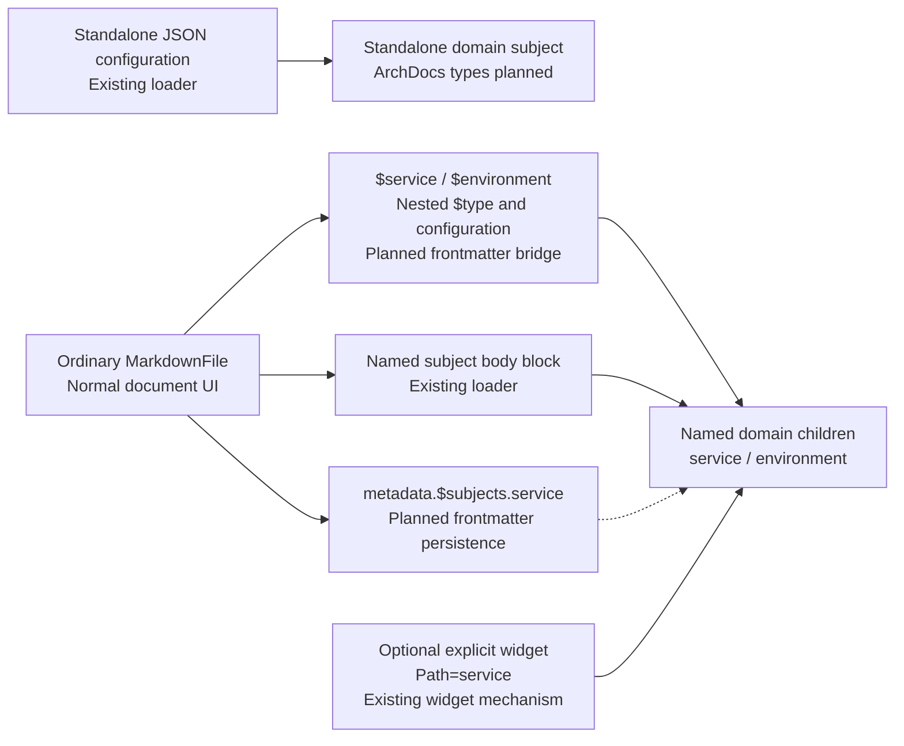

# Markdown Subject Authoring [Planned]

Define domain subjects without creating a specialized Markdown document type.

## Implementation readiness

**Delivery:** Requires the HomeBlaze extensions identified below; standalone JSON subjects and explicitly embedded widgets can be delivered independently.

**Prerequisites:** MarkdownFile load/write lifecycle, configurable subject serialization, metadata persistence, and shared named-child identity.

## Existing entry points [Implemented]

Standalone JSON configuration and registered IConfigurable subjects in explicit Markdown blocks already exist. Blocks use C# property casing; JSON subject files use camelCase. Ordinary Markdown rendering and page navigation remain available.

MarkdownFile already exposes its Children dictionary through InlinePaths, so a child named `service` has the path segment `service`. The registry path writer emits that inline segment too. Reuse this behavior for frontmatter children and their scoped metadata; the missing work is the frontmatter declaration and persistence bridge, not a new child-path syntax. See [scoped metadata paths](../shared/metadata-and-relationships.md#scoped-metadata-paths-planned) for normalization and write requirements.

## New entry points [Planned]

Top-level $name frontmatter child declarations and the metadata envelope are not implemented. Extend parsing, named-child publication, configuration writeback, metadata writes, and refresh identity together. These features are not prerequisites for JSON subjects or explicitly embedded widgets.

Direct file editing is a first-class authoring path under the [file-authoring requirement](../file-authoring.md). UI writes and source edits must produce the same model. Preserve unrelated Markdown, frontmatter, metadata, and supported comments, and avoid unnecessary whole-document reformatting. Invalid declarations must remain available for correction with source-located diagnostics; ordinary prose and links must remain useful without richer rendering.

Exact naming rules for the new frontmatter schema must be settled; the sample currently illustrates camelCase configuration. Do not assume the existing body-block naming choice automatically decides frontmatter naming.

## Detailed behavior [Planned]

Markdown remains an ordinary MarkdownFile with its normal renderer, editor, navigation, expressions, and blocks. A top-level frontmatter key `$<name>` defines a child subject named `<name>`. Its value contains the registered subject's `$type` and configuration using the standalone configuration schema. The child name is independent of its type: `$orders` could define a Service just as `$service` can. Multiple named children are supported in one document. Exact registered type names remain builder choices.

```yaml
---
title: Orders
$service:
  $type: Namotion.ArchDocs.Service
  name: Orders
  componentSources: []
$environment:
  $type: Namotion.ArchDocs.Environment
  name: Staging
---
# Orders
Regular documentation here.
```

The document and its domain children are distinct subjects. No domain-specific MarkdownFile subclass or declared page type is needed. Domain subjects do not inherit MarkdownFile or depend on Markdown storage. The file owns their configuration persistence and provides its origin for relative file access; domain subjects must not infer that origin from the process working directory. A page that only describes an existing service can instead reference it through metadata without defining another instance. Keep domain logic headless and Blazor contributions in separate UI code. Custom page subclasses are deferred; if introduced later, they must inherit MarkdownFile and retain normal Markdown behavior.



JSON subjects and Markdown children reuse the same registered domain types and configuration schema; the ArchDocs types themselves remain planned. Frontmatter and body blocks share the child-name namespace. Scoped metadata enriches the child, and an optional widget reads it while the containing document keeps its normal Markdown behavior.

Reuse registered configurable-subject loading and normal lifecycle rules for these children, as existing inline blocks already do. Their stable identity is their declared child name, independent of the entry's position in the source. Frontmatter and named inline subjects share the page's child-name namespace: duplicates must produce diagnostics rather than silently shadow or instantiate competing definitions. Reserve framework keys such as `$type` so they cannot accidentally become child declarations, and validate declaration names and values. Same-name, same-type refreshes preserve compatible children; removed children detach and type changes replace subjects through normal lifecycle handling. Invalid or unavailable types need visible diagnostics and preservation of source content, while the document remains readable. UI configuration edits route back to the corresponding `$<name>` entry through the owning file's configuration writer. Exact storage interfaces and recovery behavior are builder choices.

Named children appear directly in authored paths. A declaration named `$service` is addressed as `service` from its page, including `metadata.$subjects.service`; the dollar sign belongs only to the declaration. A widget can use `Path=service` to refer to the same subject. Declaration names must remain unambiguous with published page properties, which take precedence during path resolution; diagnose collisions rather than publish a child whose intended name addresses another target. Generated descendants retain their own published collection segments.

A service-summary widget reads the Service child without rendering the Markdown body again. The page's context slot and link previews can discover applicable contributions from its defined children, while keeping the page as the navigation target. Domain links and selectors can address the child explicitly; a page link is not silently rewritten into a service reference. Keep generic widget cycle protection intact. Defining a service as a child allows a widget in its parent document to refer to that child without referring back to the containing Markdown page.

Use one metadata model and API with two persistence representations. JSON subjects keep metadata in their existing sidecar; Markdown keeps it under `metadata` in frontmatter. Frontmatter is the canonical metadata store for a Markdown document, including scoped entries for its defined children and their generated descendants; do not introduce an additional active metadata sidecar for that document. Page metadata belongs to the document, and child-scoped metadata belongs to the defined subject. Existing page display/navigation frontmatter remains supported. Define how those existing fields relate to metadata without creating two independently editable copies of the same value.

Extend Markdown loading to read generic child declarations and metadata in addition to the existing fixed display fields; FileSubjectFactory can continue choosing MarkdownFile by extension. The current inline parser accepts registered configurable types, preserves compatible named subjects, and writes configuration edits back into their blocks. Reuse those contracts and suitable helpers for frontmatter rather than introduce a competing subject lifecycle. Frontmatter definitions contribute children without inserting render segments into the Markdown body. Frontmatter edits through the UI must preserve the body and unrelated keys. Use the existing metadata API for metadata changes, and the configuration writer for declared configuration. Each write must serialize with other writes to the same document. Child definitions, configuration, metadata, and content must come from a compatible load; invalid or superseded loads cannot publish a mismatched combination.

Moving a definition into JSON reuses the same domain type and configuration schema. Its persisted enrichment must move with it, and path-based references must be updated when its canonical path changes. Automatic extraction and identity-preserving relocation tooling are not MVP requirements. The original page can then describe the standalone subject through a metadata relationship.

Typed relationships are structured metadata, with a kind and target reference and optional descriptive data such as technology or a label. Their source defaults to the owning subject: page metadata originates at the document, while child-scoped service metadata originates at that service. A typed reader exposes those entries to graph queries and widgets. Provider-produced relationships remain discovered state with provenance. Authored relationship edits reconcile the effective graph through the same change-driven pattern; they do not require independent relationship JSON files.

Supported ordinary Markdown links should supply a planned reference index for backlinks, [impact exploration](../widgets/impact-view.md), and reference-validation findings. A link alone does not assert a runtime dependency or establish the truth of surrounding prose. Target mapping, source locations, and index invalidation need implementation. A general Markdown prose-extraction provider remains deferred; structured frontmatter and existing subject blocks provide explicit architectural authoring independently of it. MVP inclusion is still open.

## Related specifications

[Overview and status legend](../overview.md) · [Platform readiness](../implementation-readiness.md)
