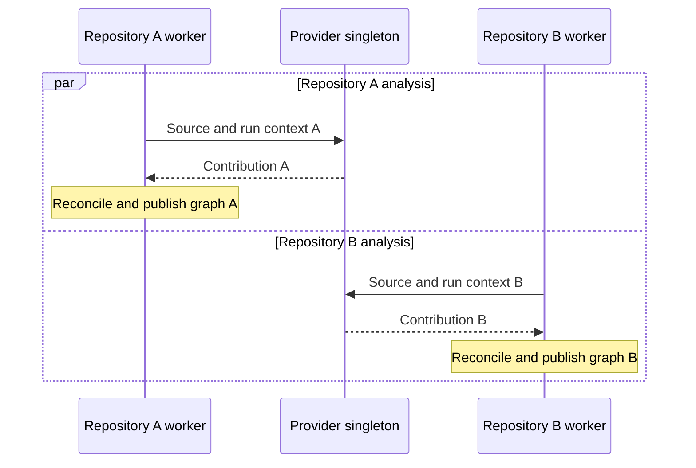

# Provider Extension Model [Planned]

Providers are shared [Provider subjects](../subjects/provider.md) that [SourceRepositories](../subjects/source-repository.md) explicitly select for read-only discovery. Several repositories can select the same singleton subject without cloning it or transferring its ownership.

## Implementation readiness

**Delivery:** Can be implemented through existing subject and component extension points. The ArchDocs feature itself is not implemented.

**Prerequisites:** Ordinary subject/type and DI/module registration, publication of the shared Provider subjects in the loaded graph, explicit repository selections, and repository-owned reconciliation. Existing registration primitives do not implement ArchDocs selection or define provider graph lifetime.

## Contract [Planned]

A provider subject declares capabilities and applicability and exposes its shared configuration. A repository invokes a selected provider with that repository's explicit source boundary, supported run options, and cancellation. The invocation returns identities, facts, references, diagnostics, and provenance to the repository owner. Multiple providers can enrich or link the same element; do not duplicate a Host merely because container and language providers both describe it.

Use normal typed subject and DI/module registration. No separate executable plugin loader is required. The [Provider subject specification](../subjects/provider.md) defines the proposed app/root scope, shared settings, concurrency, identity, and subject-specific UI. Being registered or present in the graph does not automatically select a provider or start source analysis.

SourceRepository configuration contains an `providers` list of records with a `path` to one shared Provider and optional repository-specific `config`. Its read-only `resolvedProviders` state contains compatible subject references. Omitted or empty configuration selects none. Run options stay beside the reference in the same entry and do not mutate the shared subject. See the [repository configuration example](../subjects/source-repository.md#configuration-properties-proposed-schema). Exact option schemas remain proposed, and the shared scalar [Identifier](../shared/identifiers.md) syntax decision remains open. A name or generic subject link alone cannot supply an executable provider capability.

For repository discovery, the repository owns its source access boundary, analysis status, diagnostics, results, generated subjects, reconciliation worker, and cancellation. Reconciliation publishes compatible results through that owner. Other consumers retain their own result owners; standalone contract parsing does not move authored Contract state under a repository. The shared provider holds no mutable last-repository result or repository-owned worker. One repository canceling or detaching must not cancel another repository's call.

### Shared execution and separate owners [Planned]

Each repository resolves its proposed `providers` into `resolvedProviders` before invoking a compatible subject. Calls to the singleton may overlap, while each repository keeps its own worker, cancellation, and publication. DI registration, graph publication, selection, and execution are separate steps; registration alone performs none of the latter three.

## Categories [Planned]

- [C# project provider](csharp-provider.md): basic solution/project XML, source/build groupings, and project-level elements.
- [Contract file discovery](contract-discovery.md): raw file recognition, same-directory project association, and explicit-definition precedence independently of parsing.
- [C# public API provider](csharp-api-provider.md): optional programming API Contract extraction.
- [OpenAPI provider](openapi-provider.md): optional OpenApiContract parsing.
- [Protobuf provider](protobuf-provider.md): optional ProtobufContract parsing.

Container packaging, further languages, other contract formats, and remote sources can be added later without changing Service semantics. Version comparison and compatibility analysis are separate capabilities.

## Scheduling and failures [Planned]

Initial and explicit repository refresh are planned for the candidate project slice. Automatic file-change refresh is proposed, coalesced by the repository owner; events only invalidate the inventory. Selection changes and changes to a selected provider's configuration, capability, or availability invalidate dependent repository work. Concurrent callers must remain isolated, and superseded calls cannot publish after their inputs change. An unresolved or unavailable required provider produces repository diagnostics and retains the last successful graph.

Per-repository successful publication is atomic, failures retain the last successful graph, and repository detach fences stale publication. Deliberately removing a provider selection reconciles its former contributions only through a complete successful pass. See [reconciliation](../shared/reconciliation.md), [path queries](../shared/path-queries.md), and [SourceRepository](../subjects/source-repository.md) for the owner contracts.

## Related specifications

[Provider](../subjects/provider.md) · [SourceRepository](../subjects/source-repository.md) · [Overview and status legend](../overview.md) · [Platform readiness](../implementation-readiness.md)
