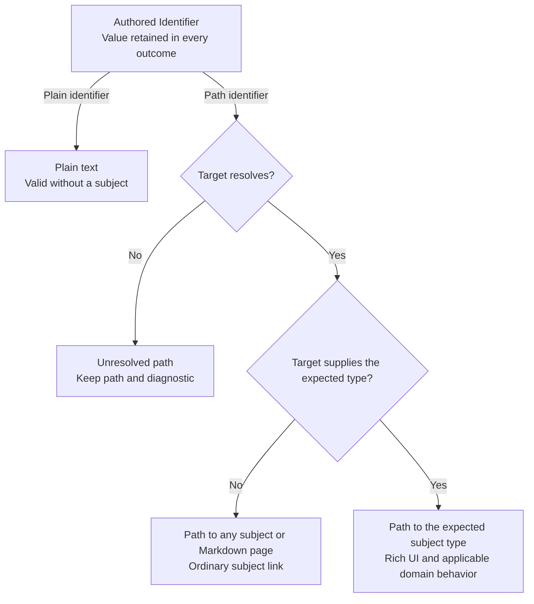

# Identifiers [Planned]

An Identifier names a concept in scalar configuration. It can remain a plain string, point to any subject or ordinary Markdown page, or resolve to the expected subject type. All three are identifiers. Resolution adds available information and behavior; it does not require a different domain meaning or a mandatory subject for every classification.

Identifier describes the shared semantics here, not an implemented CLR type or a selected serialization format. Exact syntax remains open.

## Resolution and presentation [Planned]

| Level | Example meaning | Available presentation |
|---|---|---|
| Plain identifier | Technology `PostgreSQL`, environment `production`, or a project identifier | Display the identifier and use it as authored data without requiring a corresponding subject. |
| Path to any subject | A technology Markdown page or an environment described by a generic subject | Render an ordinary subject link and available title/summary information, even without a specialized domain type. |
| Path to the expected subject type | A CodeProject or Environment reference resolving to that type | Reuse the specialized subject presentation and applicable domain behavior. |

A generic subject target is valid for the second level. It does not become an error merely because the richer expected type is unavailable. Preserve the authored identifier independently of display titles and optional resolved references. An identifier must remain readable and editable before its target subject or supporting module exists. An unknown `$type` definition still follows the loader's diagnostics and source-preservation contract; accepting an identifier does not instantiate an unavailable type.

A Markdown document and its named domain children remain separate targets. A path to the page supplies generic document navigation; a path to its typed child enables that child's domain presentation. Do not silently rewrite a page identifier into a child identifier.

An unresolved path retains its authored value and a visible resolution diagnostic. It must not silently become a plain identifier because its target disappeared, nor change back and forth between literal and path meaning based on current graph contents. The selected syntax must make that distinction deterministic. A target that resolves generically can still provide a link while a missing typed capability is shown as unavailable.

These are resolution levels of the same Identifier concept; serialization syntax remains undecided. Structural operations still require the actual compatible subjects described below.

## Domain behavior [Planned]

Each property documents its optional expected subject type and which operations need it. A plain environment identifier can describe an association before an Environment subject exists. Generating Environment-owned Deployments still requires the actual owning Environment and its selected DeploymentUnits. A generic subject link does not fabricate an Environment, CodeProject, membership, or installation. Collection selectors remain governed by [path queries](path-queries.md); this identifier convention does not turn unresolved text into collection members.

Do not conflate title, identifier text, subject locator, and persistent target identity. Equality, alias handling, grouping across documents, rename/move behavior, and the scope of a plain identifier still need design. No global name registry or automatic name lookup has been selected.

## Applicable scalar fields [Planned] / [Proposed schema]

Use this pattern for scalar classification and descriptive concept fields, such as Service/Resource kind and technology, Host runtime and packaging, and Interface protocol and technology. It can also support scalar associations such as an environment or project identifier. Related property tables link here and retain their expected type where one is known. Exact property names and concrete API types remain proposed; no mandatory Kind or Technology subject hierarchy is selected.

Names, free prose, versions, protocol addresses, and raw source file locations keep their documented meanings. A file input such as an OpenApiContract's `path` selects source bytes and uses file-origin rules; it is distinct from a subject identifier. An Identifier-valued classification remains in the master-data group, while structural associations follow it in the references group.

## Syntax options [Proposed]

The syntax decision is deferred. Candidate representations are:

- **Recognizable path prefixes:** `/`, `./`, or `../` identify a subject path; other strings remain plain identifiers. Familiar and compact, but path-looking literal identifiers need an escaping or explicit-literal analyzer.
- **Explicit reference marker:** a prefix such as `@` marks a subject path. Keeps scalar strings and supports otherwise ambiguous paths, but reserves a marker and needs an escaping analyzer.
- **Explicit reference object:** a shape such as `{ "$ref": "/environments/Production" }` distinguishes references from plain strings. Clear to tooling, but more verbose and no longer a scalar in the serialized file.

These are options to refine, not accepted reference syntax. Relative reference scope, validation, literal escaping, property naming, and any automatic resolution of plain identifiers remain to be defined. Do not infer support for a candidate merely from these examples.

## Implementation readiness

**Delivery:** Planned shared authoring, resolution, and presentation behavior. No Identifier implementation exists as part of ArchDocs.

**Prerequisites:** A selected representation, property-level expected-type metadata, optional subject resolution, generic link presentation, and preservation through configuration readers/writers. Existing subject path resolution and path pickers provide useful primitives; literal-or-path interpretation and graceful generic/typed presentation require explicit implementation.

## Verification criteria [Planned]

Retain a plain identifier with no target; link to an ordinary Markdown page; upgrade presentation when a target supplies the expected type; preserve generic navigation when it does not; retain unresolved paths with diagnostics; and keep the stored value unchanged as targets attach, detach, or change available capabilities. Confirm that typed graph operations stay unavailable until their required compatible subjects resolve.

[File authoring](../file-authoring.md) · [Metadata and relationships](metadata-and-relationships.md) · [Overview](../overview.md)
