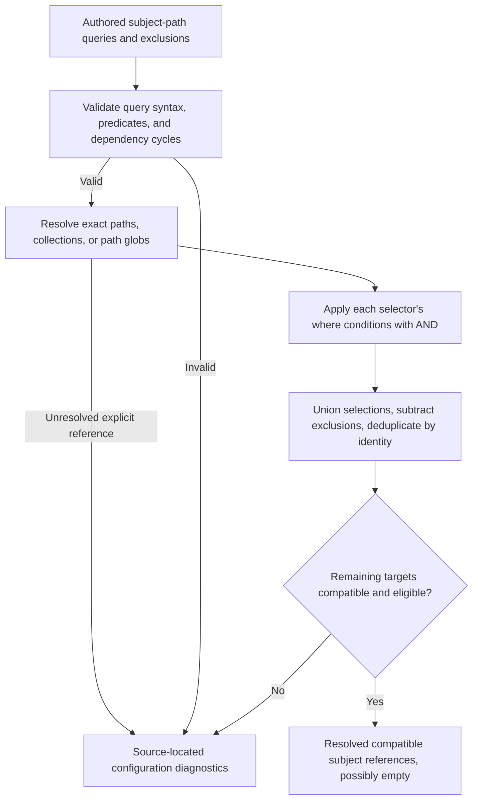

# Path Queries [Planned]

A reusable selection mechanism, independent of source language or domain type.

## Implementation readiness

**Delivery:** Can be implemented as a domain/shared extension using the existing resolver and expression facilities; general path-glob queries do not exist yet.

**Prerequisites:** Exact subject-path resolution and property expressions exist; selection, glob semantics, diagnostics, and dependency invalidation are planned.

## Implementation boundary [Planned]

Do not extend the HomeBlaze page shell to implement selectors. Keep exact paths usable while adding generic collection/wildcard selection in an appropriate library. A widget can consume the same query service as a subject. Repository file paths and subject graph paths are distinct address spaces.

Follow the [file-authoring requirement](../file-authoring.md): selectors and references must be understandable and editable as text, with documented scope, target derivation, casing, wildcard behavior, and defaults. Surface malformed/unresolved references with a source file and relevant key or location. Runtime graphs and UI pickers may help, but must not be the only way to understand what a path selects.

## Detailed behavior [Planned]

A path-query entry resolves subjects from an exact subject path, a collection-property path, or a subject-path pattern, then optionally applies a `where` property predicate. An exact collection path produces its members; an explicit `/*` can also select those immediate members. The mechanism should be usable outside this domain rather than restricted to an Artifact base class. Repository file-location predicates remain separate from subject-path matching.

Filters within one selector combine with AND. Proposed default: a list of selectors combines by set union; exclusions subtract from that result; results are deduplicated by identity. Support explicit references as the simplest selector. Deployment-unit selections validate release-participant eligibility rather than accepting only Hosts; environment selections validate that their results are deployment units. A wrong result kind produces a diagnostic rather than being converted into another kind of entity. Rule-suite queries explicitly enumerate compatible [Rule subjects](../subjects/rule.md) so a page/directory/global wildcard can filter out folders and ordinary documents; an exact incompatible Rule target still produces a diagnostic. This typed enumeration policy does not change other consumers' result-validation contracts.

Consumers reference resolved subject properties through ordinary paths. A deployment unit can therefore select `service/hosts`, with no separate `selection` or `from` field. Proposed default: detect cyclic query dependencies and report invalid configuration; do not recursively expand them forever.

Source paths are repository-relative file locations. Subject paths identify subjects in the object graph. Namespaces are another future filter. These must not be silently treated as the same address space.

The current checkout has subtree matching in AgentWatchPaths, path-prefix/type/property filtering in the MCP search tool, and name wildcards in NuGetPackageNameMatcher. It does not have a general reusable path-glob matcher. Reuse the applicable behavior without introducing a dependency on the AI or NuGet plugin assembly. The NuGet matcher's `*` matches one or more characters and has no path-segment semantics, so it cannot be adopted as a path matcher unchanged.

Path globs use `/` separators, `*` within a path segment, and `**` across path segments. `*` does not cross a segment boundary, and `**` can span zero or more segments. Wildcards match subject-path segments or keys rather than display names; property conditions use `where`. Remaining matching rules, including casing and empty matches, must be specified once and tested by the implementation. The builder may choose an existing suitable dependency after checking the repository's requirements.

**Selection pipeline [Planned]**

This conceptual pipeline shows the planned query behavior, not a fixed evaluation algorithm or selected serialization syntax. Globs match subject graph paths: `*` stays within a segment and `**` spans zero or more segments. Raw source file inputs use their own address space, and selecting a subject does not add its transitive dependencies. Structural operations require compatible resolved targets; plain identifiers and generic links do not supply those capabilities.

Selectors determine membership. Dependencies outside the selected scope remain external relationships and are not automatically added. Transitive membership expansion is deferred. Project references describe code dependencies; they do not by themselves establish runtime communication between services. Authored architectural relationships and their evidence remain distinguishable from discovered code-reference edges.

Unresolved explicit references and invalid predicates are diagnostics. A syntactically valid selection with no matches is an empty result, distinguishable from failed analysis. A temporary input failure must not erase the last successful discovered graph or the authored selection.

Proposed default: successful publication is atomic per repository. An incomplete directory listing, a required source read failure, or a malformed project that prevents analysis fails that repository's pass and retains its entire last successful graph. Other repositories can publish independently. Preserve the failure diagnostics separately; on an initial failed pass there is no successful graph to show yet. A complete pass can publish confirmed removals. An unresolved condition or reference that the static analyzer intentionally represents as unknown is a diagnostic on a successful pass, not a reason to pretend the pass failed. Partial per-project stale-result merging is deferred.

## Related specifications

[Overview and status legend](../overview.md) · [Platform readiness](../implementation-readiness.md)
