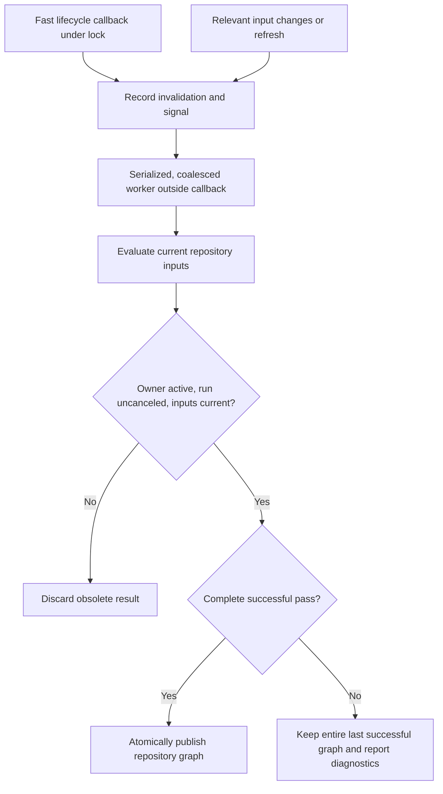

# Generated Subject Reconciliation [Planned]

Maintain generated subjects without recreating compatible instances on every refresh.

## Implementation readiness

**Delivery:** Can start in the extension library using existing lifecycle/tracking. Shared helper extraction is optional; no new HomeBlaze shell feature is required.

**Prerequisites:** Stable owner keys, serialized/coalesced work, correct attach/detach behavior, and caller-controlled ownership policies.

## Status boundary

Existing subjects already perform reconciliation. The proposed shared ArchDocs/helper API is [Planned]. A new Namotion.Interceptor.Utils package is a candidate, not an existing dependency or an implementation prerequisite.

## Detailed behavior [Planned]

SourceRepository owns discovery results. Environment owns Deployment children. Each uses shared keyed reconciliation infrastructure to preserve matching instances, add missing subjects, remove subjects no longer desired, and publish replacement collections only when needed. Do not recreate all subjects on each refresh or mutate an already-published collection in place.

Selected [Provider](../subjects/provider.md) singletons are shared input references, not repository-owned generated children. Reconcile provider selection and relevant provider changes without cloning the instances. Deselecting a provider or detaching a repository releases that repository's subscriptions/work rather than disposing a provider still used elsewhere. Repository publication must fence runs using obsolete selections or configuration; shared provider invocation must not mix results, diagnostics, or cancellation between repositories.

Lifecycle attach/detach and property-reference changes provide invalidation signals. Relevant configuration/property changes also trigger reconciliation because a subject can remain attached while its selection or filter match changes. An initial reconciliation accounts for already attached inputs. Subscription establishment and the initial snapshot must not miss concurrent changes.

Lifecycle callbacks are fast, exception-free bookkeeping and signaling. They run under the lifecycle lock. Do not perform file analysis or substantial graph changes directly inside these callbacks. A serialized worker re-evaluates current inputs and publishes changes outside the callback. Coalescing is allowed provided it cannot lose the final invalidation.

The owning subject's detach stops subscriptions and background work. Canceled or superseded work cannot republish children for an owner that is no longer active. Inputs changing during a pass schedule a later pass or invalidate that pass's publication. Once writes and source changes settle, generated collections agree with the current successfully evaluated inputs.

**Repository worker and publication [Planned]**

This is the planned SourceRepository publication flow. Invalidation during a pass remains pending for a later pass; detach or cancellation fences publication. An incomplete pass keeps the entire previous successful graph, with failure diagnostics separate; before the first success there is no graph to retain. Confirmed removals, including deliberate provider deselection, publish only after a complete successful pass.

Use stable keyed dictionaries for generated children, not positional arrays. Proposed default: repository element keys derive from a repository identity, provider identity namespace, element kind, and normalized repository-relative identity. A project-file move is a removal and addition unless a later explicit identity mapping preserves it. Do not claim rename detection that the provider does not implement. Unchanged files retain keys across root relocation and restart.

Deployment keys derive from the environment and deployment-unit identities. Persist authored identities or use the existing persistent subject reference conventions consistently; do not use discovery order, transient object references, display names, or timestamps as persisted keys. Exact serialized identifier fields and reference formatting are builder decisions, and their rename behavior must be documented.

Use the existing path-reference patterns to reference subjects without inadvertently creating ownership cycles or extra canonical parents. Where an actual shared subject collection is useful, follow the existing shared-child ownership and detach rules.

Shared infrastructure is a helper or library API, not a new domain subject. Domain-specific selection and object creation remain with the owner. The exact placement should avoid introducing application dependencies into the core libraries or granting cross-library internal access.

### Reuse beyond ArchDocs

The shared-helper direction also applies to existing implementations. Sonos preserves players and groups by identity; Hue preserves discovered devices and builds rooms and zones; SunSpec reuses units and compatible model subjects; FritzBox preserves clients and access-point memberships; installation client reconciliation merges configured clients with live connections; storage and Markdown reloads preserve file and widget subjects when their identities and types remain compatible. These are candidate consumers, not a commitment to migrate all of them as part of this MVP.

There is already repeated dictionary equality by key and reference identity in HueBridge.DictionaryEquals, SonosSystem.HaveSameEntries, SunSpecDiscovery.HaveSameUnits, and StorageReconciler.AssignChildren. This is a narrower initial extraction than a complete discovery coordinator. FritzBox also demonstrates why caller policy matters: an absent client remains for one more poll so its departure can be recorded before detach. Installation clients retain named entries even when disconnected. A generic helper must not assume every missing item is immediately removed or disposed.

Proposed default: separate collection reconciliation primitives from work scheduling and lifecycle bindings. Collection primitives can cover identity comparison, reuse versus replacement, creation, caller-controlled retention, and returning the original published collection when membership and instance identity are unchanged. Allocate replacement collections lazily where practical. The caller owns synchronization, publication, subject-state updates, and disposal/ownership policy; the helper does not promise a transaction across mutable child properties.

A second helper can coalesce invalidations, serialize passes, preserve invalidations arriving during a pass, and fence obsolete work. Storage's ReconcileTrigger provides an existing reference, but its path batching, quiet periods, retries, and storage-refusal behavior are not all universal defaults. Subscription/lifecycle integration belongs in a layer that already depends on tracking or hosting. Pure collection helpers should have no dependency on storage, UI, device protocols, or the tracking runtime; Namotion.Interceptor itself is a possible eventual home.

Candidate placement: a dedicated `Namotion.Interceptor.Utils` library for reusable subject helpers, including selection and keyed reconciliation where their dependencies fit. No such project exists in the current checkout. Keep its public API headless and independent of ArchDocs, storage, and device implementations. Keep pure collection primitives separate from helpers that require tracking or hosting, and do not make the core library depend on the utility package. Final package naming, dependency boundaries, and any later promotion of primitives into core remain implementation-design decisions.

Proposed rollout: establish the small contracts against SourceRepository and Environment and validate them against at least one representative existing reconciliation use before declaring the API broadly reusable. Agree any existing-consumer migration separately; avoid coupling the architecture MVP to a repository-wide refactor. Core publication is a later API-placement decision unless the extraction clearly fits the existing dependency graph and is approved with the design.

Connector CollectionDiffBuilder produces ordered transport patches rather than maintains discovered child identity, and LifecycleInterceptor reconciles references under its own graph invariants. Similar terminology does not make those implementations interchangeable with the proposed collection helper. Reuse individual primitives there only when their contracts actually match.

## Related specifications

[Overview and status legend](../overview.md) · [Platform readiness](../implementation-readiness.md)
