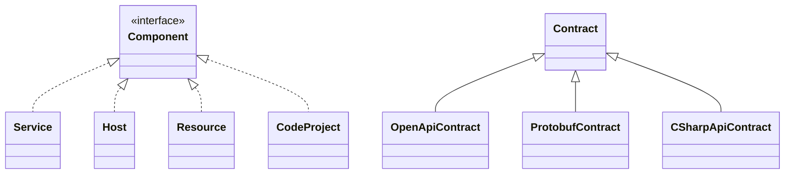
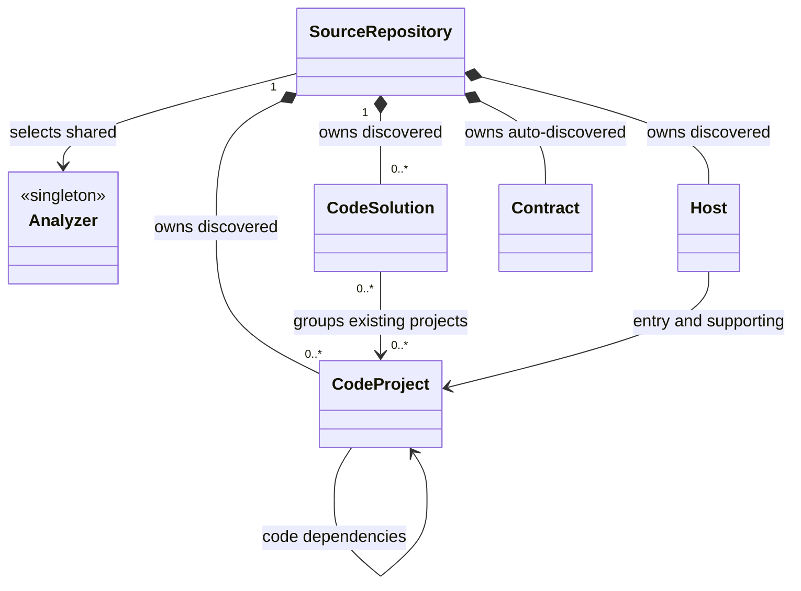
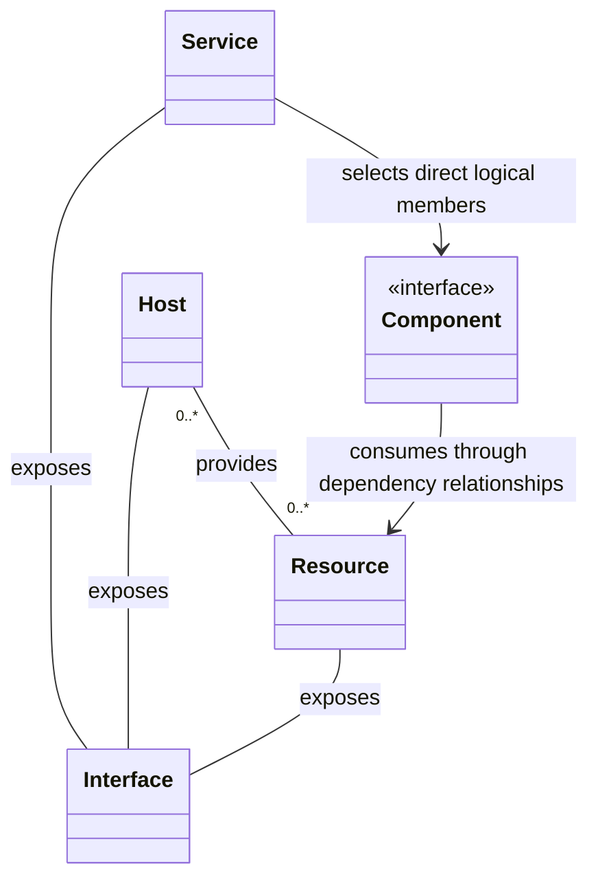
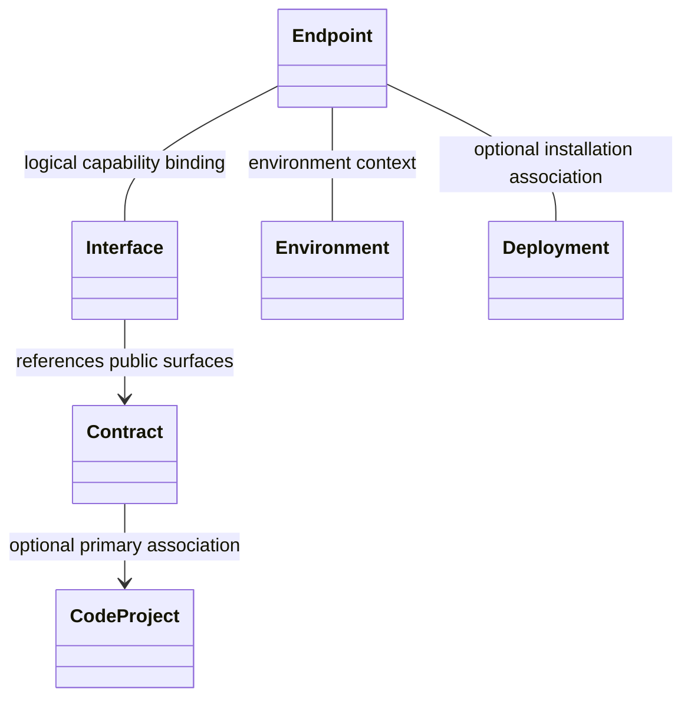
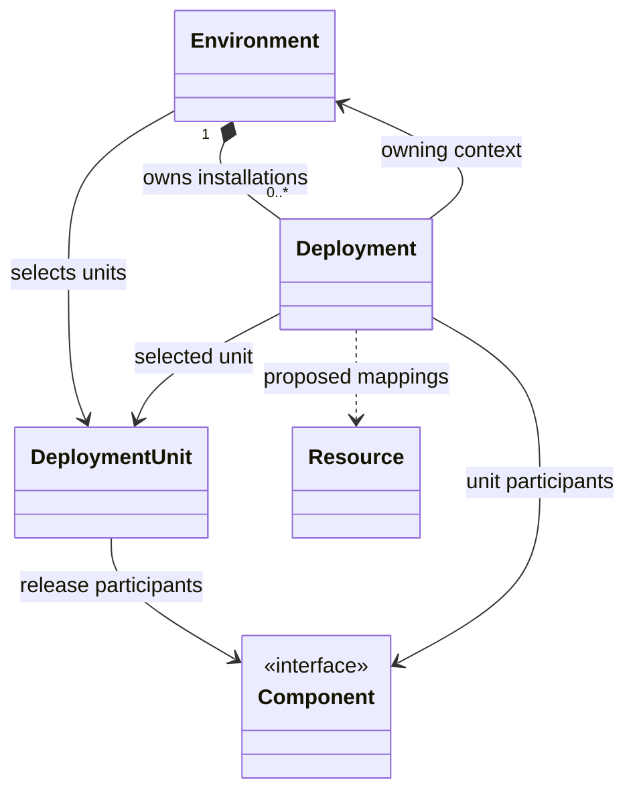
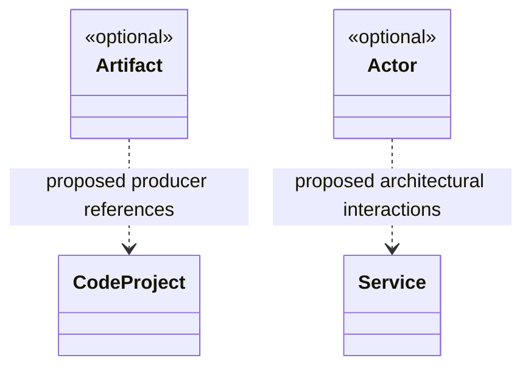

# Subject Model [Planned]

These conceptual UML views cover every subject and capability in the ArchDocs specification. They separate capability realization, discovery ownership, architectural membership, access, and intended installations so each view can be read independently. They describe planned semantics, not implemented CLR types or an approved implementation plan. The linked subject specifications remain canonical for configuration, read-only state, presentation, and unresolved schemas.

## Subject inventory

| Area | Subjects and capabilities |
|---|---|
| Shared capabilities | [Component](subjects/component.md), [Analyzer](subjects/analyzer.md) |
| Source discovery | [SourceRepository](subjects/source-repository.md), [CodeSolution](subjects/code-solution.md), [CodeProject](subjects/code-project.md) |
| Logical architecture and access | [Host](subjects/host.md), [Service](subjects/service.md), [Resource](subjects/resource.md), [Interface](subjects/interface.md), [Endpoint](subjects/endpoint.md) |
| Public surfaces | [Contract](subjects/contract.md), [OpenApiContract](subjects/openapi-contract.md), [ProtobufContract](subjects/protobuf-contract.md), [CSharpApiContract](subjects/csharp-api-contract.md) |
| Release and installation | [DeploymentUnit](subjects/deployment-unit.md), [Environment](subjects/environment.md), [Deployment](subjects/deployment.md) |
| Optional later concepts | [Artifact](subjects/artifact.md), [Actor](subjects/actor.md) |

## Diagram legend

| Notation | Meaning |
|---|---|
| `..\|>` toward Component | Realizes the Component interface capability; no concrete base class or ownership is implied. |
| `--\|>` toward Contract | Selected Contract specialization inheritance; the base's concrete/abstract shape and exact CLR declarations remain open. |
| `*--` with the diamond at the owner | Canonical ownership of the described generated subjects. |
| `-->` or `--` | Reference or association, preserving subject identity and ownership. Labels identify the relationship; an arrow identifies the referencing side when useful. |
| `..>` with a proposed label | Proposed relationship whose schema or inclusion remains open. |
| `<<optional>>` | Optional later concept, without selected Component participation. |

All diagrams are [Planned]; explicitly proposed relationships and optional concepts remain [Proposed]. Multiplicities appear only where the subject specifications establish them. An omitted multiplicity leaves that detail open. Relationships do not select diagram membership or an internal/external classification; those belong to each view.

## Capabilities and Contract inheritance [Planned]

Component marks participation in architectural composition. It declares no shared composition, Contract, Interface, or resource-provision members. Service, Host, Resource, and CodeProject retain their own contracts and owners. The separate Contract hierarchy describes public surfaces, including programming APIs that need no Host, network Interface, or Endpoint.

Analyzer has a separate shared subject capability with an open CLR interface/base-class shape. No Component participation is selected for Analyzer, CodeSolution, Artifact, or Actor. Absence from this inheritance view does not prevent an ordinary subject from appearing in queries or diagrams.

## Discovery ownership and source grouping [Planned]

A SourceRepository selects existing shared Analyzer singleton subjects within the loaded root. Several repositories can select the same instance; selecting it neither clones it nor transfers ownership. Each repository owns its own analysis work, diagnostics, results, and discovered children. The Contract ownership edge below applies only to auto-discovered Contracts, and the Host edge only to discovered Hosts. Authored Contracts and Hosts retain their separate defining owners.

Solution membership is many-to-many. A project can belong to several solutions or none; removing a solution does not remove an independently discovered project. A CodeProject can contribute to zero or many Hosts, while a library needs none. Source grouping and code dependencies do not establish runtime calls, logical Service membership, or release membership. Identity and reconciliation follow the [shared reconciliation specification](shared/reconciliation.md); exact persistence and rename rules remain proposed.

## Logical membership, provision, and exposure [Planned]

Services select Component references, including other Services, Hosts, Resources, and CodeProjects. Direct membership can overlap and does not transfer ownership. The resolved Host subset includes only directly selected Hosts; selecting a Resource or nested Service does not expand its underlying Hosts. Host-to-Resource provision is optional and many-to-many, independently of logical membership or consumption.

A Resource can be useful without a known providing Host. A Service can also select a database Host directly when no separate logical Resource is needed. Interface exposure uses ordinary associations here: its canonical relationship location, ownership, and cardinalities remain open in [Interface](subjects/interface.md). Internal/external classification belongs to a diagram, rather than a Service flag.

## Contracts and environment access [Planned]

A Contract's optional primary CodeProject association supplies the project's read-only inverse Contract collection. An Interface references public-surface Contracts without owning copies. An Endpoint supplies environment-specific access details for a logical Interface and can optionally identify a Deployment. The Endpoint associations below describe compatible typed references when resolved; plain descriptive identifiers do not create missing subjects.

These associations choose no Interface or Endpoint ownership, persistence, or unresolved cardinalities. Endpoint address and protocol-binding schemas remain proposed. A configured address expresses intended access; it does not establish connectivity or observed health. See [Contract](subjects/contract.md), [Interface](subjects/interface.md), and [Endpoint](subjects/endpoint.md) for their canonical association and resolution contracts.

## Release membership and intended installations [Planned]

A DeploymentUnit selects explicit release participants through Component references. Eligibility remains a separate schema decision: Component participation alone does not make a library deployable. Neither Service membership, provision, nor consumption automatically adds release participants. Environment selections generate one enduring Deployment per selected unit, rather than a Cartesian product of every environment and unit in the graph.

Each Deployment references its actual owning Environment and selected DeploymentUnit. The environment/unit pair identifies the intended installation; exact key representation and rename behavior remain proposed. Reconciliation reuses that subject while selected and removes confirmed deselections. This describes current intended installations, not rollout history, provisioning, execution, or health. Authored enrichment follows the Environment's metadata writer; resource mapping and component-version binding schemas remain open in [Deployment](subjects/deployment.md).

## Optional outputs and actors [Proposed]

Artifact and Actor are optional later concepts. Artifact keeps a produced output separate from a CodeProject, runnable Host, or deployed version. Actor represents an architectural person or role, independently of user accounts. Producer relationships and interaction endpoints remain proposed; the illustration does not select their exact schemas or restrict all Actor interactions to Services.

No inheritance from Component or implicit deployment participation is selected for either optional concept. [Artifact](subjects/artifact.md) and [Actor](subjects/actor.md) retain their open identity, ownership, relationship, and presentation decisions.

## Related specifications

[Overview and subject index](overview.md) · [Scope and design decisions](scope-and-decisions.md) · [Path queries](shared/path-queries.md) · [Metadata and relationships](shared/metadata-and-relationships.md) · [Reconciliation](shared/reconciliation.md)
