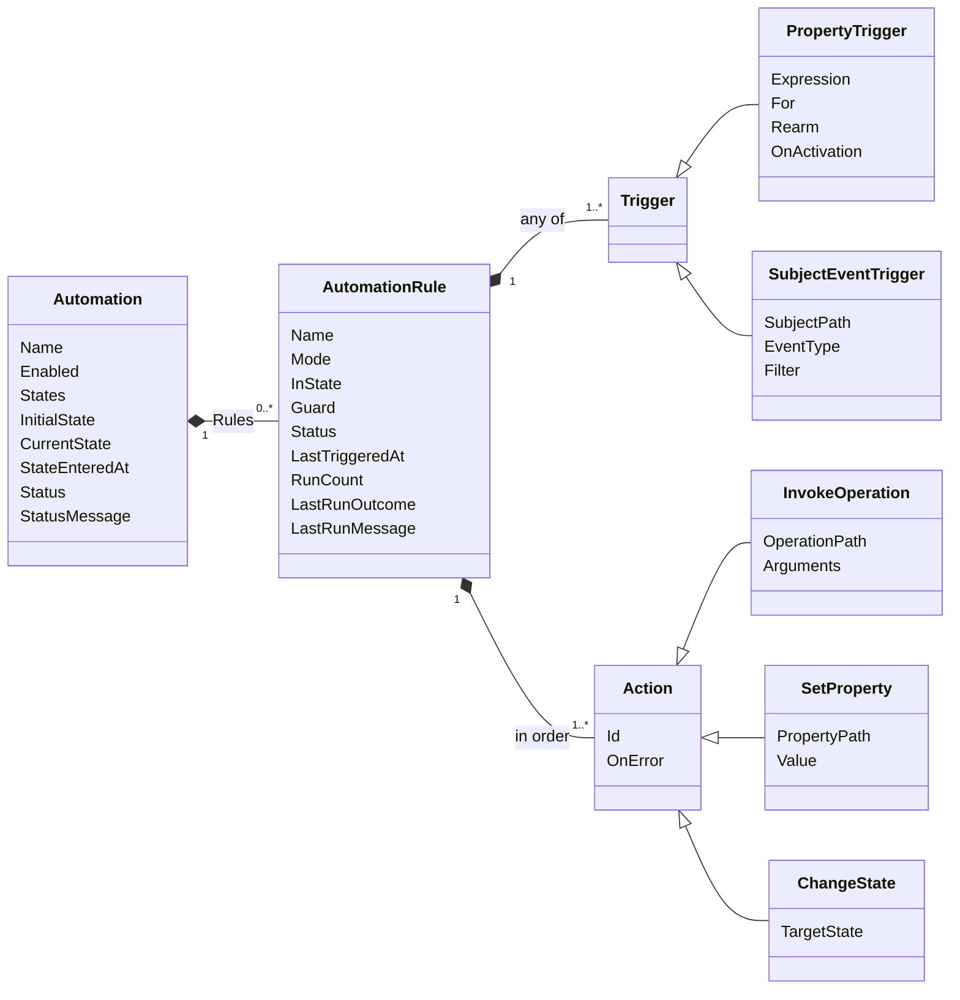

# Automations

An automation is a subject that runs rules. A rule starts when one of its triggers fires, checks an optional condition, and then runs its actions in order: it calls operations of devices and services, writes properties, or changes the named state of its automation. Named states let a few rules form a small workflow, such as a washing machine that is idle or running. Automations run inside HomeBlaze without an AI model, and they keep their state across restarts.

This page is the operator guide. The syntax of expressions is the one of [page expressions](pages.md#live-expressions), the checkpoint files are in the [data folder](configuration.md#data-folder), and why device readings start empty is explained in [Building Subjects](../development/building-subjects.md#readings-are-null-until-observed).

---

## Quick start

1. In the subject browser, create an **Automation** from the group Automation, for example in a folder `Automations`.
2. Open its page and click **Edit**. In the **Rules** tab, add a rule, write its condition under **Runs when any of these happens**, and add an action under **Then, in this order**. Save is available once nothing is invalid or unfinished.
3. Keep the rule in **Dry run** and save. Each time the rule would run, the page lists the run with its actions and their values, and nothing is executed.
4. Switch the rule to **On** once its runs look right.

The demo data has `Demo/ConveyorGuard`, an automation in dry run over the demo conveyor: both rules are Dry run, which never changes the state, so the automation stays in Normal and shows what it would do: it would slow the conveyor down and enter Hot when the temperature stays above 40 for 30 seconds (at most once every 10 minutes, rearming once it is below 38), and would return to Normal when it stays below 37 for a minute.

---

## Rules and states



- **Rules** process each input in the order of the Rules tab, and several rules can run for one input. Each rule has a key such as `k3f9` that never changes, so that its path, such as `/Automations/Storm/Rules[k3f9]/LastTriggeredAt`, stays the same when the rule is renamed or moved in the list.
- **States** are optional names, such as `Idle` and `Running`. A rule can be **Active in state**: it observes its triggers only while the automation is in that state, and it starts again with fresh holds each time the automation enters it. A rule without a state is active in every state, also in an automation without states.
- **The initial state** is the state of a new automation and the state that **Reset state** on the page enters. Reset state also clears the last trigger times of the rules.
- **A state changes** only through a **Change state** action of a rule of the same automation. Once a rule changed the state, it finishes its own actions and the rules after it skip that input; the rules after it that would have run for that input are recorded as **Canceled** runs, and the rules of the new state see the inputs that follow. The outcome Canceled is also recorded when a feedback chain overflows or the automation stops. What should happen when a state is entered is an ordinary rule with an event trigger on the state changes of the automation, see [Events](#events).

---

## Triggers

A rule has one or more triggers and runs when any of them fires. Each trigger keeps its own hold and arming, so two triggers that fire shortly after each other request two runs; a [cooldown](#only-if-and-cooldown) limits that.

### Property conditions

A property condition fires when its expression changes from not true to true, never on every reading:

| Field | Meaning |
|---|---|
| **When** | The condition, such as `/Weather/WS90/WindGust > 8`. Conditions are combined with `and`, `or`, `not` and parentheses. |
| **For at least** | A hold: the condition must stay true this long before the trigger fires, such as `20s`, `10m` or `1h30m`. The hold restarts when the condition becomes false or unknown. Empty fires at once. |
| **When the rule starts** | **Run if already true**, the default: when the rule becomes active and the condition is true, the hold starts then. **Wait for a change**: a condition that is already true when the rule becomes active does not fire until it has been false and true again. With **Run again only after**, it waits for the rearm condition instead of plain false, and the status reads "Already true, waiting to rearm" until then. |
| **Run again only after** | A rearm condition. After the trigger fired, it fires again only once this condition is true, instead of once the condition is false. With `/Weather/WS90/WindGust > 8` and `/Weather/WS90/WindGust < 6`, gusts that move around 8 fire once per storm. |

A rule becomes active when the automation starts, when its mode leaves Off, when a saved change replaces its trigger, and when the automation enters the state the rule is active in. Holds start again after a restart, because the time a value held during the downtime is unknown.

Tracking ignores a write of an equal value, so a trigger sees changes, not readings. To require a value over several readings, use a hold of about one report interval, such as `WindGust > 8` for `20s`.

### Events

An event trigger fires on every event of one type that a subject publishes, also when two events in a row are the same, such as a button released twice:

| Field | Meaning |
|---|---|
| **From** | The subject that publishes the events, or **This automation**, whose events are its own state changes. |
| **Event** | The event type, such as `ButtonEvent` of a Hue button or `SwitchEvent` of a Shelly switch. The dropdown shows the name with its words split, such as "Button", and the configuration stores the type name `ButtonEvent`. A subject publishes the event types `T` of the `IObservable<T>` interfaces it implements. |
| **Only events where** | A filter over the event, such as `event/ButtonState == Release`. The rows of the filter offer the fields of the event. |

`event` is the event and `subject` its publisher, as in `event/ButtonState` or `subject/Name`. The arguments of the actions of a rule with an event trigger can read both; they hold the event that started the run. A state change of an automation has the fields `event/PreviousState`, `event/NewState` and `event/Timestamp`, and restoring the state after a restart raises no event.

Events are never replayed: an event from before the rule became active, or one that [Only if](#only-if-and-cooldown) rejected, is gone.

---

## Only if and cooldown

**Only if** is one condition, checked once, against the current values, when a run starts. It answers "only if" where triggers answer "when": a change of it never starts a run, and a run it rejects is gone. A rule without it runs on every trigger.

**At most once every** is a cooldown, such as `30m`. The editor writes it into the condition as `./LastTriggeredAt == null or now - ./LastTriggeredAt > 30m`, joined to the rest with `and`, and shows it as a duration again as long as the condition keeps exactly that form. `LastTriggeredAt` is set when the first action of a run starts, also when the actions then fail, so that a failing device is not retried before the cooldown ends. Rejected runs, dry runs and Test now do not set it. A dry run still checks Only if first.

Put a value the rule must wait for into its trigger and not into Only if: an Only if that is unknown rejects the run.

---

## Unknown values

A value is missing when its path leads nowhere or the value is null, and device readings are null until the device reports them. An expression that needs a missing value is unknown, which is never the same as false:

| The condition is | The trigger fires | The trigger rearms | The rule status |
|---|---|---|---|
| true | Yes, once the hold elapsed | No | Holding, then Triggered |
| false | No | Yes, without a rearm condition | Armed |
| unknown | No | No | Unknown since a time, with the missing paths |

With a **Run again only after** condition, a false expression does not rearm: only a true rearm condition does, even while the expression is unknown.

An Only if that is unknown rejects the run, recorded as **Rejected by Only if** with the missing paths. An unknown rule is no error, so the automation keeps its status. To detect an outage, write it out: `/Weather/WS90/Temperature == null` is true while the value is missing, and `now - /Weather/WS90/LastUpdated > 15m` covers a subject that keeps its last values and implements `ILastUpdatedProvider`.

---

## Expressions

Conditions, filters and the arguments of actions are expressions with the syntax of [page expressions](pages.md#live-expressions):

- **Paths** are absolute, such as `/Weather/WS90/WindGust`, or start at the rule: `./LastTriggeredAt` is a property of the rule, and `../CurrentState` or `../StateEnteredAt` one of its automation.
- **Variables**: `now` is the current instant, `time` the local time of day of the host, `event` the captured event and `subject` its publisher. `event` and `subject` are available in event filters and in the arguments of a rule with an event trigger only; in a rule with both kinds of trigger, they read as missing on a run that a property trigger started.
- **Arithmetic**: numbers add, subtract, multiply and divide; an instant minus an instant is a duration; an instant plus or minus a duration is an instant. An operator stands between spaces, as in `now - ../StateEnteredAt > 10m`. A division by zero, or any missing operand, is missing.
- **Pipes**: conditions, filters and value expressions take no pipes. Only the `{{ }}` of a text template takes the pipes `display` and `raw`, without arguments, as in `{{ ../StateEnteredAt | raw }}`.
- **Durations** are written with their units from the largest to the smallest: `30s`, `15m`, `2h`, `8h30m`, `1.5d`. `time >= 8h30m and time < 21h30m` is true during the day.
- **Secrets**: secret configuration values and properties marked `[ExcludeFromExpressions]` are missing in automations, so that a notification cannot send them.
- **Bare words are text**: a word without `/` right of a comparison is a text, so `/Living/Heating/Mode == Away` compares with the text `Away`, which suits an enum. `/Door/OpenedAt > Now` compares with the text "Now", not with the time; the variable is `now` in lowercase. The editor warns about such a word when it differs from a variable only in case, or when it is compared with a number, a date, a duration or a boolean.

Active conditions that read `now` or `time` are evaluated again every second, so such a condition becomes true at most one second late. `time` follows the time zone of the host, also across a daylight-saving change, while elapsed times are measured in UTC.

### Simple and advanced editing

Every condition field of the editor has two modes. **Simple** shows rows of property, comparison and value, joined with `and` or `or`, with the current value and result of each row and the result of the whole condition. **Advanced** shows the expression as text. The stored value is always the text, and `and` binds tighter than `or`. A condition with any other form, such as parentheses, `not` or arithmetic, is shown in Advanced only and is never rewritten by the editor. Event filters show no current values, because there is no event yet.

---

## Actions

The actions under **Then, in this order** run one after the other:

| Action | What it does |
|---|---|
| **Call operation** | Calls an operation of a subject, such as `/Living/Blinds/Close`, and waits until it completes, at most one minute. Operations that require confirmation by a person are refused, queries are no operations, and a disabled operation fails. |
| **Set property** | Writes a property that is writable and is no configuration. |
| **Change state** | Changes the state of this automation. A change to the current state does nothing. |

The arguments of an operation:

- **Text** is a template: `{{ path }}` inserts a value as pages show it, as in `Gust {{ /Weather/WS90/WindGust }} m/s`. A missing value inserts nothing, and the action still runs, so a notification about an outage can name the missing sensor. **Insert value** picks a path, and the field shows the text as it would be sent now.
- **Other values** are a constant, such as `300`, or an expression, such as `/Weather/WS90/WindGust * 2`. An expression that is unknown fails the action. Values are the raw stored values, as in expressions and configuration files, and are never scaled by the unit of the parameter: a parameter shown as a percentage takes `0.5` for 50 percent.
- **A record parameter**, such as the notification of `SendNotification`, is given per member, as `notification.Message`, and its text members are templates as well. A parameter is given either whole or per member, not both.
- **Keys** match the names of the parameters without regard to case. A key that names no parameter or member of the operation is an error, and so is a missing argument of a parameter that is not optional.

**Set property** takes one value in the same way and writes the raw value of the property.

Authorization has a seam but no rules yet: every operation the automation can see and every writable property is allowed, except operations that require confirmation. The automation asks an authorizer before each call and write, so rules can restrict it later, see [Missing Features](#missing-features).

**On error** decides what a failed action does to the rest of the run: **Continue**, the default, runs the remaining actions; **Stop rule** skips them. Neither undoes actions that succeeded, including a state change, and nothing is retried. A failure is logged and recorded in the run of the rule.

---

## Modes and Test now

| | Off | Dry run | On |
|---|---|---|---|
| Triggers observed | No | Yes | Yes |
| Actions executed | No | No: the run is recorded as **Would have run (dry run)** with its actions and their values | Yes |
| State changes | No | No, so the rules of the next state do not run | Yes |
| `LastTriggeredAt` set | No | No | Yes |
| Run recorded | No | Yes, with the outcome DryRun | Yes |

A dry run changes nothing but its record: it increments the run count and sets the last run, and it does not set `LastTriggeredAt` or change the state. New rules start in Dry run. **Test now** on the page evaluates a saved rule with the current values: the result of each trigger, of Only if, and the actions with their arguments as they would run now. It works in every mode and executes and records nothing. It tests the saved rule only; the editor shows the current value and result of every condition instead. Agents get the same result through `invoke_query` on the `TestNow` query of the rule, such as `/Automations/Storm/Rules[k3f9]/TestNow`.

---

## The page and the widget

The page of an automation shows its status and last error, a **Reset state**, which asks for confirmation, and an **Edit** button, the read-only state diagram with the current state and the time it was entered (when the automation has states), the rules with their mode, status, last trigger time, run count and **Test now**, and the recent runs.

Recent runs come from history: every run increments the `RunCount` of its rule, also two identical runs in a row, and the page lists the runs of the last seven days, at most 20, with the outcome and the message each run left in `LastRunOutcome` and `LastRunMessage`. A run counts when its `RunCount` sample follows a known one. Without a [history store](../architecture/design/history.md), the page shows the last run of each rule.

The widget of an automation, placed on a page, shows its title with a link to its page, its status, its state and since when, and the error of the automation or, when there is none, the first rule that holds a condition or misses values.

---

## The editor

**Edit** opens a dialog with three tabs:

- **General**: the name and whether the automation is enabled.
- **Rules**: the rules in run order, with buttons to move them, and the selected rule with its name, mode, **Active in state** (shown once there are states), **Runs when any of these happens**, **Only if**, and **Then, in this order**.
- **States**: the state diagram, a button to add a state, and the selected state with its name, whether it is the initial state, the rules that enter, are active in and leave it, and a delete button that is disabled while rules use the state. Renaming a state renames it in every rule. A click on an edge opens its rule.

An edge of the diagram is a rule that is active in a state, or in any state, and changes to another state with exactly one Change state action. Rules that change no state, or change it in a way the diagram cannot show, are listed below it and stay in the Rules tab. The layout is computed; positions are not stored.

Above the tabs, the dialog lists the reasons that keep it from saving: an invalid expression or value, a condition row that is not finished, a duplicate rule name (ignoring case), a duplicate action id within a rule, a state name with white space at its ends, and everything the automation itself checks, such as an unknown state. Save is blocked while any is listed.

Saving writes the configuration only and never changes the current state, the trigger times or the runs. It keeps the arguments of every action, and prunes the arguments that no longer fit only for an action whose operation was changed. The current state is the exception to a safe rename: if the current state is renamed or removed, the editor warns, and after saving the automation stops with an error until **Reset state** enters the initial state.

Values typed into a simple row follow these rules. A value that is one token, such as a number, a path, `true` or a word like `Away`, is written as it is. Any other value is written as text in quotes, so that it cannot change the meaning of the condition: text with spaces, a date or a time, and `N/A`. A number with a decimal comma such as `1,5` is rejected with the hint to use a point.

---

## Status and errors

`Status` of an automation is `Starting`, `Running`, `Error` or `Stopped`, and `StatusMessage` holds the latest failure, such as a failed action or an invalid configuration, which keeps the previous configuration running. A later run that executes actions and completes all of them clears the error; a rejected run does not. A disabled automation keeps its state and its last error.

The status of a rule starts with its mode, `On`, `DryRun` or `Off` (a rule that is off shows only `Off`), and the examples below show an `On` rule:

| Status | Meaning |
|---|---|
| `Off` | The rule is off. |
| `On: Armed` | A trigger can fire. |
| `On: Holding since 13:00:00 for 20s` | A condition is true and waits for its hold. |
| `On: Triggered, waiting to rearm` | Every trigger fired and waits until its condition is false, or its rearm condition true. |
| `On: Already true, waiting until false` | With **Wait for a change**, every condition was true when the rule became active. |
| `On: Already true, waiting to rearm` | The same with a **Run again only after** condition: it waits for that condition. |
| `On: Unknown since 2026-11-06 12:00:00, missing /Weather/Gust` | A condition needs values that are missing. |
| `On: Inactive outside state Running` | The automation is in another state. |
| `On: Inactive: the automation is disabled` | The automation is disabled. |
| `On: Inactive: the automation is stopped` | The automation is stopped. |
| `On: Not applied yet` | The configuration was not applied yet, which is the case before the first start. |
| `On: Not applied: the configuration is invalid` | The saved configuration is invalid, so the previous one keeps running. |

---

## Restart and the checkpoint

Each automation keeps its current state, when it entered it, and the last trigger time and last run of each rule in a checkpoint file in the [data folder](configuration.md#data-folder), not in its configuration. After a restart, the state and the times are restored without a state change event, and offline time counts: a condition such as `now - ../StateEnteredAt > 10m` can be true right after the start. Device readings are not restored; they are missing until the device reports, so rules over them wait.

The checkpoint belongs to the path of the automation. Moving it to another folder or renaming its file starts it fresh at the new path, from its initial state, and deletes the checkpoint at the old path. Deleting an automation deletes its checkpoint. An action and the checkpoint are not one transaction: a crash right after a notification and before the state is saved can send that notification again after the restart.

---

## Limits

- An automation processes its inputs one after the other. At most 1024 inputs wait; more are refused and reported as an overload.
- A chain of more than 16 runs that each caused the next, such as two rules that change each other's values, is stopped and reported.
- An operation may run for one minute, then its cancellation is requested and the action fails.
- `LastRunMessage` holds at most 500 characters; the full errors are in the log.

---

## Examples

The paths are illustrative. Each example is the configuration file of the automation, which the editor shows in its tabs.

### Washing machine finished

The memory "it was running" is a state, so a standby reading after a restart in Idle reports nothing. The ten-minute hold keeps the pump phase from reporting a finished cycle.

```json
{
  "$type": "HomeBlaze.Automation.Automation",
  "name": "Washing machine",
  "states": [ "Idle", "Running" ],
  "initialState": "Idle",
  "ruleOrder": [ "started", "finished" ],
  "rules": {
    "started": {
      "name": "Started",
      "mode": "On",
      "inState": "Idle",
      "triggers": [
        { "$type": "PropertyTrigger", "expression": "/Laundry/Washer/Plug/MeasuredPower > 500" }
      ],
      "actions": [
        { "$type": "ChangeState", "id": "state-1", "targetState": "Running" }
      ]
    },
    "finished": {
      "name": "Finished",
      "mode": "On",
      "inState": "Running",
      "triggers": [
        { "$type": "PropertyTrigger", "expression": "/Laundry/Washer/Plug/MeasuredPower < 5", "for": "00:10:00" }
      ],
      "actions": [
        {
          "$type": "InvokeOperation",
          "id": "call-1",
          "operationPath": "/Notifications/Family/SendNotification",
          "arguments": { "notification.Message": "Washing machine finished" }
        },
        { "$type": "ChangeState", "id": "state-1", "targetState": "Idle" }
      ]
    }
  }
}
```

### Storm

A gust held for 20 seconds or rain for a minute retracts the blinds, at most once every 30 minutes and not while they move. The rearm condition keeps gusts around 8 m/s from firing again before the storm is over.

```json
{
  "$type": "HomeBlaze.Automation.Automation",
  "name": "Storm",
  "rules": {
    "retract": {
      "name": "Retract blinds",
      "mode": "On",
      "triggers": [
        { "$type": "PropertyTrigger", "expression": "/Weather/WS90/WindGust > 8", "for": "00:00:20", "rearm": "/Weather/WS90/WindGust < 6" },
        { "$type": "PropertyTrigger", "expression": "/Weather/WS90/RainRate > 0", "for": "00:01:00" }
      ],
      "guard": "not /Living/Blinds/IsMoving and not /Living/Blinds/IsCalibrating and (./LastTriggeredAt == null or now - ./LastTriggeredAt > 30m)",
      "actions": [
        { "$type": "InvokeOperation", "id": "call-1", "operationPath": "/Living/Blinds/Close" },
        {
          "$type": "InvokeOperation",
          "id": "call-2",
          "operationPath": "/Notifications/Family/SendNotification",
          "arguments": { "notification.Message": "Blinds retracted: gust {{ /Weather/WS90/WindGust }} m/s, rain {{ /Weather/WS90/RainRate }} mm/h" }
        }
      ]
    }
  }
}
```

### Hue button

Every release of the button starts the music, also two releases in a row; a long release does not.

```json
{
  "$type": "HomeBlaze.Automation.Automation",
  "name": "Kitchen button",
  "rules": {
    "play": {
      "name": "Play music",
      "mode": "On",
      "triggers": [
        {
          "$type": "SubjectEventTrigger",
          "subjectPath": "/Kitchen/Hue/Buttons[dimmer-1]",
          "eventType": "ButtonEvent",
          "filter": "event/ButtonState == Release"
        }
      ],
      "actions": [
        { "$type": "InvokeOperation", "id": "call-1", "operationPath": "/Kitchen/Sonos/Play" }
      ]
    }
  }
}
```

### Door reminder

The door state is part of the reminder's trigger and not of Only if, so after a restart in an overdue Open state the rule waits for the first door reading: open sends at once with the original deadline, closed lets Shut reset the state, and no reading keeps the rule unknown.

```json
{
  "$type": "HomeBlaze.Automation.Automation",
  "name": "Front door",
  "states": [ "Closed", "Open", "Informed" ],
  "initialState": "Closed",
  "ruleOrder": [ "opened", "remind", "shut" ],
  "rules": {
    "opened": {
      "name": "Opened",
      "mode": "On",
      "inState": "Closed",
      "triggers": [ { "$type": "PropertyTrigger", "expression": "/Entrance/Door/DoorState == Open" } ],
      "actions": [ { "$type": "ChangeState", "id": "state-1", "targetState": "Open" } ]
    },
    "remind": {
      "name": "Remind",
      "mode": "On",
      "inState": "Open",
      "triggers": [ { "$type": "PropertyTrigger", "expression": "now - ../StateEnteredAt > 10m and /Entrance/Door/DoorState == Open" } ],
      "actions": [
        {
          "$type": "InvokeOperation",
          "id": "call-1",
          "operationPath": "/Notifications/Family/SendNotification",
          "arguments": { "notification.Message": "Front door open since {{ ../StateEnteredAt }}" }
        },
        { "$type": "ChangeState", "id": "state-1", "targetState": "Informed" }
      ]
    },
    "shut": {
      "name": "Shut",
      "mode": "On",
      "triggers": [ { "$type": "PropertyTrigger", "expression": "/Entrance/Door/DoorState == Closed" } ],
      "actions": [ { "$type": "ChangeState", "id": "state-1", "targetState": "Closed" } ]
    }
  }
}
```

### Day and night

Two rules switch between the states Day and Night. After a restart in the wrong period, Run if already true changes to the current period once instead of replaying the missed changes.

```text
States  Day, Night

Rule  Morning   Active in state: Night
  When  time >= 8h30m and time < 21h30m
  Then  Change state to Day

Rule  Evening   Active in state: Day
  When  time >= 21h30m or time < 8h30m
  Then  Change state to Night
```

### Sensor outage

The first condition covers an integration that empties its values when a sensor goes offline, the second one a subject that keeps its last values and reports `LastUpdated`.

```text
Rule  WS90 silent
  When  /Weather/WS90/Temperature == null       For at least 15m
  When  now - /Weather/WS90/LastUpdated > 15m
  Then  Call /Notifications/Family/SendNotification  Message: WS90 has not reported for 15 minutes
```

---

## Missing Features

The following features are not available yet:

- Authorization rules: an allowlist of the operations and properties an automation may call or write, such as a storm automation that may close the blinds but never open them. Today every operation the automation can see is allowed, except those that require confirmation.
- History functions in expressions, such as the maximum of a property over the last hours or "was above 500 W in the last 3 hours". Named states cover the washing machine without them.
- A sun subject with sunrise and sunset instants for light rules.
- A lock that depends on state and applies to every caller, such as nobody extending the blinds during a storm.
- Dry runs that simulate state changes, so that a workflow of several states can be observed end to end.
- Computed deadlines instead of re-evaluating time-based conditions every second.
- Keeping the checkpoint when an automation is renamed or moved.
- Carrying the current state over when it is renamed in the editor: the automation stops with an error until it is reset.
- Event descriptors: display names, descriptions, units or hidden fields for event types, and friendly names for event types. The editor shows the property names of the event record as they are and the type name without its Event suffix and with its words split.
- Restoring a property from its history at startup, which would interact with readings that start empty.
- Testing an unsaved draft in the editor: Test now tests the saved rule, and the editor shows the current values of each condition instead.
- Stored diagram positions: the layout of the diagram is computed, so states cannot be moved by hand.
- Showing several runs that history stored as one step of the run count as separate runs: they show as one run.
- Keeping events that wait to be processed while a changed configuration is saved: they are dropped, also for event triggers that did not change.
- Reporting an event source that failed or completed: its trigger stays silent until the graph gives it a new source.
- Choosing between event types with the same name from different libraries other than by the full type name.
- Arbitrary scripts, automatic retries, parallel actions and the conversion of automations from HomeBlaze v1.
