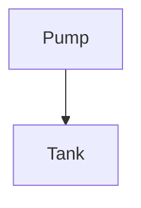
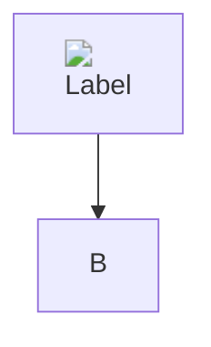
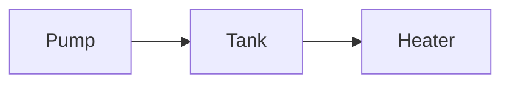

# Mermaid Diagrams Implementation Plan

> **For agentic workers:** REQUIRED SUB-SKILL: Use superpowers:subagent-driven-development (recommended) or superpowers:executing-plans to implement this plan task-by-task. Steps use checkbox (`- [ ]`) syntax for tracking.

**Goal:** Render ```` ```mermaid ```` fenced code blocks as diagrams in pages, metadata notes and agent replies, with a small implementation.

**Architecture:** Pages and notes already emit `<pre class="mermaid">` through Markdig's diagrams extension. The agent renderer learns to emit the same for a closed mermaid fence. One global script watches the DOM for `pre.mermaid`, lazy-loads a vendored `mermaid.min.js` and replaces the source with SVG, falling back to the source as code on any failure. One strict Mermaid configuration covers all diagrams.

**Tech Stack:** Markdig 0.45, Mermaid 11.x (UMD build, vendored), plain JavaScript, xUnit, Playwright.

**Spec:** [mermaid-diagrams.md](mermaid-diagrams.md)

**Rules from AGENTS.md:** test names `When<Condition>_Then<Expected>` with `// Arrange`, `// Act`, `// Assert`; no `Task.Delay`; no em dashes in docs; no hard wrapping in markdown; no AI attribution or `Co-Authored-By` in commits.

All paths below are relative to the repository root.

## File Structure

- Modify `src/HomeBlaze/HomeBlaze.AI.Blazor/AgentMarkdownRenderer.cs`: closed mermaid fence renders as `<pre class="mermaid">`.
- Modify `src/HomeBlaze/HomeBlaze.AI.Tests/Blazor/AgentMarkdownRendererTests.cs` and `AgentStreamingMarkdownTests.cs`: unit tests.
- Create `src/HomeBlaze/HomeBlaze/wwwroot/lib/mermaid/mermaid.min.js`, `LICENSE`, `VERSION`: vendored Mermaid.
- Create `src/HomeBlaze/HomeBlaze/wwwroot/mermaid-diagrams.js`: finds and renders diagrams.
- Modify `src/HomeBlaze/HomeBlaze/wwwroot/app.css`: hide a diagram while it renders.
- Modify `src/HomeBlaze/HomeBlaze/Components/App.razor`: load the script.
- Create `src/HomeBlaze/HomeBlaze.E2E.Tests/TestData/Demo/Diagrams.md`, `src/HomeBlaze/HomeBlaze.E2E.Tests/MermaidDiagramTests.cs`: page E2E tests.
- Create `src/HomeBlaze/HomeBlaze.E2E.Tests/TestData/Agents/DiagramAgent.json`, modify `src/HomeBlaze/HomeBlaze.E2E.Tests/AgentPageTests.cs`: agent reply E2E test.
- Modify `src/HomeBlaze/HomeBlaze/Data/Files/Docs/administration/pages.md`, `administration/ai-agents.md`, `home.md`; delete both plan files: docs.

---

### Task 1: Mermaid fences in agent replies

**Files:**
- Modify: `src/HomeBlaze/HomeBlaze.AI.Blazor/AgentMarkdownRenderer.cs`
- Test: `src/HomeBlaze/HomeBlaze.AI.Tests/Blazor/AgentMarkdownRendererTests.cs`
- Test: `src/HomeBlaze/HomeBlaze.AI.Tests/Blazor/AgentStreamingMarkdownTests.cs`

- [ ] **Step 1: Write the failing tests**

Add to `AgentMarkdownRendererTests`, after `WhenMarkdownContainsListsAndCode_ThenTheyAreRendered`:

```csharp
    [Theory]
    [InlineData("```mermaid\ngraph TD\n  A --> B\n```")]
    [InlineData("```MERMAID\ngraph TD\n  A --> B\n```")]
    [InlineData("~~~mermaid\ngraph TD\n  A --> B\n~~~")]
    public void WhenMermaidFenceIsClosed_ThenItIsRenderedAsDiagram(string markdown)
    {
        // Act
        var html = AgentMarkdownRenderer.ToHtml(markdown);

        // Assert
        Assert.Contains("<pre class=\"mermaid\">", html);
        Assert.Contains("A --&gt; B", html);
        Assert.DoesNotContain("<code", html);
    }

    [Theory]
    [InlineData("```mermaid\ngraph TD\n  A --> B")]
    [InlineData("```mermaidjs\ngraph TD\n  A --> B\n```")]
    [InlineData("```nomnoml\n[A] -> [B]\n```")]
    public void WhenFenceIsNoClosedMermaidFence_ThenItIsRenderedAsCodeWithoutClass(string markdown)
    {
        // Act
        var html = AgentMarkdownRenderer.ToHtml(markdown);

        // Assert
        Assert.Contains("<pre><code>", html);
        Assert.DoesNotContain("class=", html);
    }

    [Fact]
    public void WhenMermaidFenceContainsHtml_ThenItIsEncoded()
    {
        // Act
        var html = AgentMarkdownRenderer.ToHtml("```mermaid\n</pre><script>alert(1)</script>\n```");

        // Assert
        Assert.Contains("&lt;/pre&gt;&lt;script&gt;", html);
        Assert.DoesNotContain("<script", html);
        Assert.DoesNotContain("</pre><", html);
    }
```

Add one row to `WhenBlocksAreComplete_ThenTheStablePartEndsAfterTheLastBlankLineOutsideACodeBlock` in `AgentStreamingMarkdownTests`, after the `json` row:

```csharp
    [InlineData("Intro.\n\n```mermaid\ngraph TD\n\n  A --> B\n", "Intro.\n\n")]
```

- [ ] **Step 2: Run the tests to verify the closed fence tests fail**

Run: `dotnet test src/HomeBlaze/HomeBlaze.AI.Tests --filter "FullyQualifiedName~AgentMarkdownRendererTests|FullyQualifiedName~AgentStreamingMarkdownTests"`
Expected: `WhenMermaidFenceIsClosed_ThenItIsRenderedAsDiagram` fails three times (the HTML is `<pre><code>...`). Everything else passes; those tests guard behavior that must not change.

- [ ] **Step 3: Implement**

In `AgentMarkdownRenderer.cs`, add a constant below `ApplicationRoot`:

```csharp
    private const string MermaidLanguage = "mermaid";
```

Replace the fenced code block loop in `RenderHtml`:

```csharp
        // The parser turns the info string of a fenced code block into a class name. The diagrams extension renders a
        // block whose info is a diagram language as <pre> with the class without its language- prefix, so only a closed
        // mermaid block keeps a fixed info and class; an open one is still being streamed and stays code.
        foreach (var codeBlock in document.Descendants<FencedCodeBlock>())
        {
            var isDiagram = codeBlock.ClosingFencedCharCount > 0 &&
                string.Equals(codeBlock.Info, MermaidLanguage, StringComparison.OrdinalIgnoreCase);
            codeBlock.TryGetAttributes()?.Classes?.Clear();
            codeBlock.Info = isDiagram ? MermaidLanguage : null;
            if (isDiagram)
            {
                codeBlock.GetAttributes().AddClass("language-" + MermaidLanguage);
            }
        }
```

In `CreatePipeline`, add `.UseDiagrams()` after `.UseListExtras()` and extend the comment's last sentence:

```csharp
    // An allow list: extensions that copy text into class, id or style attributes (custom containers, generic
    // attributes, footnotes, heading identifiers) or embed content (media links) must stay out, because a class
    // can apply page styles such as a full-viewport overlay and repeated ids collide across timeline entries. The
    // remaining extensions only emit fixed attributes, such as a table column's text alignment or the mermaid class
    // that RenderHtml sets.
    private static MarkdownPipeline CreatePipeline() => new MarkdownPipelineBuilder()
        .UsePipeTables()
        .UseEmphasisExtras()
        .UseAutoLinks()
        .UseTaskLists()
        .UseListExtras()
        .UseDiagrams()
        .DisableHtml()
        .Build();
```

If `ClosingFencedCharCount` does not compile, the property is on Markdig's `IFencedBlock` interface, which `FencedCodeBlock` implements; look it up there instead of guessing another name.

- [ ] **Step 4: Run the tests to verify they pass**

Run: `dotnet test src/HomeBlaze/HomeBlaze.AI.Tests --filter "FullyQualifiedName~AgentMarkdownRendererTests|FullyQualifiedName~AgentStreamingMarkdownTests"`
Expected: all pass, including `WhenMarkdownTriesToSetClassesOrIds_ThenNoneAreRendered`.

- [ ] **Step 5: Commit**

```bash
git add src/HomeBlaze/HomeBlaze.AI.Blazor/AgentMarkdownRenderer.cs src/HomeBlaze/HomeBlaze.AI.Tests/Blazor/AgentMarkdownRendererTests.cs src/HomeBlaze/HomeBlaze.AI.Tests/Blazor/AgentStreamingMarkdownTests.cs
git commit -m "feat: render closed mermaid fences of agent replies as diagram elements"
```

---

### Task 2: Vendor Mermaid

**Files:**
- Create: `src/HomeBlaze/HomeBlaze/wwwroot/lib/mermaid/mermaid.min.js`
- Create: `src/HomeBlaze/HomeBlaze/wwwroot/lib/mermaid/LICENSE`
- Create: `src/HomeBlaze/HomeBlaze/wwwroot/lib/mermaid/VERSION`

- [ ] **Step 1: Download the latest 11.x release**

```bash
cd src/HomeBlaze/HomeBlaze/wwwroot
mkdir -p lib/mermaid
VERSION=$(curl -fsS "https://data.jsdelivr.com/v1/packages/npm/mermaid/resolved?specifier=11" | python3 -c 'import json,sys; print(json.load(sys.stdin)["version"])')
echo "$VERSION"
curl -fsS -o lib/mermaid/mermaid.min.js "https://cdn.jsdelivr.net/npm/mermaid@$VERSION/dist/mermaid.min.js"
curl -fsS -o lib/mermaid/LICENSE "https://cdn.jsdelivr.net/npm/mermaid@$VERSION/LICENSE"
echo "$VERSION" > lib/mermaid/VERSION
cd -
```

Expected: a version starting with `11.`, `mermaid.min.js` of roughly 2 to 3.5 MB, `LICENSE` starting with `The MIT License`.

- [ ] **Step 2: Verify it is the global (UMD/IIFE) build**

Run: `grep -c "globalThis.mermaid\|window.mermaid" src/HomeBlaze/HomeBlaze/wwwroot/lib/mermaid/mermaid.min.js`
Expected: at least `1`. If 0, the file is the ES module build; download `dist/mermaid.min.js` again from the exact version and do not use any `.mjs` file.

- [ ] **Step 3: Commit**

```bash
git add src/HomeBlaze/HomeBlaze/wwwroot/lib/mermaid
git commit -m "chore: vendor Mermaid $(cat src/HomeBlaze/HomeBlaze/wwwroot/lib/mermaid/VERSION)"
```

---

### Task 3: Diagram script, CSS and page E2E tests

**Files:**
- Create: `src/HomeBlaze/HomeBlaze.E2E.Tests/TestData/Demo/Diagrams.md`
- Create: `src/HomeBlaze/HomeBlaze.E2E.Tests/MermaidDiagramTests.cs`
- Create: `src/HomeBlaze/HomeBlaze/wwwroot/mermaid-diagrams.js`
- Modify: `src/HomeBlaze/HomeBlaze/wwwroot/app.css`
- Modify: `src/HomeBlaze/HomeBlaze/Components/App.razor`

- [ ] **Step 1: Write the test page**

Create `src/HomeBlaze/HomeBlaze.E2E.Tests/TestData/Demo/Diagrams.md`:

`````markdown
---
title: Diagrams Demo
---

# Diagrams Demo



```mermaid
this is not a diagram
```


`````

- [ ] **Step 2: Write the failing E2E tests**

Create `src/HomeBlaze/HomeBlaze.E2E.Tests/MermaidDiagramTests.cs`:

```csharp
using HomeBlaze.E2E.Tests.Infrastructure;
using Microsoft.Playwright;

namespace HomeBlaze.E2E.Tests;

/// <summary>
/// E2E tests for Mermaid diagrams on markdown pages.
/// </summary>
[Collection(nameof(PlaywrightCollection))]
[Trait("Category", "Integration")]
public class MermaidDiagramTests
{
    private const int Timeout = 30000;
    private const int ValidDiagram = 0;
    private const int InvalidDiagram = 1;
    private const int ActiveContentDiagram = 2;

    private readonly PlaywrightFixture _fixture;

    public MermaidDiagramTests(PlaywrightFixture fixture)
    {
        _fixture = fixture;
    }

    private async Task<IPage> OpenPageAsync(List<string>? requestUrls = null)
    {
        var page = await _fixture.CreatePageAsync();
        if (requestUrls is not null)
        {
            page.Request += (_, request) => requestUrls.Add(request.Url);
        }

        await page.GotoAsync($"{_fixture.ServerAddress}pages/Demo/Diagrams.md");
        await page.WaitForLoadStateAsync(LoadState.DOMContentLoaded);
        return page;
    }

    [Fact]
    public async Task WhenPageHasDiagram_ThenItIsShownAsSvg()
    {
        // Arrange & Act
        var page = await OpenPageAsync();
        var diagram = page.Locator("pre.mermaid").Nth(ValidDiagram);

        // Assert
        await Assertions.Expect(diagram).ToHaveAttributeAsync("data-mermaid-state", "done", new() { Timeout = Timeout });
        await Assertions.Expect(diagram.Locator("svg")).ToBeVisibleAsync();
        await Assertions.Expect(diagram).ToContainTextAsync("Tank");
    }

    [Fact]
    public async Task WhenDiagramIsInvalid_ThenItsSourceIsShown()
    {
        // Arrange & Act
        var page = await OpenPageAsync();
        var diagram = page.Locator("pre.mermaid").Nth(InvalidDiagram);

        // Assert
        await Assertions.Expect(diagram).ToHaveAttributeAsync("data-mermaid-state", "error", new() { Timeout = Timeout });
        await Assertions.Expect(diagram).ToBeVisibleAsync();
        await Assertions.Expect(diagram).ToHaveTextAsync("this is not a diagram");
        await Assertions.Expect(diagram.Locator("svg")).ToHaveCountAsync(0);
    }

    [Fact]
    public async Task WhenDiagramContainsActiveContent_ThenNothingActiveIsRenderedOrLoaded()
    {
        // Arrange
        var requestUrls = new List<string>();

        // Act
        var page = await OpenPageAsync(requestUrls);
        var diagram = page.Locator("pre.mermaid").Nth(ActiveContentDiagram);
        await Assertions.Expect(diagram).ToHaveAttributeAsync("data-mermaid-state", "done", new() { Timeout = Timeout });

        // Assert
        await Assertions.Expect(diagram.Locator("img")).ToHaveCountAsync(0);
        await Assertions.Expect(diagram.Locator("a")).ToHaveCountAsync(0);
        await Assertions.Expect(diagram.Locator("foreignObject")).ToHaveCountAsync(0);
        var hasEventHandler = await diagram.EvaluateAsync<bool>(
            "element => [...element.querySelectorAll('*')].some(child => [...child.attributes].some(attribute => attribute.name.startsWith('on')))");
        Assert.False(hasEventHandler);
        Assert.DoesNotContain(requestUrls, url => url.Contains("127.0.0.1:9", StringComparison.Ordinal));
    }
}
```

- [ ] **Step 3: Run the E2E tests to verify they fail**

Run: `dotnet test src/HomeBlaze/HomeBlaze.E2E.Tests --filter "FullyQualifiedName~MermaidDiagramTests"`
Expected: all three fail with a timeout waiting for `data-mermaid-state` (no script sets it yet).

- [ ] **Step 4: Write the script**

Create `src/HomeBlaze/HomeBlaze/wwwroot/mermaid-diagrams.js`:

```js
// Renders the Mermaid diagrams of Markdown, which the server writes as <pre class="mermaid"> with the source as text, as
// SVG. Blazor inserts a new element whenever the markup around a diagram changes, so the page is watched instead of
// components calling in. Mermaid itself is only loaded once a page shows a diagram.
(() => {
    // One configuration for every diagram, as the text of an agent reply is not trusted: strict turns off click handlers
    // and links, labels as SVG text cannot load an image, and secure stops an init directive or frontmatter of a diagram
    // from changing these keys, including the CSS ones, whose url() could load an address.
    const settings = {
        startOnLoad: false,
        securityLevel: 'strict',
        htmlLabels: false,
        flowchart: { htmlLabels: false },
        suppressErrorRendering: true,
        secure: ['secure', 'securityLevel', 'startOnLoad', 'maxTextSize', 'suppressErrorRendering', 'maxEdges',
            'htmlLabels', 'flowchart', 'theme', 'themeVariables', 'themeCSS', 'fontFamily', 'altFontFamily', 'dompurifyConfig']
    };

    const diagrams = document.getElementsByClassName('mermaid');

    // The SVG by theme and source, so that a diagram Blazor inserts again is shown before the browser paints.
    const svgs = new Map();
    let mermaidLoad = null;
    let renderCount = 0;

    const loadMermaid = () => mermaidLoad ??= new Promise((resolve, reject) => {
        const script = document.createElement('script');
        script.src = 'lib/mermaid/mermaid.min.js';
        script.onload = () => resolve(window.mermaid);
        script.onerror = reject;
        document.head.appendChild(script);
    });

    const show = (element, svg) => {
        element.innerHTML = svg;
        element.dataset.mermaidState = 'done';
    };

    const render = async (element, source, theme, key) => {
        try {
            const mermaid = await loadMermaid();
            mermaid.initialize({ ...settings, theme });
            if (!await mermaid.parse(source, { suppressErrors: true })) {
                element.dataset.mermaidState = 'error';
                return;
            }

            const { svg } = await mermaid.render(`mermaid-diagram-${++renderCount}`, source);
            svgs.set(key, svg);
            show(element, svg);
        } catch {
            element.dataset.mermaidState = 'error';
        }
    };

    const scan = () => {
        if (diagrams.length === 0) {
            return;
        }

        const theme = document.querySelector('.homeblaze-dark-mode') ? 'dark' : 'default';

        // A copy, as a rendered SVG can contain elements with the class too.
        for (const element of Array.from(diagrams)) {
            if (element.tagName !== 'PRE' || element.dataset.mermaidState) {
                continue;
            }

            const source = element.textContent;
            const key = theme + '\n' + source;
            const svg = svgs.get(key);
            if (svg) {
                show(element, svg);
            } else {
                element.dataset.mermaidState = 'pending';
                render(element, source, theme, key);
            }
        }
    };

    // Only added and removed nodes: a live value that changes the text of a node does not call it.
    new MutationObserver(scan).observe(document.body, { childList: true, subtree: true });
    scan();
})();
```

- [ ] **Step 5: Add the CSS**

Append to `src/HomeBlaze/HomeBlaze/wwwroot/app.css`:

```css

/* A Mermaid diagram (mermaid-diagrams.js) is hidden while it renders; one that cannot render keeps its source as code. */
pre.mermaid[data-mermaid-state="pending"] {
    visibility: hidden;
}
```

- [ ] **Step 6: Load the script**

In `src/HomeBlaze/HomeBlaze/Components/App.razor`, after the `widget-selection.js` line:

```razor
<script src=@Assets["mermaid-diagrams.js"]></script>
```

- [ ] **Step 7: Run the E2E tests to verify they pass**

Run: `dotnet test src/HomeBlaze/HomeBlaze.E2E.Tests --filter "FullyQualifiedName~MermaidDiagramTests"`
Expected: 3 passed.

If `WhenDiagramContainsActiveContent_ThenNothingActiveIsRenderedOrLoaded` ends in `error` instead of `done`, Mermaid rejected the label: open the page in the running app, check the browser console, and fix the test page so the diagram parses while keeping the `` label, both `click` lines and the `init` directive. Do not loosen the settings.

- [ ] **Step 8: Commit**

```bash
git add src/HomeBlaze/HomeBlaze/wwwroot/mermaid-diagrams.js src/HomeBlaze/HomeBlaze/wwwroot/app.css src/HomeBlaze/HomeBlaze/Components/App.razor src/HomeBlaze/HomeBlaze.E2E.Tests/MermaidDiagramTests.cs src/HomeBlaze/HomeBlaze.E2E.Tests/TestData/Demo/Diagrams.md
git commit -m "feat: render mermaid diagrams of Markdown in the browser"
```

---

### Task 4: Agent reply E2E test

**Files:**
- Create: `src/HomeBlaze/HomeBlaze.E2E.Tests/TestData/Agents/DiagramAgent.json`
- Modify: `src/HomeBlaze/HomeBlaze.E2E.Tests/AgentPageTests.cs`

- [ ] **Step 1: Add a separate agent**

Create `src/HomeBlaze/HomeBlaze.E2E.Tests/TestData/Agents/DiagramAgent.json`:

```json
{
  "$type": "HomeBlaze.AI.Agents.ClaudeCli.ClaudeCliAgent",
  "name": "Diagram Agent",
  "cliPath": "claude-not-configured"
}
```

- [ ] **Step 2: Write the test**

In `AgentPageTests.cs`, add a constant below `ResultAgentPath`:

```csharp
    private const string DiagramAgentPath = "Agents/DiagramAgent";
```

Add the test after `WhenABackgroundRunHasTextBeforeItsResult_ThenTheCardAndTheActivityTabShowTheResult`:

```csharp
    [Fact]
    public async Task WhenAReplyContainsAMermaidDiagram_ThenItIsShownAsSvg()
    {
        // Arrange - a separate agent, so the seeded entry never reaches the other tests.
        var (page, resolver, agent) = await OpenSeededAgentPageAsync(DiagramAgentPath);
        try
        {
            await agent.Timeline.AppendAsync(new AgentTimelineEntry
            {
                Kind = AgentTimelineEntryKind.Assistant,
                Timestamp = DateTimeOffset.UtcNow,
                Text = "The flow:\n\n```mermaid\ngraph TD\n    Pump --> Tank\n```"
            }, CancellationToken.None);

            // Act
            await page.ReloadAsync();

            // Assert
            var diagram = page.GetByTestId("agent-reply").Last.Locator("pre.mermaid");
            await Assertions.Expect(diagram).ToHaveAttributeAsync("data-mermaid-state", "done", new() { Timeout = PageLoadTimeout });
            await Assertions.Expect(diagram.Locator("svg")).ToBeVisibleAsync();
        }
        finally
        {
            DeleteAgentData(resolver, agent);
        }
    }
```

- [ ] **Step 3: Run it**

Run: `dotnet test src/HomeBlaze/HomeBlaze.E2E.Tests --filter "FullyQualifiedName~AgentPageTests"`
Expected: all pass. The new test passes right away because Tasks 1 and 3 are in place; to see it fail, temporarily remove `.UseDiagrams()` from `AgentMarkdownRenderer` and run it again, then restore it.

- [ ] **Step 4: Run the tests that count or list seeded files**

A new agent and a new demo page can change counts in other E2E tests. Run: `dotnet test src/HomeBlaze/HomeBlaze.E2E.Tests --filter "FullyQualifiedName~SeedDataTests|FullyQualifiedName~NavigationTests|FullyQualifiedName~NavigationMetadataTests"`
Expected: all pass. If one fails on a count or list, update it to include `Diagram Agent` or `Diagrams Demo`.

- [ ] **Step 5: Commit**

```bash
git add src/HomeBlaze/HomeBlaze.E2E.Tests/TestData/Agents/DiagramAgent.json src/HomeBlaze/HomeBlaze.E2E.Tests/AgentPageTests.cs
git commit -m "test: show a mermaid diagram of an agent reply as SVG"
```

---

### Task 5: Docs

**Files:**
- Modify: `src/HomeBlaze/HomeBlaze/Data/Files/Docs/administration/pages.md`
- Modify: `src/HomeBlaze/HomeBlaze/Data/Files/Docs/administration/ai-agents.md`
- Modify: `src/HomeBlaze/HomeBlaze/Data/Files/Docs/home.md`
- Delete: `src/HomeBlaze/HomeBlaze/Data/Files/Docs/plans/mermaid-diagrams.md`, `src/HomeBlaze/HomeBlaze/Data/Files/Docs/plans/mermaid-diagrams-implementation.md`

- [ ] **Step 1: Document diagrams on pages**

In `pages.md`, insert this section between the end of `## Pictures` (after its `---`) and `## Navigation Updates`:

``````markdown
## Diagrams

A fenced code block with the language `mermaid` is shown as a [Mermaid](https://mermaid.js.org) diagram, as on GitHub:

~~~~markdown

~~~~

- **Size**: a diagram is never wider than its place.
- **Theme**: a diagram takes the dark or light theme that is active when it is shown. After a switch, it changes on the next visit of the page.
- **Not shown**: a diagram with an error, or one on a browser that cannot load Mermaid, appears as its source in a code block.
- **No interaction**: `click` lines, links and HTML in labels are ignored, and an `init` directive or frontmatter of a diagram cannot change these settings.

---

``````

- [ ] **Step 2: Document diagrams in agent replies**

In `ai-agents.md`, the bullet starting with `- Replies render as Markdown while they stream in.` ends with `is shown as text.`. Append to that same line:

```markdown
 A `mermaid` code block is shown as a [diagram](pages.md#diagrams) once its closing fence has arrived.
```

- [ ] **Step 3: Remove the completed plan**

Completed plans are removed (see the Plans section of `home.md`):

```bash
git rm src/HomeBlaze/HomeBlaze/Data/Files/Docs/plans/mermaid-diagrams.md src/HomeBlaze/HomeBlaze/Data/Files/Docs/plans/mermaid-diagrams-implementation.md
```

In `home.md`, delete the line `- [Mermaid Diagrams](plans/mermaid-diagrams.md): render mermaid fenced code blocks as diagrams in pages, notes and agent replies`.

- [ ] **Step 4: Check the docs**

Run: `grep -c "—" src/HomeBlaze/HomeBlaze/Data/Files/Docs/administration/pages.md src/HomeBlaze/HomeBlaze/Data/Files/Docs/administration/ai-agents.md`
Expected: the same counts as before the change (no new em dashes).

- [ ] **Step 5: Commit**

```bash
git add -A src/HomeBlaze/HomeBlaze/Data/Files/Docs
git commit -m "docs: mermaid diagrams on pages and in agent replies"
```

---

### Task 6: Final verification

- [ ] **Step 1: Build**

Run: `dotnet build src/Namotion.Interceptor.slnx`
Expected: `Build succeeded`, 0 warnings as errors.

- [ ] **Step 2: Unit tests**

Run: `dotnet test src/Namotion.Interceptor.slnx --filter "Category!=Integration"`
Expected: all pass.

- [ ] **Step 3: Targeted E2E tests**

Run: `dotnet test src/HomeBlaze/HomeBlaze.E2E.Tests --filter "FullyQualifiedName~MermaidDiagramTests|FullyQualifiedName~AgentPageTests|FullyQualifiedName~MarkdownImageTests|FullyQualifiedName~LiveUpdateTests|FullyQualifiedName~MetadataDisplayTests"`
Expected: all pass. The last three cover markdown pages, live updates and notes, which run next to the new script.

- [ ] **Step 4: Look at it**

Run the app (`dotnet run --project src/HomeBlaze/HomeBlaze`), open a page with a mermaid block in dark and in light mode, and confirm the diagram reads well in both and fits a narrow window. Report what you saw; do not claim it looks right without having opened it.
